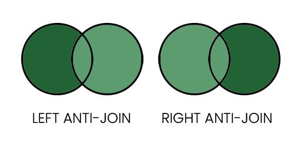

# Pandas - how to anti-join

**Author:** piocarz
**Votes:** 1
**Link:** [https://leetcode.com/problems/page-recommendations-ii/solutions/4234468/](https://leetcode.com/problems/page-recommendations-ii/solutions/4234468/)

---

# Intuition
This problem is ideal to show how to handle anti-join.

In SQL or PySpark you have options to do "normal" joins (inner,outer,left,right,cross) and more advanced (left/right anti and left/right semi).

In Pandas there is no such thing like anti-joins:

... at least not explicitly like 'left' or 'right'.

There is however option in `merge` to get functionality of anti joins: it's called "indicator".
On merge, `indicator` creates  additional column, which shows you where value was present - in both, in left only or in right only, and there can only be those 3 values in `_merge` column: `left_only`, `right_only` and `both`.
- By filtering this column, we can get all functionalities of this joins: `left`,`right`,`inner`,`outer` and `anti-left`,` anti-right`. 
- Note we cannto get from this `cross` which is simple cartesian multiplication (all with all), and `semi_left` or `semi_right` - you could get `semi` by filtering using `.isin()`) 

`anti-left` is exactly what we need, becouse what we need here are only films that our friends watched (left join) BUT without films that we already watched (left anti-join).


# Approach
1. To get all friends of all people, we must combine `friendship` with reversed version of itself (user1->user2, user2->user1), becouse original table have each relationship only once (only 1->3, but we alse need 3->1, since not only user 1 have friend 3, but also user 3 have friend 1)
2. We create both versions, and rename them, to `user_id` and `friend` to be clear what does each column mean, and also to match final required output (there is column `user_id`)
3. We concat both tables -> on axis 0 it's smimilar way we `UNION` in SQL, and axis 0 is default (it's like joining but vertically). What we also do is merging with `likes` to get what our friends like. ( in `likes` we rename `user_id` to `friend`)
4. Finally, we can use our `anit-join` method, which is getting list of films friends like, but without films user already likes. It creates additional column `_merge` and we filter this column to have only `left_only` values.
5. At the end, we simply count how many of each user friends liked each recomended film.

# Code
```
import pandas as pd

def recommend_page(friendship: pd.DataFrame, likes: pd.DataFrame) -> pd.DataFrame:
    fr1 = friendship.rename(columns = {"user1_id":"user_id", "user2_id":"friend"})
    fr2 = friendship.rename(columns = {"user2_id":"user_id", "user1_id":"friend"})
    df = pd.concat([fr1, fr2]).merge(likes.rename(columns={"user_id":"friend"}),on="friend")
    df = df.merge(likes,on=["user_id","page_id"],how="outer",indicator=True).query("_merge=='left_only'")
    return df.groupby(["user_id","page_id"],as_index=False).agg(friends_likes=("friend","count"))
```