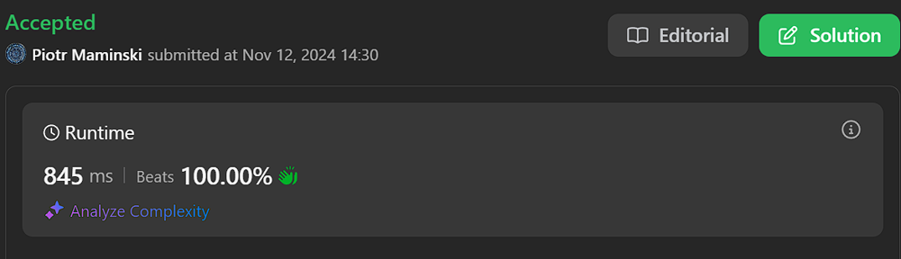

# ✅ Clean code, Correct

**Author:** Piotr_Maminski
**Votes:** 0
**Link:** [https://leetcode.com/problems/accepted-candidates-from-the-interviews/solutions/6037342/](https://leetcode.com/problems/accepted-candidates-from-the-interviews/solutions/6037342/)

---

# Upvote if I should write premium solutions and if anyone reads them. That way I will know.


# Clear Code
```pythondata [Pandas short]
def accepted_candidates(candidates: pd.DataFrame, rounds: pd.DataFrame) -> pd.DataFrame:
    qualified = candidates[candidates['years_of_exp'] >= 2]
    scores = rounds.groupby('interview_id')['score'].sum().reset_index(name='total_score')
    passed = scores[scores['total_score'] > 15]
    return qualified.merge(passed, how='inner', on='interview_id')[['candidate_id']]
```
```pythondata [Pandas]
import pandas as pd

def accepted_candidates(candidates: pd.DataFrame, rounds: pd.DataFrame) -> pd.DataFrame:
    """
    Returns candidate IDs meeting acceptance criteria.
    Criteria: 2+ years experience and total interview score > 15
    """
    qualified_candidates = candidates[candidates['years_of_exp'] >= 2]
    
    total_scores = (rounds.groupby('interview_id')
                   ['score'].sum()
                   .reset_index(name='total_score'))
    
    qualified_scores = total_scores[total_scores['total_score'] > 15]
    
    result = qualified_candidates.merge(
        qualified_scores, 
        how='inner', 
        on='interview_id'
    )
    
    return result[['candidate_id']]
```
```mysql [MySQL,MCSQLServer,Oracle,PostreSQL]
SELECT c.candidate_id
FROM Candidates c
INNER JOIN Rounds r 
    ON c.interview_id = r.interview_id

WHERE c.years_of_exp >= 2
GROUP BY c.candidate_id
HAVING SUM(r.score) > 15
;
```
# I'll expand if someone even reads it.
# Have a nice day! <3
