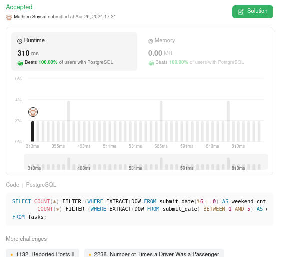

# 🌟 Explained PostgreSQl solution 🚀 Beats 100% 🌠

**Author:** MathieuSoysal
**Votes:** 2
**Link:** [https://leetcode.com/problems/tasks-count-in-the-weekend/solutions/5076171/](https://leetcode.com/problems/tasks-count-in-the-weekend/solutions/5076171/)

---



# Explain

- `COUNT(*) FILTER (WHERE EXTRACT(DOW FROM submit_date) % 6 = 0) AS weekend_cnt`: This part of the query counts the number of tasks that were submitted on weekends. The `EXTRACT(DOW FROM submit_date)` function returns the day of the week as an integer from 0 (Sunday) to 6 (Saturday). The `FILTER` clause applies a condition to the `COUNT` function, so it only counts rows where the day of the week is either 0 (Sunday) or 6 (Saturday), as indicated by the modulo operation % 6 = 0.

- `COUNT(*) FILTER (WHERE EXTRACT(DOW FROM submit_date) BETWEEN 1 AND 5) AS working_cnt`: This part counts the number of tasks submitted on weekdays (Monday to Friday). The `FILTER` clause specifies that only rows with `submit_date` falling between 1 (Monday) and 5 (Friday) should be counted.

## What is performand in this query

- **Single Table Scan**:
    - By using the FILTER clause with the COUNT function, the query efficiently performs two different counts in a single query without the need for multiple queries or subqueries, which would require additional table scans.


# Code
``` PostgreSQL []
SELECT COUNT(*) FILTER (WHERE EXTRACT(DOW FROM submit_date)%6 = 0) AS weekend_cnt,
        COUNT(*) FILTER (WHERE EXTRACT(DOW FROM submit_date) BETWEEN 1 AND 5) AS working_cnt
FROM Tasks;
```
``` Oracle []
SELECT
  COUNT(CASE WHEN TO_CHAR(submit_date, 'D') IN ('1', '7') THEN 1 END) AS weekend_cnt,
  COUNT(CASE WHEN TO_CHAR(submit_date, 'D') BETWEEN '2' AND '6' THEN 1 END) AS working_cnt
FROM
  Tasks;
```

____

If it was useful don't hesitate to upvote \uD83C\uDF20 Or keep it in your favorite \uD83C\uDF1F
