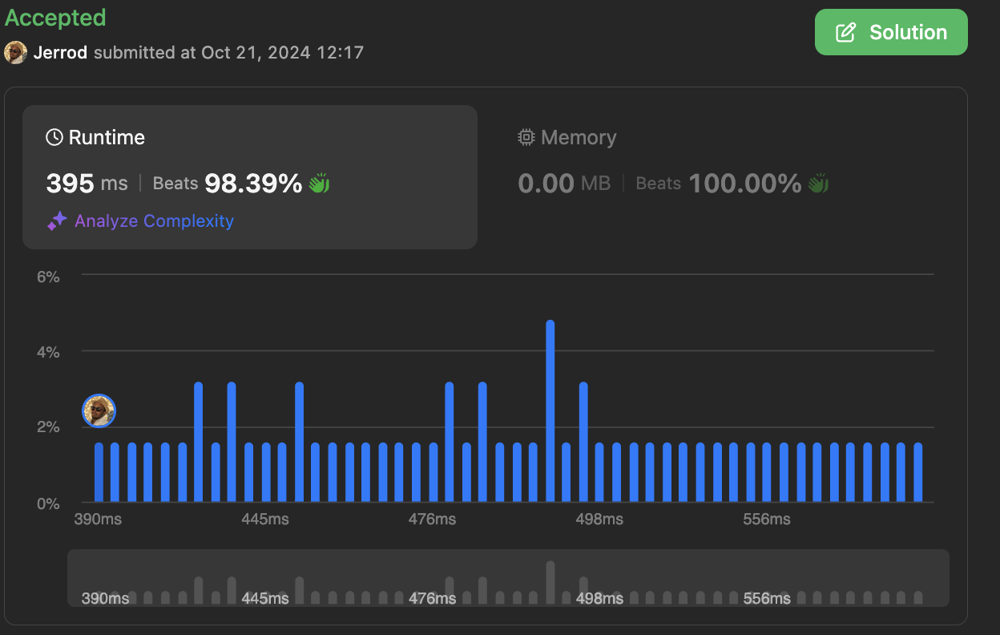

# beats 98%

**Author:** _jhowlett_
**Votes:** 0
**Link:** [https://leetcode.com/problems/generate-the-invoice/solutions/5948144/](https://leetcode.com/problems/generate-the-invoice/solutions/5948144/)

---



# Code
```postgresql []
-- Write your PostgreSQL query statement below
with get_invoice as (
    select
        distinct invoice_id,
        a.invoice_total,
        rank() over (order by invoice_total desc, invoice_id) as rnk
    from (
        select
            invoice_id,
            sum(price * quantity) as invoice_total
        from purchases
        left join products p on purchases.product_id = p.product_id
        group by invoice_id
    ) a
)

select
    products.product_id,
    purchases.quantity,
    sum(quantity * price) as price
from products
join purchases on products.product_id = purchases.product_id
where invoice_id = (select invoice_id from get_invoice where rnk = 1)
group by 1,2

```