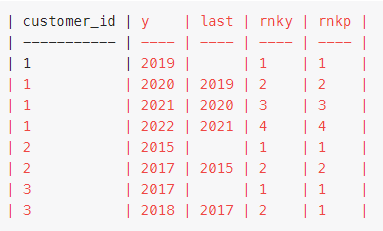

# MySQL solution: intuition and step by step explanation

**Author:** LawrenceZ9528
**Votes:** 6
**Link:** [https://leetcode.com/problems/customers-with-strictly-increasing-purchases/solutions/3101777/](https://leetcode.com/problems/customers-with-strictly-increasing-purchases/solutions/3101777/)

---

# Intuition
When I saw this question, my first thought is that we need to consider what are the scenarios that a customer would fail the conditions described in the question.

Generally speaking there are two cases:
1. The customer did not make any purchase in between consecutive years (for example purchase in both 2015 and 2017, but not in 2016).
2. The purchase amounts are not strictively increasing.

# Approach
<!-- Describe your approach to solving the problem. -->
Here is how do we detect the two cases:
1. Use the lag() function to determine the last entry of year for each entry of each customer. If the difference between current year and previous entry is greater than 1, then we would know that we have a **case 1 breach**.
2. Use rank() function to calculate the ranking of current year entry and total purchase respectively. If the rankings are not the same, then we have a **case 2 breach**.

Using the example test case, we run the CTE part, and obtain the follwing result:

We notice that for customer 2, the (y-last) is not equal to 1, so he/she must have skipped a year. For customer 3, rnky!=rnkp for one of the entries, therefore, the purchase is not strictly increasing.

Knowing all the information, we have obtained the IDs of customers who violated the condition. With a simple **not in**, we can find the final answer.

# Code
```
# Write your MySQL query statement below
with cte as (
    select customer_id, year(order_date) y, lag(year(order_date)) over (partition by customer_id order by year(order_date)) last,
        rank() over (partition by customer_id order by year(order_date)) rnky, rank() over (partition by customer_id order by sum(price)) rnkp
    from Orders
    group by 1, 2
)
select distinct customer_id
from cte
where customer_id not in (select customer_id from cte where last is not null and ((y-last)!=1 or rnky!=rnkp))
```
Please upvote if you find this helpful, thank you!