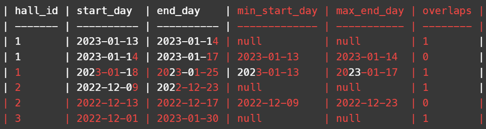
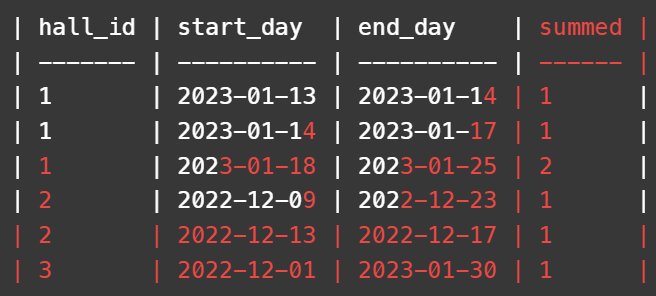

# Two CTEs simple query with description

**Author:** SayJay
**Votes:** 9
**Link:** [https://leetcode.com/problems/merge-overlapping-events-in-the-same-hall/solutions/3410020/](https://leetcode.com/problems/merge-overlapping-events-in-the-same-hall/solutions/3410020/)

---

# Approach\r
Create two CTEs:\r
1) **rollingcalcs** - columns from HallEvents table as well as 3 computed ones \r
- **min_start_date** : Rolling earliest start date partitioned by hall_id between the start of the hall_id and the previous row (ordered by start date and end date, respectively)\r
- **max_start_date** : Rolling latest start date partitioned by hall_id between the start of the hall_id and the previous row (ordered by start date and end date, respectively)\r
- **overlaps** : Indicates when there is an overlap between the start_day of the row and max_end_day calculation.  If the value of max_end_day is null, then we consider this the beginning (a brand new hall_id)\r
\r
An example table of the first CTE can be seen below\r
\r
\r
2) **addgroups** - Rolling sum of the rollingcalcs CTE.  Purpose of this is to identify when we encounter a new 'group' of dates (i.e. when the next date does not overlap with the previous ones anymore).  Can see in the image below that hall_id has 2 'groups' of dates that do not overlap\r
\r
\r
3) Last bit of code simply grabs the earliest start date and latest end date grouped based on hall_id and 'summed' column.\r
\r
\r
# Code\r
```\r
WITH rollingcalcs AS (\r
    SELECT hall_id, start_day, end_day, \r
        MIN(start_day) OVER(PARTITION BY hall_id ORDER BY start_day, end_day ROWS BETWEEN UNBOUNDED PRECEDING and 1 PRECEDING) as min_start_day,\r
        MAX(end_day) OVER(PARTITION BY hall_id ORDER BY start_day, end_day ROWS BETWEEN UNBOUNDED PRECEDING and 1 PRECEDING) as max_end_day,\r
    (CASE WHEN start_day > MAX(end_day) OVER(PARTITION BY hall_id ORDER BY start_day, end_day ROWS BETWEEN UNBOUNDED PRECEDING and 1 PRECEDING)\r
        or MAX(end_day) OVER(PARTITION BY hall_id ORDER BY start_day, end_day ROWS BETWEEN UNBOUNDED PRECEDING and 1 PRECEDING) IS NULL\r
        THEN 1 \r
        ELSE 0\r
        END) as overlaps\r
    FROM HallEvents\r
), addgroups as (\r
    SELECT hall_id, start_day, end_day, SUM(overlaps) OVER(PARTITION BY hall_id ORDER BY start_day, end_day) as summed\r
    FROM rollingcalcs \r
)\r
\r
SELECT hall_id, MIN(start_day) as start_day, MAX(end_day) as end_day\r
FROM addgroups\r
GROUP BY hall_id, summed\r
ORDER BY hall_id, start_day\r
```