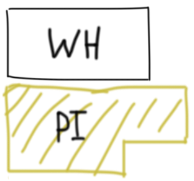

# PostgreSQL: Clear solution with explanation

**Author:** smipe_a
**Votes:** 5
**Link:** [https://leetcode.com/problems/maximize-items/solutions/4783777/](https://leetcode.com/problems/maximize-items/solutions/4783777/)

---

<div align="center">

*I don't know why the problem is marked as* **Hard**

If this explanation (solution) helps you, then please click on the **Upvote** button


# Intuition \uD83D\uDD0E
The task may seem challenging due to its classification as **Hard** but in reality, it boils down to implementing a **straightforward greedy algorithm**

# Approach \uD83D\uDCD1
We are tasked with optimizing warehouse space allocation within a $500.000$ square feet facility. The key requirement is to prioritize stocking **all premium class items** first. If any premium item fails to fit within the available space, **none of them** are added to the warehouse (a somewhat unusual stipulation)

---

First, using CTE, we will record information about the amount of space and the number of items for the premium class and regular


```PostgreSQL []
WITH prime AS (
    SELECT 'prime_eligible' item_type,
           SUM(square_footage) sum_item,
           COUNT(item_id) count_item
    FROM Inventory
    WHERE item_type = 'prime_eligible'
), not_prime AS (
    SELECT 'not_prime' item_type,
           SUM(square_footage) sum_item,
           COUNT(item_id) count_item
    FROM Inventory
    WHERE item_type = 'not_prime'
)
```

```
# Some notes
+----------------+    +-----------------+
| prime_data     |    | not_prime_data  |
+----------------+    +-----------------+
| 68.00          |    | 26.40           |
| 325.00         |    | 64.50           |
| 85.00          |    | 15.00           |
| 8.50           |    | 22.60           |
| 55.50          |    |                 |
| 13.20          |    |                 |
+----------------+    +-----------------+
# CTEs data
sum_item = 555,2      sum_item = 128,5
count_item = 6        count_item = 4
```

Now, to find out the maximum amount of premium items 
that can be stored in the storage, you need to find $K$



$$ PI = K * sum\\_item_{prime} \\leq WH$$
$$K = \u230A\\frac{500000}{sum\\_item_{prime}}\u230B$$

Now multiply by the number of unique premium items
and find out the maximum number of premium products

```PostgreSQL []
-- Previous code with CTE
SELECT item_type,
       TRUNC(500000 / sum_item) * count_item item_count
FROM prime
```

Now you need to do exactly the same steps for regular class items, **but first taking away the already occupied space with premium class items**


$$ CI = K * sum\\_item_{common} \\leq WH - PI$$
$$ K = \u230A\\frac{500000 - PI}{sum\\_item_{common}}\u230B$$

We also multiply by the number of unique common items and combine the result through **UNION**. Sort by specified condition


```PostgreSQL []
-- Previous code
UNION
SELECT item_type,
       TRUNC((500000 - (SELECT TRUNC(500000 / sum_item) * sum_item FROM prime)) / sum_item) * count_item item_count
FROM not_prime
ORDER BY item_count DESC
```

# Solution on PostgreSQL
```
WITH prime AS (
    SELECT 'prime_eligible' item_type,
           SUM(square_footage) sum_item,
           COUNT(item_id) count_item
    FROM Inventory
    WHERE item_type = 'prime_eligible'
), not_prime AS (
    SELECT 'not_prime' item_type,
           SUM(square_footage) sum_item,
           COUNT(item_id) count_item
    FROM Inventory
    WHERE item_type = 'not_prime'
)

SELECT item_type,
       TRUNC(500000 / sum_item) * count_item item_count
FROM prime
UNION
SELECT item_type,
       TRUNC((500000 - (SELECT TRUNC(500000 / sum_item) * sum_item FROM prime)) / sum_item) * count_item item_count
FROM not_prime
ORDER BY item_count DESC
```

</div>