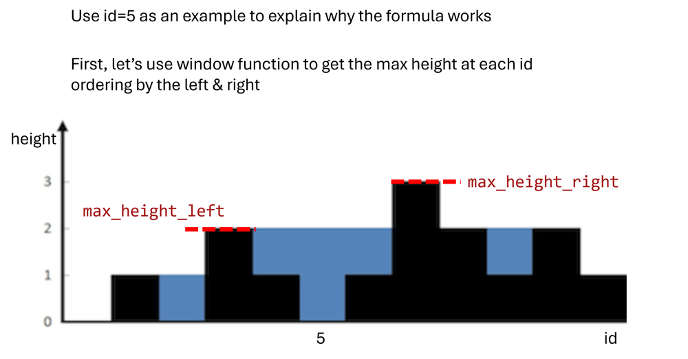
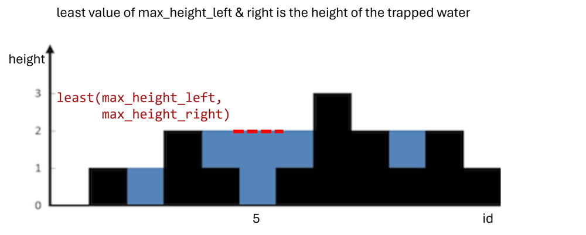
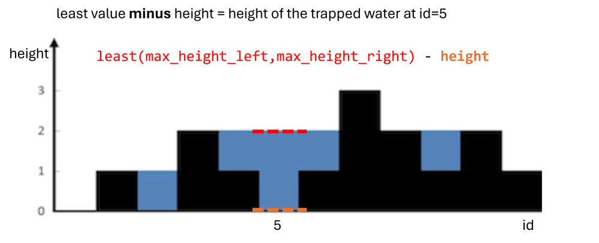
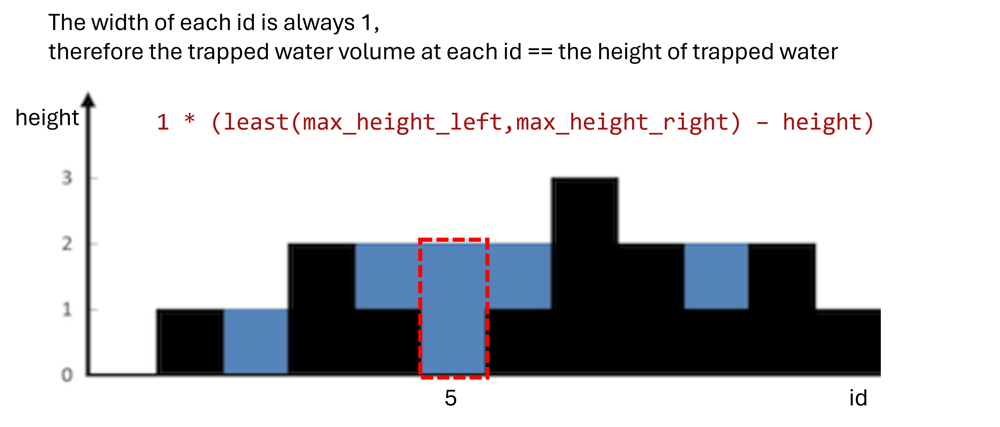
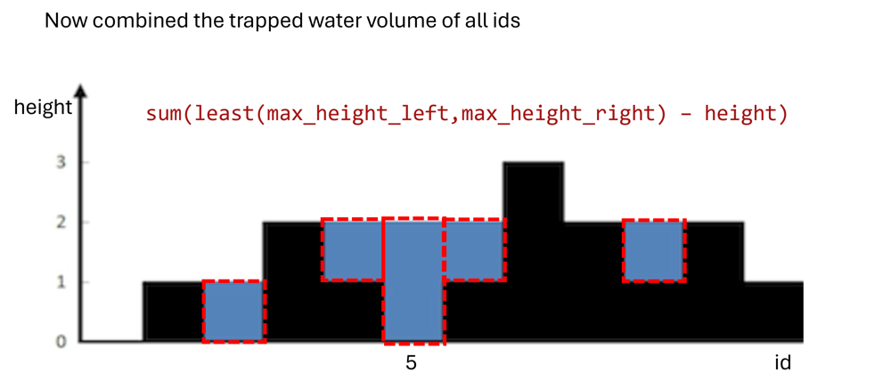
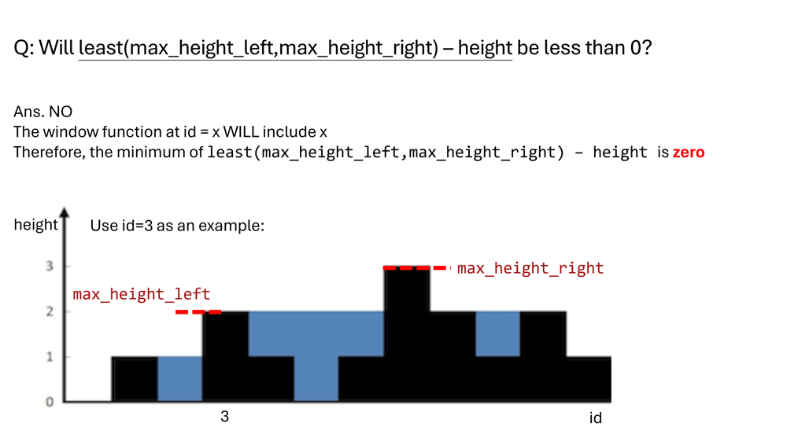

# Step by Step explanation with visualization; sum(least(max_height_left, max_height_right) – height)

**Author:** tsung_pct
**Votes:** 5
**Link:** [https://leetcode.com/problems/calculate-trapping-rain-water/solutions/5228671/](https://leetcode.com/problems/calculate-trapping-rain-water/solutions/5228671/)

---

# Visual explanation

**[Note: check my Medium post for more details](https://medium.com/@tctsung/leetcode-3061-sql-hard-calculate-trapping-rain-water-1839308c557f)**













## Difference of version 1 & 2
* we can simplify the code because min of `least(max_height_left,max_height_right) \u2013 height` is zero




# Code

## Version 1
```
-- intuitive version:
with t1 as (
    -- get the left & right max height to determine how deep the water can be
    select id, height,
        max(height) over(order by id) as "max_height_left",
        max(height) over(order by id desc) as "max_height_right"
    from Heights 
)

select sum(case 
    when least(max_height_left, max_height_right) > height
        then least(max_height_left, max_height_right) - height
    else 0 end
    )  as "total_trapped_water"
from t1
```

## Version 2, simplified version:
can simplified because the window function at id=x include x
-> so least(max_height_left, max_height_right) - height = 0 when at the peak
```
with t1 as (
    -- get the left & right max height to determine how deep the water can be
    select id, height,
        max(height) over(order by id) as "max_height_left",
        max(height) over(order by id desc) as "max_height_right"
    from Heights 
)

select sum(least(max_height_left, max_height_right) - height) as "total_trapped_water"
from t1


```