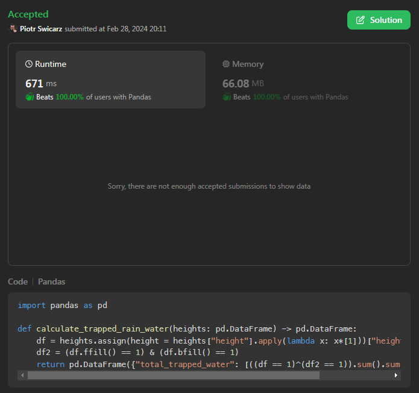

# Pandas - apply pd.Series, ffill(), bfill()

**Author:** piocarz
**Votes:** 1
**Link:** [https://leetcode.com/problems/calculate-trapping-rain-water/solutions/4796601/](https://leetcode.com/problems/calculate-trapping-rain-water/solutions/4796601/)

---

# Code
explanation works on examples, so its long, I putted code here :)
It's `Hard`so forgive if its a bit hand-wavy:
```
import pandas as pd

def calculate_trapped_rain_water(heights: pd.DataFrame) -> pd.DataFrame:
    df = heights.assign(ones = heights["height"].apply(lambda x: x*[1]))["ones"].apply(pd.Series)
    df2 = (df.ffill() == 1) & (df.bfill() == 1)
    return pd.DataFrame({"total_trapped_water": [((df == 1)^(df2 == 1)).sum().sum()]})
```
# Intuition
The easiest way to get weight of something is to measure it with its container, then substract weight of container. 

in Pandas we have something like ffill() and bfill(), what it does it transforms:

```
| 0    | 1    | 2    |
| ---- | ---- | ---- |
| null | null | null |
| 1    | null | null |
| null | null | null |
| 1    | 1    | null |
| 1    | null | null |
| null | null | null |
| 1    | null | null |
| 1    | 1    | 1    |
| 1    | 1    | null |
| 1    | null | null |
| 1    | 1    | null |
| 1    | null | null |
```
into `.ffill()`:
```
| 0    | 1    | 2    |
| ---- | ---- | ---- |
| null | null | null |
| 1    | null | null |
| 1    | null | null |
| 1    | 1    | null |
| 1    | 1    | null |
| 1    | 1    | null |
| 1    | 1    | null |
| 1    | 1    | 1    |
| 1    | 1    | 1    |
| 1    | 1    | 1    |
| 1    | 1    | 1    |
| 1    | 1    | 1    |
```
into `.bfill()`:
```
| 0 | 1    | 2    |
| - | ---- | ---- |
| 1 | 1    | 1    |
| 1 | 1    | 1    |
| 1 | 1    | 1    |
| 1 | 1    | 1    |
| 1 | 1    | 1    |
| 1 | 1    | 1    |
| 1 | 1    | 1    |
| 1 | 1    | 1    |
| 1 | 1    | null |
| 1 | 1    | null |
| 1 | 1    | null |
| 1 | null | null |
```
then we can combine ffill & bfill into (container + trapped water:)
```
| 0    | 1    | 2    |
| ---- | ---- | ---- |
| null | null | null |
| 1    | null | null |
| 1    | null | null |
| 1    | 1    | null |
| 1    | 1    | null |
| 1    | 1    | null |
| 1    | 1    | null |
| 1    | 1    | 1    |
| 1    | 1    | null |
| 1    | 1    | null |
| 1    | 1    | null |
| 1    | null | null |
```
as you can see if we substract from this our initial state we got (our trapped water):
```
| 0    | 1    | 2    |
| ---- | ---- | ---- |
| null | null | null |
| null | null | null |
| 1    | null | null |
| null | null | null |
| null | 1    | null |
| 1    | 1    | null |
| null | 1    | null |
| null | null | null |
| null | null | null |
| null | 1    | null |
| null | null | null |
| null | null | null |
```
if we sum this - we got volume of our trapped water.
# Approach
1. first line transforms:
    ```
    | height |
    | ------ |
    | 0      |
    | 1      |
    | 0      |
    | 2      |
    | 1      |
    | 0      |
    | 1      |
    | 3      |
    | 2      |
    | 1      |
    | 2      |
    | 1      |
    ```
    into this:
    ```
    | height |
    | ------ |
    |        |
    | 1      |
    |        |
    | 1,1    |
    | 1      |
    |        |
    | 1      |
    | 1,1,1  |
    | 1,1    |
    | 1      |
    | 1,1    |
    | 1      |
    ```
    into this:
    ```
    | 0    | 1    | 2    |
    | ---- | ---- | ---- |
    | null | null | null |
    | 1    | null | null |
    | null | null | null |
    | 1    | 1    | null |
    | 1    | null | null |
    | null | null | null |
    | 1    | null | null |
    | 1    | 1    | 1    |
    | 1    | 1    | null |
    | 1    | null | null |
    | 1    | 1    | null |
    | 1    | null | null |
    ```
2. second line combines `.ffill()` and `.bfill()` and gets us this
    ( actually it's `True/False` but for readability i putted 1 and `null`):
    ```
    | 0    | 1    | 2    |
    | ---- | ---- | ---- |
    | null | null | null |
    | 1    | null | null |
    | 1    | null | null |
    | 1    | 1    | null |
    | 1    | 1    | null |
    | 1    | 1    | null |
    | 1    | 1    | null |
    | 1    | 1    | 1    |
    | 1    | 1    | null |
    | 1    | 1    | null |
    | 1    | 1    | null |
    | 1    | null | null |
    ```
3. last step substracts origianl state from ffill&bfill and gets us this (again - actually -> `True/False`): 
    ```
    | 0    | 1    | 2    |
    | ---- | ---- | ---- |
    | null | null | null |
    | null | null | null |
    | 1    | null | null |
    | null | null | null |
    | null | 1    | null |
    | 1    | 1    | null |
    | null | 1    | null |
    | null | null | null |
    | null | null | null |
    | null | 1    | null |
    | null | null | null |
    | null | null | null |
    ```
    sum this and we have answer.


