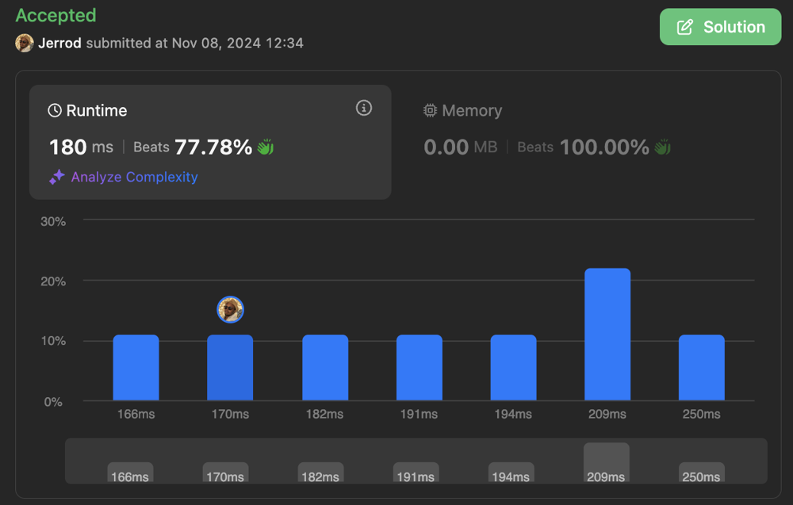

# cte + lag() -- simple intuition (Beats >75%)

**Author:** _jhowlett_
**Votes:** 0
**Link:** [https://leetcode.com/problems/employee-task-duration-and-concurrent-tasks/solutions/6024176/](https://leetcode.com/problems/employee-task-duration-and-concurrent-tasks/solutions/6024176/)

---




# Intuition
<!-- Describe your first thoughts on how to solve this problem. -->
1) Identify any time overlap using lag() on `end_time`
2) Identify the difference between previous and current `task_id` 
3) Use the combination of time overlap (i.e. less than 0) and task overlap (i.e. greater than or equal to 1) to determine the max tasks occuring concurrently.


# Code
```postgresql []
-- Write your PostgreSQL query statement below
with cte as (
    select
        employee_id,
        task_id,
        lag(task_id) over (partition by employee_id order by task_id) as previous_task,
        sum(case 
                when extract(epoch from (start_time - previous_end))::decimal / 3600 < 0 then extract(epoch from (start_time - previous_end))::decimal / 3600
            else 0
        end) as task_overlap,
        sum(hours) as task_hours
    from (
        select
            employee_id,
            task_id,
            start_time,
            end_time,
            lag(end_time) over (partition by employee_id order by start_time) as previous_end,
            extract(epoch from (end_time - start_time))::decimal / 3600 as hours
        from tasks
    )a
    group by 1,2
)

select
    employee_id,
    floor(sum(overlap_hours + task_hours)) as total_task_hours,
    1 + coalesce(max(task_diff) filter (where overlapping_task = 1),0) as max_concurrent_tasks
from (
    select
        employee_id,
        task_id - previous_task as task_diff,
        count(distinct task_id) filter (where task_overlap < 0) as overlapping_task,
        sum(task_overlap) as overlap_hours,
        sum(task_hours) as task_hours
    from cte
    group by employee_id, task_id, previous_task
)a
group by employee_id
order by employee_id


```