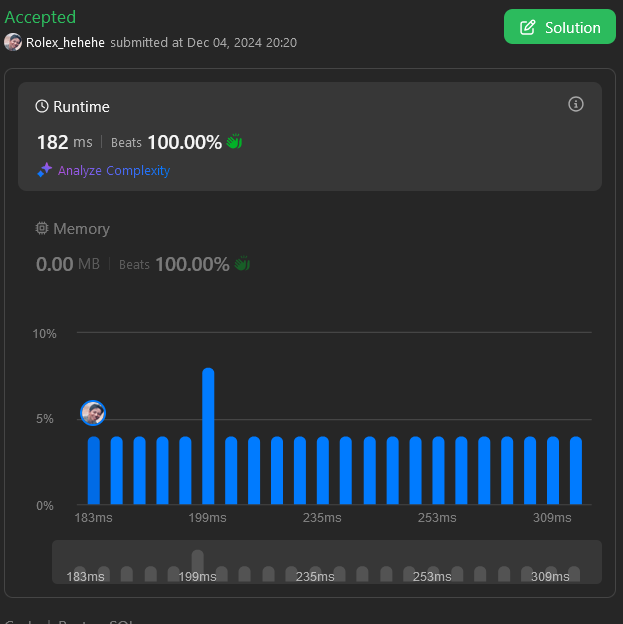

# 3 Simple solutions ( Beat 100% ): just replace + string_split + string_agg 🎅🎅🎅

**Author:** cooking_Guy_9ice
**Votes:** 3
**Link:** [https://leetcode.com/problems/first-letter-capitalization-ii/solutions/6112910/](https://leetcode.com/problems/first-letter-capitalization-ii/solutions/6112910/)

---

# Intuition
<!-- Describe your first thoughts on how to solve this problem. -->

# Approach
<!-- Describe your approach to solving the problem. -->

# Complexity
- Time complexity:
<!-- Add your time complexity here, e.g. $$O(n)$$ -->

- Space complexity:
<!-- Add your space complexity here, e.g. $$O(n)$$ -->




# WITH INITCAP(POSTGRESQL)
```postgresql []
SELECT content_id, content_text original_text, initcap(content_text) converted_text FROM user_content;

```

# WITHOUT INITCAP ( ALL SQL )
```postgresql []
WITH CTE AS(
	SELECT content_id, content_text,  unnest(string_to_array(REPLACE(content_text,'-','  '), ' ')) AS new_text
	FROM user_content 
)
SELECT content_id, content_text AS original_text , REPLACE( STRING_AGG(UPPER(SUBSTR(new_text,1,1)) || LOWER(SUBSTR(new_text,2, LENGTH(new_text) - 1)), ' ') , ' - ', '-')  AS converted_text
FROM (
	SELECT content_id, content_text, CASE WHEN new_text = '' THEN '-' ELSE new_text END 
	FROM CTE
)sub
GROUP BY content_id, content_text
ORDER BY content_id
```
# SQL SERVER 
```mssql []

WITH CTE AS (
	SELECT content_id, content_text, REPLACE(content_text,'-','  ') AS new_text
	FROM user_content
)
,CTE2 AS (
	SELECT
		content_id, content_text, UPPER(LEFT(single_word,1)) + LOWER(SUBSTRING(single_word,2, total_word_length)) AS converted
	FROM (
		SELECT content_id, content_text , new_text, spl.value single_word, LEN(spl.value)total_word_length  FROM CTE C 
		OUTER APPLY
		string_split(C.new_text,' ') spl
	)sub
)
SELECT content_id, content_text AS original_text, REPLACE( STRING_AGG(IIF( converted = '', '-',  converted) ,' ') , ' - ', '-') AS converted_text
FROM CTE2
GROUP BY content_id, content_text
ORDER BY content_id

```

# ORACLE
```oracle []
WITH CTE AS(
 SELECT content_id, content_text, REGEXP_SUBSTR(new_text, '[^ ]+', 1, LEVEL) converted_single_text
   FROM (
    SELECT content_id, content_text, replace(content_text,'-', ' -') new_text
    FROM user_content
)sub 
CONNECT BY REGEXP_SUBSTR(new_text, '[^ ]+', 1, LEVEL) IS NOT NULL
    AND PRIOR content_id = content_id
    AND PRIOR SYS_GUID() IS NOT NULL
)
, CTE2 AS (
SELECT content_id, content_text, DECODE( is_s, 1, '-' || converted_single_text2, converted_single_text2)  AS converted_single_text3, ROW_NUMBER() OVER(ORDER BY (NULL)) keyid
FROM
    (
        SELECT content_id, content_text, is_s, UPPER(SUBSTR(converted_single_text,1,1)) || LOWER(SUBSTR(converted_single_text,2, LENGTH( converted_single_text)))  converted_single_text2
        FROM (
            SELECT content_id, content_text, REPLACE(converted_single_text,'-','') converted_single_text, CASE WHEN  converted_single_text LIKE '%-%' THEN 1 ELSE 0 END is_s
            FROM CTE
        )sub
    ) sub1
)
SELECT content_id AS "content_id", content_text AS "original_text", REPLACE( LISTAGG(converted_single_text3, ' ') WITHIN GROUP (ORDER BY keyid) , ' -','-') AS  "converted_text"
FROM CTE2 
GROUP BY content_id, content_text
ORDER BY content_id;

```