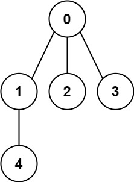
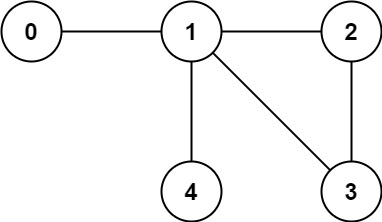

# [261. Graph Valid Tree](https://leetcode.com/problems/graph-valid-tree/)

| Category | Difficulty | Likes | Dislikes |
| :------: | :--------: | :---: | :------: |
| Algorithms | Medium | 3441 | 113 |

**Tags:** [`depth-first-search`](https://leetcode.com/tag/depth-first-search), [`breadth-first-search`](https://leetcode.com/tag/breadth-first-search), [`union-find`](https://leetcode.com/tag/union-find), [`graph`](https://leetcode.com/tag/graph)

**Companies:** `linkedin`, `google`, `facebook`, `microsoft`, `amazon`, `zenefits`

## Description

You have a graph of `n` nodes labeled from `0` to `n - 1`. You are given an integer n and a list of `edges` where `edges[i] = [a_i, b_i]` indicates that there is an undirected edge between nodes `a_i` and `b_i` in the graph.

Return `true` *if the edges of the given graph make up a valid tree, and* `false` *otherwise*.

 

**Example 1:**


```

Input: n = 5, edges = [[0,1],[0,2],[0,3],[1,4]]
Output: true

```

**Example 2:**


```

Input: n = 5, edges = [[0,1],[1,2],[2,3],[1,3],[1,4]]
Output: false

```

 

**Constraints:**

	- `1 <= n <= 2000`

	- `0 <= edges.length <= 5000`

	- `edges[i].length == 2`

	- `0 <= a_i, b_i < n`

	- `a_i != b_i`

	- There are no self-loops or repeated edges.

---

**Links:** [Submissions](https://leetcode.com/problems/graph-valid-tree/) | [Solutions](https://leetcode.com/problems/graph-valid-tree/)
