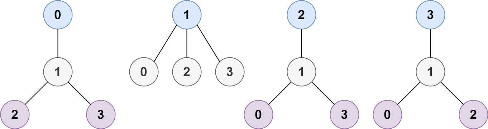
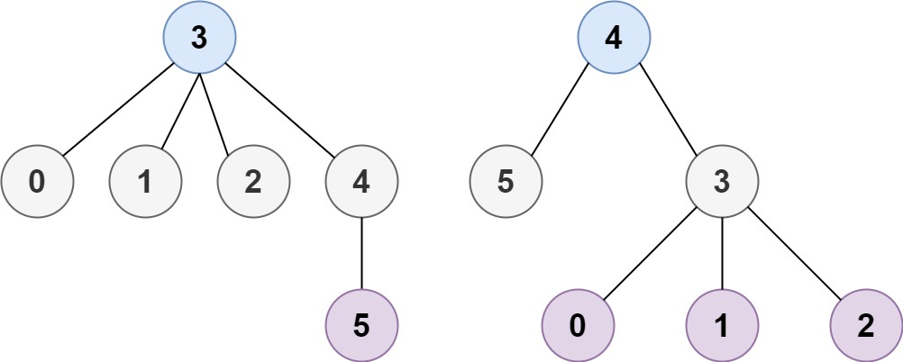

# [310. Minimum Height Trees](https://leetcode.com/problems/minimum-height-trees/)

| Category | Difficulty | Likes | Dislikes |
| :------: | :--------: | :---: | :------: |
| Algorithms | Medium | 8817 | 412 |

**Tags:** [`depth-first-search`](https://leetcode.com/tag/depth-first-search), [`breadth-first-search`](https://leetcode.com/tag/breadth-first-search), [`graph`](https://leetcode.com/tag/graph), [`topological-sort`](https://leetcode.com/tag/topological-sort)

**Companies:** `google`, `splunk`, `facebook`, `amazon`, `adobe`, `microsoft`

## Description

A tree is an undirected graph in which any two vertices are connected by exactly one path. In other words, any connected graph without simple cycles is a tree.

Given a tree of `n` nodes labelled from `0` to `n - 1`, and an array of `n - 1` `edges` where `edges[i] = [a_i, b_i]` indicates that there is an undirected edge between the two nodes `a_i` and `b_i` in the tree, you can choose any node of the tree as the root. When you select a node `x` as the root, the result tree has height `h`. Among all possible rooted trees, those with minimum height (i.e. `min(h)`)  are called **minimum height trees** (MHTs).

Return *a list of all **MHTs'** root labels*. You can return the answer in **any order**.

The **height** of a rooted tree is the number of edges on the longest downward path between the root and a leaf.

 

**Example 1:**


```

Input: n = 4, edges = [[1,0],[1,2],[1,3]]
Output: [1]
Explanation: As shown, the height of the tree is 1 when the root is the node with label 1 which is the only MHT.

```

**Example 2:**


```

Input: n = 6, edges = [[3,0],[3,1],[3,2],[3,4],[5,4]]
Output: [3,4]

```

 

**Constraints:**

	- `1 <= n <= 2 * 10^4`

	- `edges.length == n - 1`

	- `0 <= a_i, b_i < n`

	- `a_i != b_i`

	- All the pairs `(a_i, b_i)` are distinct.

	- The given input is **guaranteed** to be a tree and there will be **no repeated** edges.

---

**Links:** [Submissions](https://leetcode.com/problems/minimum-height-trees/) | [Solutions](https://leetcode.com/problems/minimum-height-trees/)
