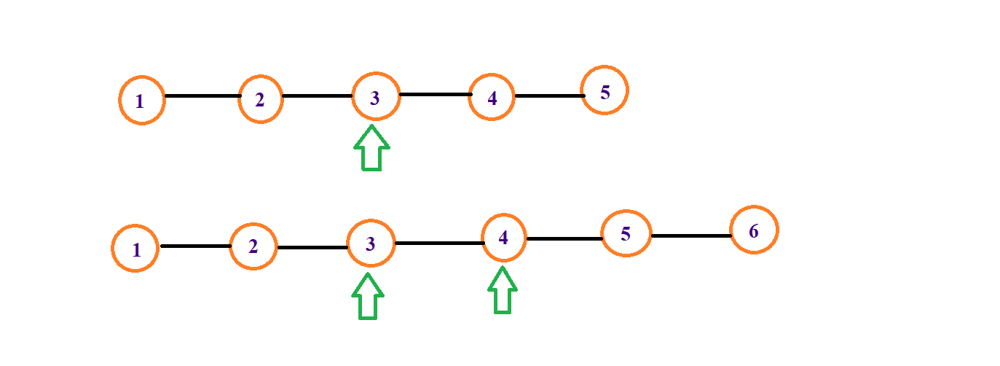

# [C++] Simple Solution | Topological Sort | W/ Explanation

**Author:** Mythri_Kaulwar
**Votes:** 173
**Link:** [https://leetcode.com/problems/minimum-height-trees/solutions/1630778/](https://leetcode.com/problems/minimum-height-trees/solutions/1630778/)

---

We need to find the minimum height trees and return the roots of those trees. There can be atmost 2 trees with minimum height. So the result vector can have atmost 2 elements. Let's see how!
**APPROACH :** 
Consider the two graphs shown here :
* For the graph with odd no. of nodes, only the node at the middle of the graph when made the root, will give a minimum height tree.
* For the graph with even no. of nodes, both the middle nodes when made the root give a minimum height tree.

So, we need to start from the leaf nodes and find a way to approach the middle nodes, add them to the result vector and return the answer.
How do we do that?

**We use Topological Sorting!**
* We create an array called indegree which keeps the count of the no. of edges approaching each node in the tree.
* We start with the nodes having the minimum indegree (ie; indegree=1, i.e the leaf nodes) and we go on removing them i.e decrementing the indegree of nodes that're connected to them, until we reach the middle nodes.
* So we can have only one root or at max two roots for minimum height depending on tree structure as explained above.
*  For the implementation, we are going to use a BFS like approach.
*  To begin with,  all leaf node are pushed into the queue, then they are removed from the tree, next new leaf node is pushed in the queue, this procedure keeps on going until we have only 1 or 2 node in our tree, which represent the result. 

**Time Complexity :** O(V+E)

**Space Complexity :** O(V)

**Code :** 
The code uses the basic algorithm of topological sorting
```
class Solution {
public:
    vector<int> findMinHeightTrees(int n, vector<vector<int>>& edges) {
        vector<vector<int>> graph(n);
        vector<int> indegree(n, 0), ans; //vector<int> indegree keeps count of the number of nodes approaching a node
        
        for(auto &e : edges){   //Creating an adjacency matrix for the given graph
            graph[e[0]].push_back(e[1]);
            graph[e[1]].push_back(e[0]);
            indegree[e[0]]++;
            indegree[e[1]]++;
        }
        
        queue<int> q;
        for(int i=0; i<n;i++){
            if(indegree[i]==1) q.push(i), indegree[i]--; //add all the leaf nodes to the queue
        } 
        
        while(!q.empty()){
            int s = q.size();
            ans.clear();
            for(int i=0; i<s;i++){
                int curr = q.front(); q.pop();
                ans.push_back(curr);
                for(auto child : graph[curr]){ //For each node, attached to the leaf niodes, we decrement the indegree i.e remove the leaf nodes connected to them. We keep on doing this until we reach the middle nodes.
                    indegree[child]--;
                    if(indegree[child]==1) q.push(child);   
                }
            }
        }
        if(n==1) ans.push_back(0); //If there is only 1 node in the graph, the min height is 0, with root being '0'
        return ans;
        
    }
};
```

If you like my solution & explanation, please upvote my post :)

