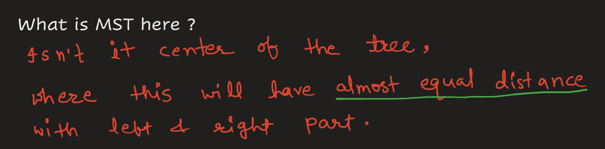
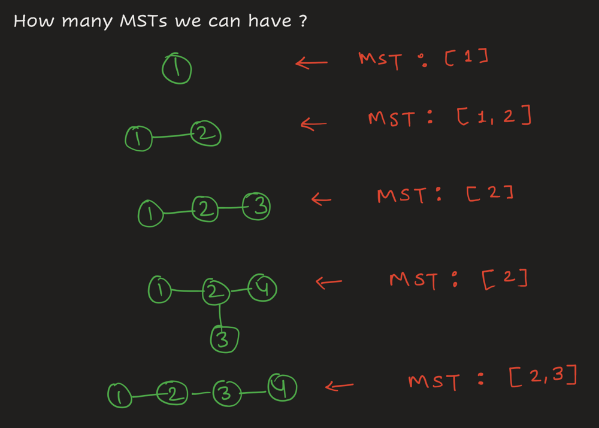
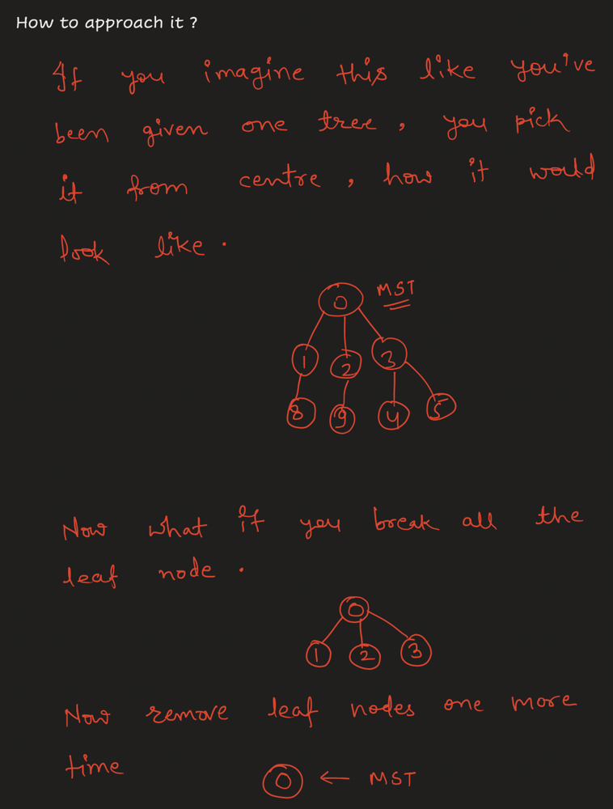
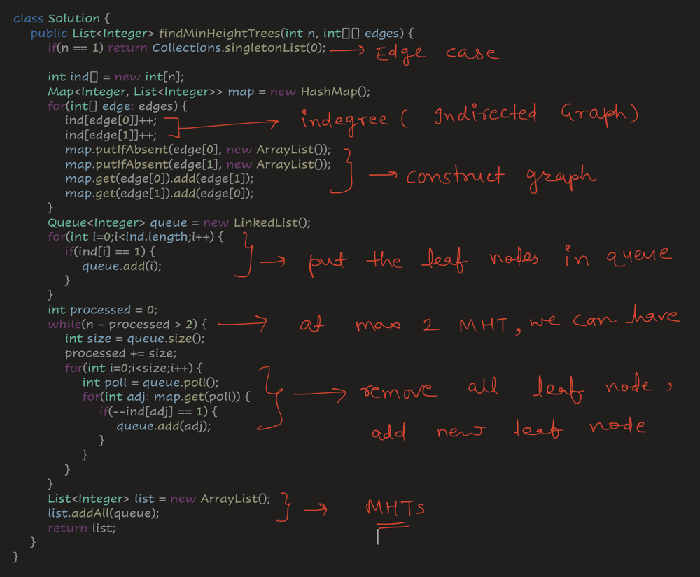

# 💡[ Full Explanation ] BFS - Remove Leaf Nodes

**Author:** cs_iitian
**Votes:** 195
**Link:** [https://leetcode.com/problems/minimum-height-trees/solutions/5060930/](https://leetcode.com/problems/minimum-height-trees/solutions/5060930/)

---

## Subscribe to My Channel ( Target : 1K )
https://www.youtube.com/channel/UCuxmikkhqbmBOUVxf-61hxw

# Approach







# Code Explanation


# Code
```
class Solution {
    public List<Integer> findMinHeightTrees(int n, int[][] edges) {
        if(n == 1) return Collections.singletonList(0);
        
        int ind[] = new int[n];
        Map<Integer, List<Integer>> map = new HashMap();
        for(int[] edge: edges) {
            ind[edge[0]]++;
            ind[edge[1]]++;
            map.putIfAbsent(edge[0], new ArrayList());
            map.putIfAbsent(edge[1], new ArrayList());
            map.get(edge[0]).add(edge[1]);
            map.get(edge[1]).add(edge[0]);
        }

        Queue<Integer> queue = new LinkedList();
        for(int i=0;i<ind.length;i++) {
            if(ind[i] == 1) {
                queue.add(i);
            }
        }

        int processed = 0;
        while(n - processed > 2) {
            int size = queue.size();
            processed += size;
            for(int i=0;i<size;i++) {
                int poll = queue.poll();
                for(int adj: map.get(poll)) {
                    if(--ind[adj] == 1) {
                        queue.add(adj);
                    }
                }
            }
        }

        List<Integer> list = new ArrayList();
        list.addAll(queue);
        return list;
    }
}
```


# Optimised Code ( by Chat GPT )

```java []
class Solution {
    public List<Integer> findMinHeightTrees(int n, int[][] edges) {
        if (n == 1) return Collections.singletonList(0);
        
        int[] degree = new int[n];
        Map<Integer, List<Integer>> adjacencyList = new HashMap<>();
        for (int[] edge : edges) {
            degree[edge[0]]++;
            degree[edge[1]]++;
            adjacencyList.computeIfAbsent(edge[0], x -> new ArrayList<>()).add(edge[1]);
            adjacencyList.computeIfAbsent(edge[1], x -> new ArrayList<>()).add(edge[0]);
        }

        Queue<Integer> leaves = new LinkedList<>();
        for (int i = 0; i < degree.length; i++) {
            if (degree[i] == 1) {
                leaves.add(i);
            }
        }

        int remainingNodes = n;
        while (remainingNodes > 2) {
            int size = leaves.size();
            remainingNodes -= size;
            for (int i = 0; i < size; i++) {
                int leaf = leaves.poll();
                for (int neighbor : adjacencyList.get(leaf)) {
                    if (--degree[neighbor] == 1) {
                        leaves.add(neighbor);
                    }
                }
            }
        }

        return new ArrayList<>(leaves);
    }
}
```
```C++ []
class Solution {
public:
    vector<int> findMinHeightTrees(int n, vector<vector<int>>& edges) {
        if (n == 1) return {0};
    
        std::vector<std::list<int>> adjacency_list(n);
        std::vector<int> degree(n, 0);
        for (auto& edge : edges) {
            int u = edge[0], v = edge[1];
            adjacency_list[u].push_back(v);
            adjacency_list[v].push_back(u);
            degree[u]++;
            degree[v]++;
        }
        
        std::queue<int> leaves;
        for (int i = 0; i < n; ++i) {
            if (degree[i] == 1) leaves.push(i);
        }
        
        int remainingNodes = n;
        while (remainingNodes > 2) {
            int leavesCount = leaves.size();
            remainingNodes -= leavesCount;
            for (int i = 0; i < leavesCount; ++i) {
                int leaf = leaves.front();
                leaves.pop();
                for (int neighbor : adjacency_list[leaf]) {
                    if (--degree[neighbor] == 1) {
                        leaves.push(neighbor);
                    }
                }
            }
        }
        
        std::vector<int> result;
        while (!leaves.empty()) {
            result.push_back(leaves.front());
            leaves.pop();
        }
        
        return result;
    }
};
```
```Python3 []
class Solution:
    def findMinHeightTrees(self, n: int, edges: List[List[int]]) -> List[int]:
        if n == 1:
            return [0]
        
        # Initialize the adjacency list and degree of each node
        adjacency_list = defaultdict(list)
        degree = [0] * n
        for u, v in edges:
            adjacency_list[u].append(v)
            adjacency_list[v].append(u)
            degree[u] += 1
            degree[v] += 1
        
        # Initialize leaves queue
        leaves = deque([i for i in range(n) if degree[i] == 1])
        
        # Trim leaves until 2 or fewer nodes remain
        remaining_nodes = n
        while remaining_nodes > 2:
            leaves_count = len(leaves)
            remaining_nodes -= leaves_count
            for _ in range(leaves_count):
                leaf = leaves.popleft()
                for neighbor in adjacency_list[leaf]:
                    degree[neighbor] -= 1
                    if degree[neighbor] == 1:
                        leaves.append(neighbor)
        
        return list(leaves)
```