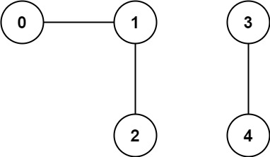
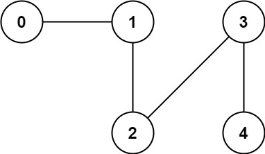

# [323. Number of Connected Components in an Undirected Graph](https://leetcode.com/problems/number-of-connected-components-in-an-undirected-graph/)

| Category | Difficulty | Likes | Dislikes |
| :------: | :--------: | :---: | :------: |
| Algorithms | Medium | 2790 | 110 |

**Tags:** [`depth-first-search`](https://leetcode.com/tag/depth-first-search), [`breadth-first-search`](https://leetcode.com/tag/breadth-first-search), [`union-find`](https://leetcode.com/tag/union-find), [`graph`](https://leetcode.com/tag/graph)

**Companies:** `general-motors`, `amazon`, `linkedin`, `facebook`, `google`, `tiktok`, `twitter`

## Description

You have a graph of `n` nodes. You are given an integer `n` and an array `edges` where `edges[i] = [a_i, b_i]` indicates that there is an edge between `a_i` and `b_i` in the graph.

Return *the number of connected components in the graph*.

 

**Example 1:**


```

Input: n = 5, edges = [[0,1],[1,2],[3,4]]
Output: 2

```

**Example 2:**


```

Input: n = 5, edges = [[0,1],[1,2],[2,3],[3,4]]
Output: 1

```

 

**Constraints:**

	- `1 <= n <= 2000`

	- `1 <= edges.length <= 5000`

	- `edges[i].length == 2`

	- `0 <= a_i <= b_i < n`

	- `a_i != b_i`

	- There are no repeated edges.

---

**Links:** [Submissions](https://leetcode.com/problems/number-of-connected-components-in-an-undirected-graph/) | [Solutions](https://leetcode.com/problems/number-of-connected-components-in-an-undirected-graph/)
