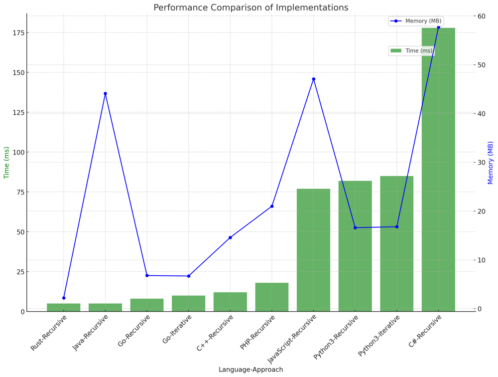

# ✅ 95.76% DFS Recursive & Iterative

**Author:** vanAmsen
**Votes:** 175
**Link:** [https://leetcode.com/problems/reconstruct-itinerary/solutions/4041944/](https://leetcode.com/problems/reconstruct-itinerary/solutions/4041944/)

---

# Comprehensive Guide to Solving "Reconstruct Itinerary": Navigating Airports Like a Pro

## Introduction & Problem Statement

Hello, coding enthusiasts! Today, we'll tackle a problem that combines graph theory and real-world scenarios: "Reconstruct Itinerary." The problem asks you to reconstruct a trip's itinerary given a list of airline tickets. The catch? You start from JFK airport, and if there are multiple valid itineraries, you should return the one that has the smallest lexical order.

## Key Concepts and Constraints

### What Makes This Problem Unique?

1. **Graph Theory**: 
   The problem can be modeled as a directed graph, where each airport is a node and each ticket represents a directed edge between airports.
  
2. **Lexical Order**: 
   Among multiple valid itineraries, the one with the smallest lexical order is preferred.

3. **Constraints**: 
   - 1 <= tickets.length <= 300
   - Tickets are given as pairs [fromi, toi] of strings.
   - Each string consists of 3 uppercase English letters.

### Strategies to Tackle the Problem

1. **Recursive DFS**: 
   This approach leverages the stack memory implicitly during recursion to backtrack and form the itinerary.
   
2. **Iterative DFS**: 
   This approach explicitly uses a stack to perform DFS iteratively.

---

## Live Coding & More in Python
https://www.youtube.com/watch?v=migy5oXV1Uc

## Recursive DFS Explained

### Extended Explanation: Logic Behind the "Find Itinerary" Solution using Recursive DFS

### What is Recursive DFS?

DFS, short for Depth-First Search, is a graph-traversal algorithm. In this specific problem, we use the recursive version of DFS, which exploits the call stack to keep track of the airports (vertices) that still need exploration.

### The Intricacies of Recursive DFS in "Find Itinerary"

1. **Initialize the Graph**:  
    - We start by initializing an adjacency list `graph` that will serve as a representation of the directed graph of flights. The graph is implemented as a defaultdict containing lists.
  
    - The adjacency list is constructed by iterating over the given list of ticket pairs, where each pair consists of a source airport and a destination airport.
  
    - These lists of destinations are sorted in reverse lexical order. This allows us to pop the last element to ensure that we are choosing the smallest lexical order when there are multiple options.

2. **DFS Traversal and Exploration**:  
    - The traversal starts from the JFK airport, which is our initial point. We initiate a recursive DFS function that takes the current airport as an argument.
  
    - Inside this function, we enter a loop that continues until we find an airport that has no more destinations left to visit. This is done by checking the adjacency list for each airport and popping the last element (which is the smallest in lexical order).
  
    - During this process, we recursively call the DFS function for each new destination, essentially diving deeper into the graph.

3. **Backtrack and Construct Itinerary**:  
    - Once we reach an airport with no outgoing edges, or in other words, no more destinations to visit, we start backtracking.
  
    - During the backtracking phase, we add the current airport to our `itinerary` list. This list was initially empty and serves as the container for our final solution.

    - Importantly, we are essentially building the itinerary in reverse during this phase because of the way DFS works. As we backtrack, we are popping from the call stack, revisiting the airports in the reverse order of how they will eventually appear in the itinerary.

4. **Reverse to Get the Final Itinerary**:  
    - Since we constructed the itinerary in reverse, the final step is to reverse this list. This gives us the correct order of airports to visit, starting from JFK, and is our final solution.

### Time and Space Complexity

- **Time Complexity**: $$O(N \\log N)$$ due to sorting the tickets.
- **Space Complexity**: $$O(N)$$, for storing the graph and the itinerary.

# Code Recursive 
``` Python []
class Solution:
    def findItinerary(self, tickets: List[List[str]]) -> List[str]:
        graph = defaultdict(list)
        
        for src, dst in sorted(tickets, reverse=True):
            graph[src].append(dst)
            
        itinerary = []
        def dfs(airport):
            while graph[airport]:
                dfs(graph[airport].pop())
            itinerary.append(airport)
        
        dfs("JFK")
        
        return itinerary[::-1]
```
``` Go []
func findItinerary(tickets [][]string) []string {
	graph := make(map[string][]string)
	
	for _, ticket := range tickets {
		graph[ticket[0]] = append(graph[ticket[0]], ticket[1])
	}
	
	for key := range graph {
		sort.Sort(sort.Reverse(sort.StringSlice(graph[key])))
	}
	
	var itinerary []string
	
	var dfs func(airport string)
	dfs = func(airport string) {
		for len(graph[airport]) > 0 {
			next := graph[airport][len(graph[airport])-1]
			graph[airport] = graph[airport][:len(graph[airport])-1]
			dfs(next)
		}
		itinerary = append(itinerary, airport)
	}
	
	dfs("JFK")
	
	for i := 0; i < len(itinerary)/2; i++ {
		itinerary[i], itinerary[len(itinerary)-1-i] = itinerary[len(itinerary)-1-i], itinerary[i]
	}
	
	return itinerary
}
```
``` Rust []
use std::collections::HashMap;

impl Solution {
    pub fn find_itinerary(tickets: Vec<Vec<String>>) -> Vec<String> {
        let mut graph: HashMap<String, Vec<String>> = HashMap::new();
        
        for ticket in &tickets {
            let (src, dst) = (ticket[0].clone(), ticket[1].clone());
            graph.entry(src.clone()).or_insert(vec![]).push(dst);
        }

        for destinations in graph.values_mut() {
            destinations.sort_by(|a, b| b.cmp(a));
        }
        
        let mut itinerary = vec![];
        
        fn dfs(graph: &mut HashMap<String, Vec<String>>, airport: &str, itinerary: &mut Vec<String>) {
            while let Some(next) = graph.get_mut(airport).and_then(|dests| dests.pop()) {
                dfs(graph, &next, itinerary);
            }
            itinerary.push(airport.to_string());
        }
        
        dfs(&mut graph, "JFK", &mut itinerary);
        
        itinerary.reverse();
        
        itinerary
    }
}
```
``` C++ []
class Solution {
public:
    vector<string> findItinerary(vector<vector<string>>& tickets) {
        unordered_map<string, vector<string>> graph;
        
        for (auto& ticket : tickets) {
            graph[ticket[0]].push_back(ticket[1]);
        }
        
        for (auto& [_, destinations] : graph) {
            sort(destinations.rbegin(), destinations.rend());
        }
        
        vector<string> itinerary;
        
        function<void(const string&)> dfs = [&](const string& airport) {
            while (!graph[airport].empty()) {
                string next = graph[airport].back();
                graph[airport].pop_back();
                dfs(next);
            }
            itinerary.push_back(airport);
        };
        
        dfs("JFK");
        reverse(itinerary.begin(), itinerary.end());
        
        return itinerary;
    }
};
```
``` Java []
class Solution {
    public List<String> findItinerary(List<List<String>> tickets) {
        Map<String, PriorityQueue<String>> graph = new HashMap<>();
        
        for (List<String> ticket : tickets) {
            graph.putIfAbsent(ticket.get(0), new PriorityQueue<>());
            graph.get(ticket.get(0)).add(ticket.get(1));
        }
        
        LinkedList<String> itinerary = new LinkedList<>();
        
        dfs("JFK", graph, itinerary);
        
        return itinerary;
    }
    
    private void dfs(String airport, Map<String, PriorityQueue<String>> graph, LinkedList<String> itinerary) {
        PriorityQueue<String> nextAirports = graph.get(airport);
        while (nextAirports != null && !nextAirports.isEmpty()) {
            dfs(nextAirports.poll(), graph, itinerary);
        }
        itinerary.addFirst(airport);
    }
}
```
``` C# []
public class Solution {
    public IList<string> FindItinerary(IList<IList<string>> tickets) {
        var graph = new Dictionary<string, List<string>>();
        
        foreach (var ticket in tickets) {
            if (!graph.ContainsKey(ticket[0])) {
                graph[ticket[0]] = new List<string>();
            }
            graph[ticket[0]].Add(ticket[1]);
        }
        
        foreach (var destinations in graph.Values) {
            destinations.Sort((a, b) => b.CompareTo(a));
        }
        
        var itinerary = new List<string>();
        
        void DFS(string airport) {
            while (graph.ContainsKey(airport) && graph[airport].Count > 0) {
                var next = graph[airport][^1];
                graph[airport].RemoveAt(graph[airport].Count - 1);
                DFS(next);
            }
            itinerary.Add(airport);
        }
        
        DFS("JFK");
        itinerary.Reverse();
        
        return itinerary;
    }
}
```
``` JavaScript []
/**
 * @param {string[][]} tickets
 * @return {string[]}
 */
var findItinerary = function(tickets) {
    const graph = {};
    
    for (const [src, dst] of tickets) {
        if (!graph[src]) graph[src] = [];
        graph[src].push(dst);
    }
    
    for (const key in graph) {
        graph[key].sort().reverse();
    }
    
    const itinerary = [];
    
    function dfs(airport) {
        while (graph[airport] && graph[airport].length > 0) {
            dfs(graph[airport].pop());
        }
        itinerary.push(airport);
    }
    
    dfs("JFK");
    
    return itinerary.reverse();
};
```
``` PHP []
class Solution {
    function findItinerary($tickets) {
        $graph = [];
        
        foreach ($tickets as [$src, $dst]) {
            $graph[$src][] = $dst;
        }
        
        foreach ($graph as &$destinations) {
            rsort($destinations);
        }
        
        $itinerary = [];
        
        $dfs = function($airport) use (&$graph, &$itinerary, &$dfs) {
            while (!empty($graph[$airport])) {
                $dfs(array_pop($graph[$airport]));
            }
            $itinerary[] = $airport;
        };
        
        $dfs("JFK");
        
        return array_reverse($itinerary);
    }
}
```

## Iterative DFS Explained

### How Does Iterative DFS Work?

Iterative DFS also starts by initializing the graph in the same manner as the recursive approach. The difference lies in the traversal and the building of the itinerary.

1. **Initialize Stack**:  
   - We explicitly initialize a stack with "JFK" as the starting point.
  
2. **Iterative DFS Traversal**:  
   - We use the stack to manage the DFS traversal. For each airport on the stack, we keep visiting its next available destination until it has no outgoing edges.
  
3. **Build Itinerary**:  
   - During this process, we keep adding the current airport to the `itinerary` list.
  
4. **Reverse the Itinerary**:  
   - Finally, we reverse the `itinerary` list to get the final itinerary in correct order.

### Time and Space Complexity

- **Time Complexity**: $$O(N \\log N)$$, due to sorting.
- **Space Complexity**: $$O(N)$$, for storing the graph and the itinerary.


# Code Iterative
``` Python []
class Solution:
    def findItinerary(self, tickets: List[List[str]]) -> List[str]:
        graph = defaultdict(list)
        
        for src, dst in sorted(tickets, reverse=True):
            graph[src].append(dst)
        
        stack = ["JFK"]
        itinerary = []
        
        while stack:
            while graph[stack[-1]]:
                stack.append(graph[stack[-1]].pop())
            itinerary.append(stack.pop())
        
        return itinerary[::-1]
```
``` Go []
func findItinerary(tickets [][]string) []string {
	graph := make(map[string][]string)
	
	for _, ticket := range tickets {
		graph[ticket[0]] = append(graph[ticket[0]], ticket[1])
	}
	
	for key := range graph {
		sort.Sort(sort.Reverse(sort.StringSlice(graph[key])))
	}
	
	stack := []string{"JFK"}
	var itinerary []string
	
	for len(stack) > 0 {
		for len(graph[stack[len(stack)-1]]) > 0 {
			last := len(graph[stack[len(stack)-1]]) - 1
			stack = append(stack, graph[stack[len(stack)-1]][last])
			graph[stack[len(stack)-2]] = graph[stack[len(stack)-2]][:last]
		}
		itinerary = append(itinerary, stack[len(stack)-1])
		stack = stack[:len(stack)-1]
	}
	
	for i := 0; i < len(itinerary)/2; i++ {
		itinerary[i], itinerary[len(itinerary)-1-i] = itinerary[len(itinerary)-1-i], itinerary[i]
	}
	
	return itinerary
}
```
``` C++ []
class Solution {
public:
    std::vector<std::string> findItinerary(std::vector<std::vector<std::string>>& tickets) {
        std::unordered_map<std::string, std::vector<std::string>> graph;
        
        for (auto& ticket : tickets) {
            graph[ticket[0]].push_back(ticket[1]);
        }
        
        for (auto& [_, dests] : graph) {
            std::sort(dests.rbegin(), dests.rend());
        }
        
        std::vector<std::string> stack = {"JFK"};
        std::vector<std::string> itinerary;
        
        while (!stack.empty()) {
            std::string curr = stack.back();
            if (graph.find(curr) != graph.end() && !graph[curr].empty()) {
                stack.push_back(graph[curr].back());
                graph[curr].pop_back();
            } else {
                itinerary.push_back(stack.back());
                stack.pop_back();
            }
        }
        
        std::reverse(itinerary.begin(), itinerary.end());
        return itinerary;
    }
};
```
``` Java []
class Solution {
    public List<String> findItinerary(List<List<String>> tickets) {
        Map<String, PriorityQueue<String>> graph = new HashMap<>();
        
        for (List<String> ticket : tickets) {
            graph.computeIfAbsent(ticket.get(0), k -> new PriorityQueue<>()).add(ticket.get(1));
        }
        
        LinkedList<String> stack = new LinkedList<>();
        stack.add("JFK");
        LinkedList<String> itinerary = new LinkedList<>();
        
        while (!stack.isEmpty()) {
            while (graph.getOrDefault(stack.peekLast(), new PriorityQueue<>()).size() > 0) {
                stack.add(graph.get(stack.peekLast()).poll());
            }
            itinerary.addFirst(stack.pollLast());
        }
        
        return itinerary;
    }
}
```
``` JavaScript []
/**
 * @param {string[][]} tickets
 * @return {string[]}
 */
var findItinerary = function(tickets) {
    const graph = {};
    
    for (const [src, dst] of tickets) {
        if (!graph[src]) graph[src] = [];
        graph[src].push(dst);
    }
    
    for (const key in graph) {
        graph[key].sort((a, b) => b.localeCompare(a));
    }
    
    const stack = ['JFK'];
    const itinerary = [];
    
    while (stack.length > 0) {
        while (graph[stack[stack.length - 1]] && graph[stack[stack.length - 1]].length > 0) {
            stack.push(graph[stack[stack.length - 1]].pop());
        }
        itinerary.push(stack.pop());
    }
    
    return itinerary.reverse();
};
```
``` C# []
using System;
using System.Collections.Generic;
using System.Linq;

public class Solution {
    public IList<string> FindItinerary(IList<IList<string>> tickets) {
        var graph = new Dictionary<string, List<string>>();
        
        foreach (var ticket in tickets) {
            if (!graph.ContainsKey(ticket[0])) {
                graph[ticket[0]] = new List<string>();
            }
            graph[ticket[0]].Add(ticket[1]);
        }

        foreach (var key in graph.Keys) {
            graph[key].Sort((a, b) => b.CompareTo(a));
        }
        
        var stack = new Stack<string>();
        stack.Push("JFK");
        var itinerary = new List<string>();
        
        while (stack.Count > 0) {
            string curr = stack.Peek();
            if (graph.ContainsKey(curr) && graph[curr].Count > 0) {
                var next = graph[curr].Last();
                graph[curr].RemoveAt(graph[curr].Count - 1);
                stack.Push(next);
            } else {
                itinerary.Add(stack.Pop());
            }
        }
        
        itinerary.Reverse();
        return itinerary;
    }
}
```
``` PHP []
class Solution {
    function findItinerary($tickets) {
        $graph = [];
        foreach ($tickets as $ticket) {
            $graph[$ticket[0]][] = $ticket[1];
        }
        
        foreach ($graph as &$dests) {
            rsort($dests);
        }
        
        $stack = ["JFK"];
        $itinerary = [];
        
        while (!empty($stack)) {
            while (!empty($graph[end($stack)])) {
                array_push($stack, array_pop($graph[end($stack)]));
            }
            array_push($itinerary, array_pop($stack));
        }
        
        return array_reverse($itinerary);
    }
}
```

## Performance

| Language   | Time (ms) | Memory (MB) | Approach  |
|------------|-----------|-------------|-----------|
| Rust       | 5         | 2.2         | Recursive |
| Java       | 5         | 44.1        | Recursive |
| Go         | 8         | 6.8         | Recursive |
| Go         | 10        | 6.7         | Iterative |
| C++        | 12        | 14.6        | Recursive |
| PHP        | 18        | 21          | Recursive |
| JavaScript | 77        | 47.1        | Recursive |
| Python3    | 82        | 16.6        | Recursive |
| Python3    | 85        | 16.8        | Iterative |
| C#         | 178       | 57.7        | Recursive |




## Live Coding+ & Go
https://youtu.be/_r9OZwy5x4c?si=P-9OousNlDl-cZnJ

## Code Highlights and Best Practices

- The Recursive DFS is elegant but uses the system stack, making it susceptible to stack overflow for very large graphs.
- The Iterative DFS is more flexible as it explicitly uses a stack, allowing for better control over the traversal process.
  
Mastering these approaches not only helps you solve this problem but also enhances your understanding of graph traversal algorithms, which are widely applicable in various domains. So, are you ready to construct some itineraries? Let's get coding!