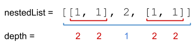
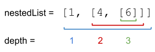

# [339. Nested List Weight Sum](https://leetcode.com/problems/nested-list-weight-sum/)

| Category | Difficulty | Likes | Dislikes |
| :------: | :--------: | :---: | :------: |
| Algorithms | Medium | 1854 | 484 |

**Tags:** [`depth-first-search`](https://leetcode.com/tag/depth-first-search), [`breadth-first-search`](https://leetcode.com/tag/breadth-first-search)

**Companies:** `facebook`, `linkedin`, `amazon`, `google`, `adobe`, `apple`

## Description

You are given a nested list of integers `nestedList`. Each element is either an integer or a list whose elements may also be integers or other lists.

The **depth** of an integer is the number of lists that it is inside of. For example, the nested list `[1,[2,2],[[3],2],1]` has each integer's value set to its **depth**.

Return *the sum of each integer in *`nestedList`* multiplied by its **depth***.

 

**Example 1:**


```

Input: nestedList = [[1,1],2,[1,1]]
Output: 10
Explanation: Four 1&#39;s at depth 2, one 2 at depth 1. 1*2 + 1*2 + 2*1 + 1*2 + 1*2 = 10.

```

**Example 2:**


```

Input: nestedList = [1,[4,[6]]]
Output: 27
Explanation: One 1 at depth 1, one 4 at depth 2, and one 6 at depth 3. 1*1 + 4*2 + 6*3 = 27.
```

**Example 3:**

```

Input: nestedList = [0]
Output: 0

```

 

**Constraints:**

	- `1 <= nestedList.length <= 50`

	- The values of the integers in the nested list is in the range `[-100, 100]`.

	- The maximum **depth** of any integer is less than or equal to `50`.

---

**Links:** [Submissions](https://leetcode.com/problems/nested-list-weight-sum/) | [Solutions](https://leetcode.com/problems/nested-list-weight-sum/)
