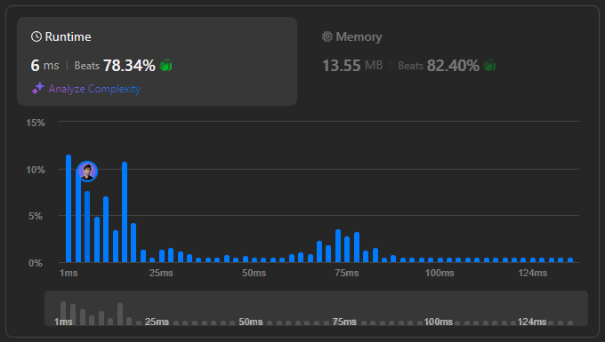

# 🌟 Solve Lexicographical Numbers Like a Pro – Multi-Language Guide 🔥💯

**Author:** withaarzoo
**Votes:** 3
**Link:** [https://leetcode.com/problems/lexicographical-numbers/solutions/5813977/](https://leetcode.com/problems/lexicographical-numbers/solutions/5813977/)

---


Explore a collection of solutions to LeetCode problems in multiple programming languages. Each solution includes a detailed explanation and step-by-step approach to solving the problem efficiently. Whether you're a beginner looking to learn or an experienced coder seeking optimized solutions, this repository aims to provide clear and insightful approaches to tackling challenging LeetCode problems.

### **Access daily LeetCode Solutions Repo :** [click here](https://github.com/withaarzoo/LeetCode-Solutions)

---




---

# Intuition
To solve this problem, we need to generate numbers from `1` to `n` in lexicographical order. Sorting numbers after generating them is inefficient for this case because sorting takes \\(O(n \\log n)\\), which violates the O(n) constraint. Instead, we can leverage a DFS-like approach, where we incrementally build each number lexicographically.

---

# Approach
1. Start with the number `1`.
2. Recursively build the next lexicographically smaller number by attempting to multiply the current number by `10`. This takes us to the next "level" of lexicographical order.
3. If multiplying by `10` overshoots `n`, we backtrack and try incrementing the current number (i.e., move to the next sibling in the lexicographical tree).
4. We repeat this process for numbers from `1` to `9` to cover all lexicographical paths.

---

# Complexity
- **Time complexity:**  
  The algorithm runs in O(n), as each number from `1` to `n` is visited once during the traversal.

- **Space complexity:**  
  O(1) extra space (excluding the result vector), since we are not using any additional data structures that grow with input size.

---

# Code
```C++ []
class Solution {
public:
    vector<int> lexicalOrder(int n) {
        vector<int> result;
        // Iterate over numbers 1 to 9 as root nodes
        for (int i = 1; i <= 9; ++i) {
            dfs(i, n, result);
        }
        return result;
    }
    
    // Helper function for DFS traversal
    void dfs(int curr, int n, vector<int>& result) {
        if (curr > n) return;  // Stop recursion if current number exceeds n
        result.push_back(curr); // Add current number to result
        
        // Try to generate the next lexicographical number
        for (int i = 0; i <= 9; ++i) {
            if (curr * 10 + i > n) break;  // If the number exceeds n, stop recursion
            dfs(curr * 10 + i, n, result); // Recursive call
        }
    }
};

```
```Java []
class Solution {
    public List<Integer> lexicalOrder(int n) {
        List<Integer> result = new ArrayList<>();
        // Iterate from 1 to 9
        for (int i = 1; i <= 9; i++) {
            dfs(i, n, result);
        }
        return result;
    }
    
    // Helper method for DFS
    private void dfs(int curr, int n, List<Integer> result) {
        if (curr > n) return;  // Stop recursion if current number is greater than n
        result.add(curr);      // Add current number to the result list
        
        // Try to append digits (0-9) to the current number
        for (int i = 0; i <= 9; i++) {
            if (curr * 10 + i > n) break;  // Stop if the number exceeds n
            dfs(curr * 10 + i, n, result); // Recursive call
        }
    }
}

```
```JavaScript []
/**
 * @param {number} n
 * @return {number[]}
 */
var lexicalOrder = function(n) {
    let result = [];
    
    // Run DFS from 1 to 9
    for (let i = 1; i <= 9; i++) {
        dfs(i, n, result);
    }
    
    return result;
};

// Helper function for DFS traversal
function dfs(curr, n, result) {
    if (curr > n) return;  // Stop if the current number is greater than n
    result.push(curr);     // Add the current number to the result
    
    // Try to add digits 0-9 to the current number
    for (let i = 0; i <= 9; i++) {
        let next = curr * 10 + i;
        if (next > n) return;  // Stop if the next number exceeds n
        dfs(next, n, result);  // Recursive DFS call
    }
}

```
```Python []
class Solution:
    def lexicalOrder(self, n: int) -> List[int]:
        result = []
        
        # Iterate over numbers 1 to 9
        for i in range(1, 10):
            self.dfs(i, n, result)
        
        return result
    
    # Helper DFS function
    def dfs(self, curr: int, n: int, result: List[int]):
        if curr > n:
            return  # Stop recursion if current number is greater than n
        result.append(curr)  # Add current number to result
        
        # Try appending digits 0-9 to the current number
        for i in range(10):
            if curr * 10 + i > n:
                return  # Stop if the next number exceeds n
            self.dfs(curr * 10 + i, n, result)  # Recursive DFS

```
```Go []
func lexicalOrder(n int) []int {
    result := []int{}
    
    // Iterate over the first digit (1 to 9)
    for i := 1; i <= 9; i++ {
        dfs(i, n, &result)
    }
    
    return result
}

// Helper DFS function
func dfs(curr, n int, result *[]int) {
    if curr > n {
        return // Stop if the current number is greater than n
    }
    
    // Add current number to the result
    *result = append(*result, curr)
    
    // Try to append digits 0-9 to the current number
    for i := 0; i <= 9; i++ {
        next := curr * 10 + i
        if next > n {
            return // Stop if the next number exceeds n
        }
        dfs(next, n, result) // Recursive DFS call
    }
}

```

---

# Step-by-Step Detailed Explanation

1. **Initialization:**
   - In all languages, we initialize the result list to store numbers in lexicographical order.

2. **DFS Helper Function:**
   - The DFS function starts with a number `curr` and appends it to the result list.
   - It then attempts to build larger numbers by multiplying `curr` by 10 and adding digits from 0 to 9.
   - If at any point the new number exceeds `n`, the recursion stops.

3. **Main Function:**
   - We initiate the DFS from numbers `1` through `9`, as these serve as the roots of lexicographical numbers.
   
4. **Efficiency:**
   - The traversal ensures that we visit each number once and avoid extra space, meeting the time and space constraints.