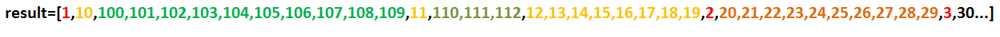
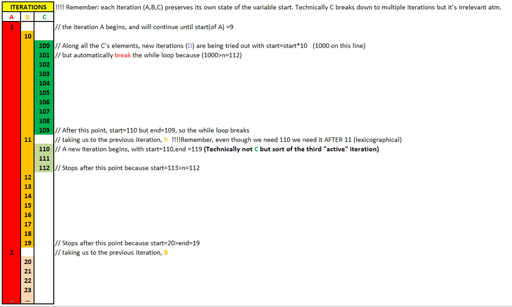

# Easy&Simple recursion beats 100%  ! Explanation + Graphic Illustration Included

**Author:** George_Chrysochoou
**Votes:** 29
**Link:** [https://leetcode.com/problems/lexicographical-numbers/solutions/399796/](https://leetcode.com/problems/lexicographical-numbers/solutions/399796/)

---

**TLDR**
The plan is to automatically create the result array without further sorting that will cost us excess runtime/space.

You have to notice how the result array is formed, and especially that you need **Iterations within other Iterations.** 

Let's create an example result array for a given  ***n**=**112*** to illustrate the requirements.


Notice how each color represents an iteration that **needs** to occur,   **IN THAT ORDER**.

So after 10, comes 100 ( which is 10* 10 and continues the green iteration until its end, 109=10* 10+9).
The Yellow Iteration's previous element is 1, so the yellow starts with 1* 10=10 and ends with 1* 10+9=119.
The Orange iteration's previous element is 2, so It starts with 2* 10=20 and ends with 2* 10+9=29
Notice that every iteration (except the olive green one) has the same relationship with its previous element. 
As for the olive green, it stopped prematurely. We expected it to keep going until 11 * 10 +9=119 (its end). Well this happened because we dont need the excess elements as they are bigger than our n.

Since we have required nested iterations, **recursion** can be helpful here. 

```
var lexicalOrder = function(n) {

        function pushFromTo( start, end ) {
            /* essentially this function pushes every integer between start and
			end to the results array and breaks whenever either the end or n is reached */
            while( start<=end && start<=n ){ 
                result.push(start);   

                /* The nesting occurs, new iterations are attempted within this
				step utilizing the observed pattern*/
				pushFromTo(start*10, start*10+9)

                start++   
            }

        }

   var result = [];

   /* start the recursion */ 
   pushFromTo( 1, 9);

   return result;
 };
 

```
**Let's examine how the algorith behaves with our previous example of n =112
Each line represents the order of processing that takes place.**


