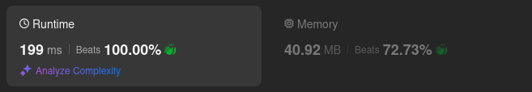
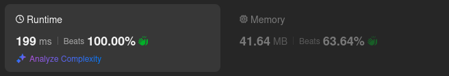
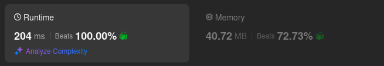
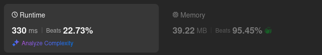
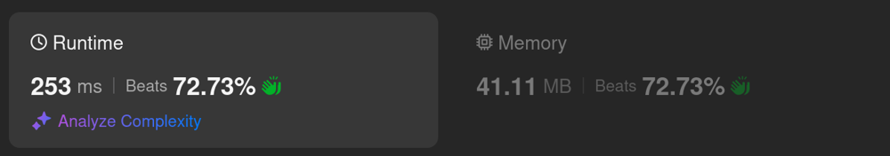

# Kotlin. Beats 100% (199 ms). Simple DFS

**Author:** mobdev778
**Votes:** 2
**Link:** [https://leetcode.com/problems/lexicographical-numbers/solutions/5815842/](https://leetcode.com/problems/lexicographical-numbers/solutions/5815842/)

---



# Code
```kotlin []
class Solution {
    val result = ArrayList<Int>()

    fun lexicalOrder(n: Int): List<Int> {
        for (i in 1..9) {
            dfs(i, n)
        }
        return result
    }

    private fun dfs(number: Int, n: Int) {
        if (number > n) return
        result.add(number)
        for (i in 0..9) {
            dfs(number * 10 + i, n)
        }
    }
}
```

# Approach

At first I had an idea to make a universal recursion that uses a virtual digit "-1" as a marker of the end of the current number.

But then I saw that a simpler and clearer solution would be a recursive pass for each initial digit. The solution in 2 cycles (one for the initial digit, the second for iterating over the digits inside the recursion) turned out to be simpler and faster.

When creating the recursion, I started by analyzing how the numbers in the range 1..113 should be distributed:

```
val a = ArrayList<String>()
for (i in 1..113) {
    a.add(i.toString())
}
a.sort()
println(a.toList())
```

Output:
```
[1, 10, 100, 101, 102, 103, 104, 105, 106, 107, 108, 109, 11, 110, 111, 112, 113, 12, 13, 14, 15, 16, 17, 18, 19, 2, 20, 21, 22, 23, 24, 25, 26, 27, 28, 29, 3, 30, 31, 32, 33, 34, 35, 36, 37, 38, 39, 4, 40, 41, 42, 43, 44, 45, 46, 47, 48, 49, 5, 50, 51, 52, 53, 54, 55, 56, 57, 58, 59, 6, 60, 61, 62, 63, 64, 65, 66, 67, 68, 69, 7, 70, 71, 72, 73, 74, 75, 76, 77, 78, 79, 8, 80, 81, 82, 83, 84, 85, 86, 87, 88, 89, 9, 90, 91, 92, 93, 94, 95, 96, 97, 98, 99]
```

We can group this output by the first digit and length:

```
[1]:
-------
1, 
  10
    100
    101
    102
    103
    104
    105
    106
    107
    108
    109
  11 
    110
    111
    112
    113 
  12 
  13 
  14 
  15 
  16 
  17 
  18 
  19

[2]:
--------
2
  20 
  21 
  22 
  23 
  24
  25 
  26 
  27 
  28 
  29

[3]:
-------
3
  30 
  31 
  32 
  33 
  34 
  35
  36 
  37 
  38 
  39
...
```

It is quite easy to see that the resulting numbers are easy to generate using a recursive inference algorithm.

For each digit we first add the digit itself ("1"), then look for a solution at the sublevels for the number 1[a], then for the number 1[a][b], etc.

# Alternative approach

There was an idea to slightly play around with the moment associated with the repeated multiplication of the same number "number" by 10, but, as it turned out, introducing an additional variable negates the gain from caching the multiplication.



1. Caching "number * 10"

```
class Solution {
    val result = ArrayList<Int>()

    fun lexicalOrder(n: Int): List<Int> {
        for (i in 1..9) {
            dfs(i, n)
        }
        return result
    }

    private fun dfs(number: Int, n: Int) {
        if (number > n) return
        result.add(number)
        var number = number * 10
        repeat(10) {
            dfs(number, n)
            number++
        }
    }
}
```

2. Updating next number via stack:



```
class Solution {
    
    val result = ArrayList<Int>()

    fun lexicalOrder(n: Int): List<Int> {
        for (i in 1..9) {
            dfs(i, n)
        }
        return result
    }

    private fun dfs(number: Int, n: Int): Int {
        if (number <= n) {
            result.add(number)
            var next = number * 10
            for (i in 0..9) {
                next = dfs(next, n) + 1
            }
        }
        return number
    }
}
```

3. Non-recursive solution (stack):
 


```
class Solution {
    
    val stack = Stack<StackState>()
    val result = ArrayList<Int>()

    fun lexicalOrder(n: Int): List<Int> {
        for (i in 1..9) {
            dfs(i, n)
        }
        return result
    }

    private fun dfs(number: Int, n: Int) {
        stack.push(StackState(number, 0))
        while (stack.isNotEmpty()) {
            val state = stack.pop()
            if (state.number <= n) {
                if (state.i == 0) {
                    result.add(state.number)
                }
                if (state.i <= 9) {
                    state.i++
                    stack.push(state)
                    stack.push(StackState(state.number * 10 + state.i - 1, 0))
                }
            }
        }
    }

    class StackState(val number: Int, var i: Int)
}
```

4. Non-recursive solution (ArrayDeque)

As leetcoder "mcmouse88"(https://leetcode.com/u/mcmouse88/) quite rightly noted, the usual java.util.Stack adds overhead costs associated with synchronization during operation. The non-recursive solution with ArrayDeque works significantly faster, showing quite acceptable 72% in runtime:



```
class Solution {
    
    val stack = ArrayDeque<StackState>()
    val result = ArrayList<Int>()

    fun lexicalOrder(n: Int): List<Int> {
        for (i in 1..9) {
            dfs(i, n)
        }
        return result
    }

    private fun dfs(number: Int, n: Int) {
        stack.addLast(StackState(number, 0))
        while (stack.isNotEmpty()) {
            val state = stack.removeLast()
            if (state.number <= n) {
                if (state.i == 0) {
                    result.add(state.number)
                    state.number *= 10
                }
                if (state.i++ <= 9) {
                    stack.addLast(state)
                    stack.addLast(StackState(state.number + state.i - 1, 0))
                }
            }
        }
    }

    class StackState(var number: Int, var i: Int)
}
```
