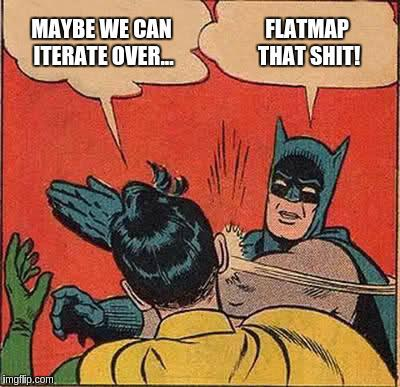

# [Scala] Concise functional recursive solution using flatMap

**Author:** cosminci
**Votes:** 2
**Link:** [https://leetcode.com/problems/lexicographical-numbers/solutions/1481858/](https://leetcode.com/problems/lexicographical-numbers/solutions/1481858/)

---



```
  def lexicalOrder(max: Int): List[Int] = {
    def dfs(n: Int): Seq[Int] =
      if (n > max) Seq.empty
      else n +: (0 to 9).flatMap(i => dfs(10 * n + i))

    (1 to 9).flatMap(dfs).toList
  }
```