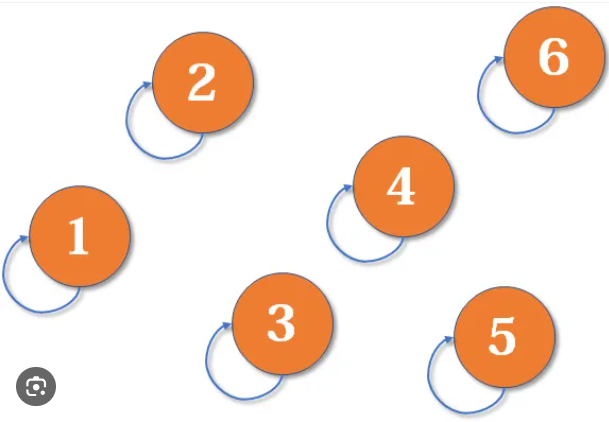
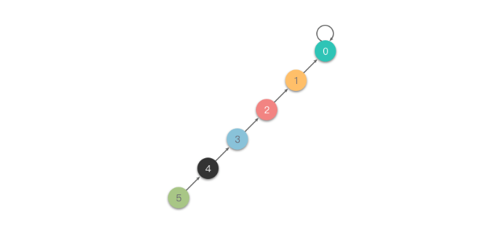

# [Union Find Tutorial] Number of Provinces

**Author:** never_get_piped
**Votes:** 14
**Link:** [https://leetcode.com/problems/number-of-provinces/solutions/5425028/](https://leetcode.com/problems/number-of-provinces/solutions/5425028/)

---

**Topic** :  Union Find
A data structure that stores non overlapping or disjoint subset of elements is called **Disjoint Set** or **Union Find** data structure. In the Union-Find data structure, each connected component (disjoint subset) is represented as a forest (or collection) of trees where each tree is rooted and nodes point to their parent. **Note that in this structure, the root node of each tree points to itself**. The elements of each subset are the nodes within these trees. The Union-Find data structure supports following operations:
* Merging disjoint sets to a single disjoint set using **Union** operation.
* Finding representative of a disjoint set using **Find** operation.
* Check if two sets are disjoint or not. 

<br/>

**Implementation**:

Let's use Java as the example code for the Union-Find template:
```
class UF {
    int[] p;
    int[] height;

    UF(int n) {
        p = new int[n];
        height = new int[n];
        for (int i = 0; i < n; i++) {
            p[i] = i;
            height[i] = 1;
        }
    }

    int find(int u) {
        if (p[u] == u) return u;
        return find(p[u]);
    }

    void merge(int root1, int root2) {
        if (root1 == root2) return;
        if (height[root1] < height[root2]) {
            int temp = root1;
            root1 = root2;
            root2 = temp;
        }
        p[root2] = root1;
        height[root1] = Math.max(height[root1], 1 + height[root2]);
    }
}
```

<br/><br/>

* Initially, in the Union-Find data structure, each node is its own root, forming a singleton tree (disjoint subset) where the node's parent points to itself.
	
	This initialization is done in the constructor of the UF data structure. We use `p[i]` to denote the parent of node i and `height[i]` to denote the height of the subtree with root node `i`. `p[i] = i` denotes that initially, each node is its own root.
	```
	UF(int n) {
        p = new int[n];
        height = new int[n];
        for (int i = 0; i < n; i++) {
            p[i] = i;
            height[i] = 1;
        }
    }
	```
<br/><br/>

* With the **find** operation, we traverse upwards to find the root of the current tree. This process stops when `p[u] = u`, indicating that `u` is the root node pointing to itself.

	This is done via the `find` method:
	```
	int find(int u) {
        if (p[u] == u) return u;
        return find(p[u]);
    }
	```
	
<br/><br/>
* With the **Union** or **Merge** operation, we combine two trees (disjoint sets) into a single tree (disjoint set). In order to merge two trees, we simply set the root of one tree to point to the root of the other tree. **Note that before merging two roots, we must ensure they are not already in the same connected component**.

	To optimize performance, we always merge the tree with smaller height to point to the root of the tree with greater height. 

	This is done via the `merge` method:
	```
	void merge(int root1, int root2) {
        if (root1 == root2) return;
        if (height[root1] < height[root2]) {
            int temp = root1;
            root1 = root2;
            root2 = temp;
        }
        p[root2] = root1;
        height[root1] = Math.max(height[root1], 1 + height[root2]);
    }
	```
<br/><br/>	
* Time Complexity :
	* **Find** : `O(h)`, where `h` denotes the height of the tree. Given that we merge trees by always attaching the smaller tree under the root of the larger tree, the maximum height of any tree is `O(logn)` at most.
	* **Union** : `O(1)`.
	* **Constructor** : `O(n)`.
* Space Complexity : `O(n)`
___

## Solution
The solution is straightforward: we use Union-Find to merge all connected nodes and then count the number of disjoint components at the end. 

All nodes that are connected to each other can reach each other, so we place them within the same disjoint set to signify their mutual accessibility.

<br/>

```c++ []
class UF {
    public:
        vector<int> p; //parent
        vector<int> height; //size
        UF(int n) {
            for(int i = 0; i < n; i++) {
                p.push_back(i);
                height.push_back(1);
            }
        }

        int find(int u) {
            return p[u] == u ? u : find(p[u]);
        }

        void merge(int root1, int root2) {
            if(root1 == root2) {
                return;
            }
            if(height[root1] < height[root2]) {
                swap(root1, root2);
            }
            p[root1] = root2;
            height[root2] = max(height[root2], 1 + height[root1]);
        }
};

class Solution {
public:
    int findCircleNum(vector<vector<int>>& isConnected) {
        int n = isConnected.size();
        UF uf(n);
        for(int i = 0; i < n; i++) {
            for(int j = i + 1; j < n; j++) {
                if(isConnected[i][j] == 1) {
                    int root1 = uf.find(i);
                    int root2 = uf.find(j);
                    uf.merge(root1, root2);
                }
            }
        }
        
        set<int> components;
        for(int i = 0; i < n; i++) {
            components.insert(uf.find(i));
        }
        return components.size();
    }
};
```
```java []
class UF {
    int[] p;
    int[] height;

    UF(int n) {
        p = new int[n];
        height = new int[n];
        for (int i = 0; i < n; i++) {
            p[i] = i;
            height[i] = 1;
        }
    }

    int find(int u) {
        if (p[u] == u) return u;
        return find(p[u]);
    }

    void merge(int root1, int root2) {
        if (root1 == root2) return;
        if (height[root1] < height[root2]) {
            int temp = root1;
            root1 = root2;
            root2 = temp;
        }
        p[root2] = root1;
        height[root1] = Math.max(height[root1], 1 + height[root2]);
    }
}

class Solution {
    public int findCircleNum(int[][] isConnected) {
        int n = isConnected.length;
        UF uf = new UF(n);
        for (int i = 0; i < n; i++) {
            for (int j = i + 1; j < n; j++) {
                if (isConnected[i][j] == 1) {
                    int root1 = uf.find(i);
                    int root2 = uf.find(j);
                    uf.merge(root1, root2);
                }
            }
        }
        
        Set<Integer> components = new HashSet<>();
        for (int i = 0; i < n; i++) {
            components.add(uf.find(i));
        }
        
        return components.size();
    }
}
```
```python []
class UF:
    def __init__(self, n):
        self.p = list(range(n))
        self.height = [1] * n

    def find(self, u):
        if self.p[u] == u:
            return u
        return self.find(self.p[u])

    def merge(self, root1, root2):
        if root1 == root2:
            return
        if self.height[root1] < self.height[root2]:
            root1, root2 = root2, root1
        self.p[root2] = root1
        self.height[root1] = max(self.height[root1], 1 + self.height[root2])

class Solution:
    def findCircleNum(self, isConnected: List[List[int]]) -> int:
        n = len(isConnected)
        uf = UF(n)
        for i in range(n):
            for j in range(i + 1, n):
                if isConnected[i][j] == 1:
                    root1 = uf.find(i)
                    root2 = uf.find(j)
                    uf.merge(root1, root2)
        
        components = set()
        for i in range(n):
            components.add(uf.find(i))
        
        return len(components) 
```
```Go []
type UF struct {
	p      []int
	height []int
}

func NewUF(n int) *UF {
	uf := UF{}
	uf.p = make([]int, n)
	uf.height = make([]int, n)
	for i := 0; i < n; i++ {
		uf.p[i] = i
		uf.height[i] = 1
	}
	return &uf
}

func (uf *UF) find(u int) int {
	if uf.p[u] == u {
		return u
	}
	return uf.find(uf.p[u])
}

func (uf *UF) merge(root1, root2 int) {
	if root1 == root2 {
		return
	}
	if uf.height[root1] < uf.height[root2] {
		root1, root2 = root2, root1
	}
	uf.p[root2] = root1
	uf.height[root1] = max(uf.height[root1], 1+uf.height[root2])
}

func findCircleNum(isConnected [][]int) int {
    n := len(isConnected)
	uf := NewUF(n)
	for i := 0; i < n; i++ {
		for j := i + 1; j < n; j++ {
			if isConnected[i][j] == 1 {
				root1 := uf.find(i)
				root2 := uf.find(j)
				uf.merge(root1, root2)
			}
		}
	}
	
	components := make(map[int]bool)
	for i := 0; i < n; i++ {
		components[uf.find(i)] = true
	}
	
	return len(components)
}
```
```PHP []
class UF {
    private $p;
    private $height;

    function __construct($n) {
        $this->p = range(0, $n - 1);
        $this->height = array_fill(0, $n, 1);
    }

    function find($u) {
        if ($this->p[$u] == $u) return $u;
        return $this->find($this->p[$u]);
    }

    function merge($root1, $root2) {
        if ($root1 == $root2) return;
        if ($this->height[$root1] < $this->height[$root2]) {
            list($root1, $root2) = array($root2, $root1);
        }
        $this->p[$root2] = $root1;
        $this->height[$root1] = max($this->height[$root1], 1 + $this->height[$root2]);
    }
}

class Solution {

    /**
     * @param Integer[][] $isConnected
     * @return Integer
     */
    function findCircleNum($isConnected) {
        $n = count($isConnected);
        $uf = new UF($n);
        for ($i = 0; $i < $n; $i++) {
            for ($j = $i + 1; $j < $n; $j++) {
                if ($isConnected[$i][$j] == 1) {
                    $root1 = $uf->find($i);
                    $root2 = $uf->find($j);
                    $uf->merge($root1, $root2);
                }
            }
        }
        
        $components = [];
        for ($i = 0; $i < $n; $i++) {
            $components[$uf->find($i)] = true;
        }
        
        return count($components);
    }
}
```
```javascript []
/**
 * @param {number[][]} isConnected
 * @return {number}
 */

class UF {
    constructor(n) {
        this.p = [...Array(n).keys()];
        this.height = Array(n).fill(1);
    }

    find(u) {
        if (this.p[u] === u) return u;
        return this.find(this.p[u]);
    }

    merge(root1, root2) {
        if (root1 === root2) return;
        if (this.height[root1] < this.height[root2]) {
            [root1, root2] = [root2, root1];
        }
        this.p[root2] = root1;
        this.height[root1] = Math.max(this.height[root1], 1 + this.height[root2]);
    }
}

var findCircleNum = function(isConnected) {
    const n = isConnected.length;
    const uf = new UF(n);
    for (let i = 0; i < n; i++) {
        for (let j = i + 1; j < n; j++) {
            if (isConnected[i][j] === 1) {
                const root1 = uf.find(i);
                const root2 = uf.find(j);
                uf.merge(root1, root2);
            }
        }
    }
        
    const components = new Set();
    for (let i = 0; i < n; i++) {
        components.add(uf.find(i));
    }
        
    return components.size;    
};
```

**Complexity**:
* Time Complexity : `O(n ^ 2 log(n))`
* Space Complexity : `O(n)`

<br/>

**Homework**:
*  [Count Servers that Communicate](https://leetcode.com/problems/count-servers-that-communicate/)
*  [Satisfiability of Equality Equations](https://leetcode.com/problems/satisfiability-of-equality-equations/)
*  [Redundant Connection](https://leetcode.com/problems/redundant-connection/)
*  [Making A Large Island](https://leetcode.com/problems/making-a-large-island/)
*  [Smallest String With Swaps](https://leetcode.com/problems/smallest-string-with-swaps/)
*  [Largest Component Size by Common Factor](https://leetcode.com/problems/largest-component-size-by-common-factor/)


**Feel free to leave a comment if something is confusing, or if you have any suggestions on how I can improve the post.**