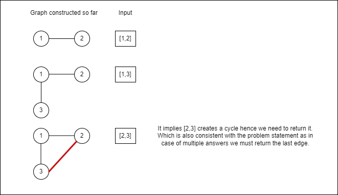

# Python3 | DFS | with clear explanation

**Author:** shib00
**Votes:** 27
**Link:** [https://leetcode.com/problems/redundant-connection/solutions/3876792/](https://leetcode.com/problems/redundant-connection/solutions/3876792/)

---

# Intuition
Redundant edge will always be the one which is responsible for forming a cycle within graph. And we can be ensured that a cycle will be formed because number of edges >= number of nodes. 


Let's consider the input -
[[1,2],[1,3],[2,3]]

Let's form the graph - 


# Pseudo Code
1. keep track of graph constructed so far
2. for each pair of nodes (u,v) provided in input
   - check if path exists between u and v using dfs
   - if it exists it means that adding the current edge will create a cycle hence return (u,v) as answer
   - else add that to graph

# Complexity
- Time complexity:
$$O(n^2)$$ because for each pair of nodes we run dfs.
=> $$O(n)$$ during **for loop** and $$O(n)$$ during **dfs** 

- Space complexity:
$$O(n)$$

# Code
```
def findRedundantConnection(self, edges: List[List[int]]) -> List[int]:
    # variable to keep track of graph constructed so far
    graph_so_far = collections.defaultdict(lambda: [])
    
    # dfs function to check if path exists between nodes u and v
    def path_exists(u, v):
        # we reached to v from u
        if u == v:
            return True

        # mark u as visited
        visited.add(u)

        # iterate through all the neighbors of u and if they are not visited call dfs on them
        for neighbor in graph_so_far[u]:
            if neighbor not in visited:
                if path_exists(neighbor, v):
                    return True
                    
        return False

    # iterate through all the pairs of edges
    for u, v in edges:
        # we make a fresh visited because we call dfs for every pair of edges
        visited = set()
        # if path exists between u and v return that's the answer
        if path_exists(u,v):
            return [u,v]
        else:
            # if path does not exist we add edges to graph
            graph_so_far[u].append(v)
            graph_so_far[v].append(u)

    return None
```