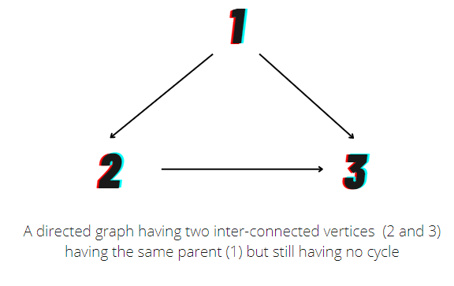
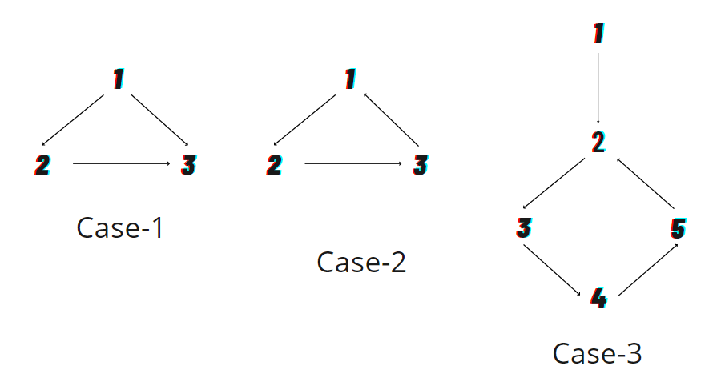

# Explained: Why can I apply DSU to a directional graph?

**Author:** vfvf4002
**Votes:** 24
**Link:** [https://leetcode.com/problems/redundant-connection-ii/solutions/2190590/](https://leetcode.com/problems/redundant-connection-ii/solutions/2190590/)

---

Firstly, I recommend solving [redundant connection 1](https://leetcode.com/problems/redundant-connection/) on leetcode as the approach would be somewhat similar with slight additions to the code.
The two questions are different in the sense that the former question deals with the detection of edges in an
undirected graph which was pretty much a direct application of the DSU algorithm as a cycle would have been
surely present in case of a common parent between any two inter-connected nodes in the graph. But, in this
question, if we try applying DSU directly, we would encounter an issue wherein two nodes would be having the
same parent and would be connected but still won't be forming a cycle (See Diagram).


Now, In this problem, we would basically be facing three cases:
1. When a node has 2 parents
2. When an edge leads to a cycle
3. When there are both dual parents as well as a cycle in the graph.


We can find wether there are 2 parents of a node by counting the inwards-directed arrows for all nodes. If there is more 
than one inward arrow for any vertex, it means there is a dual- parent node. Hence, this states either case 1 or 3 is 
present.
Then, we store both the previous edge and the second edge in different variables and then compare both 1-by-1,
removing one of the parent and checking for a cycle using DSU.

### Now the main question: Why can we apply DSU?
In the problem statement, it is clearly stated that the graph is initially a generic tree and a single additional edge is 
created in the tree. Hence, once we have checked and removed either of the dual parent edges (either of which 
must be the additional edge), we would no longer have a vertex having 2 parents and hence, cases like case-1 
would not be there anymore. Now, we apply simple DSU, ignoring one dual edge at a time, if it is present and then 
checking wether the graph is cyclic anymore.

Code: 
```
class Solution {
    public int[] findRedundantDirectedConnection(int[][] edges) {
        
        int[]inDegree = new int[edges.length+1];        // Case 1: Check for double parents
        Arrays.fill(inDegree, -1);
        
        int bl1 = -1, bl2 = -1;
        
        for(int i=0; i<edges.length; i++){
            int u = edges[i][0];
            int v = edges[i][1];
            
            if(inDegree[v] == -1){
                inDegree[v] = i;
            } else {
                bl1 = i;                        // If double parents exist, we need to find which one of them is unecessary
                bl2 = inDegree[v];              // We store them both in vars and then run DSU on both, ignoring
                                                // one edge at a time and check for correct removal
                break;
            }
        }
        
         // DSU Implementation
        
        int[]parent = new int[edges.length+1];
        int[]rank = new int[edges.length+1];
        
        for(int i=0; i<parent.length; i++) parent[i] = i;
        
        for(int i=0; i<edges.length; i++){
            if(i == bl1) continue;
            
            int[]edge = edges[i];
            boolean bool = union(edge[0], edge[1], parent, rank);
            if(bool){
                if(bl1 == -1){                  // Case 3: Double parents dont exist. Cycle exists.
                    return edge;
                } else{
                    return edges[bl2];          // Case 2: Double parents and cycle both exist
                }
            }
        }
        
        return edges[bl1];
    }
    
    public int find(int x, int[]parent){
        if(x == parent[x]) return x;
        else return find(parent[x], parent);
    }
	
    public boolean union(int s1, int s2, int[]parent, int[]rank){
		int s1lead = find(s1, parent);        // Finding the parent nodes of both the nodes
        int s2lead = find(s2, parent);
        
        if(s1lead != s2lead){
            if(rank[s1lead] > rank[s2lead]){
                parent[s2lead] = s1lead;
            } else if(rank[s2lead] > rank[s1lead]){
                parent[s1lead] = s2lead;
            } else{
                parent[s2lead] = s1lead;
                rank[s1lead]++;
            }
            return false;       // No cycle due to this edge  
        } else return true;     // Indicates that the cycle exists
    }
}
```