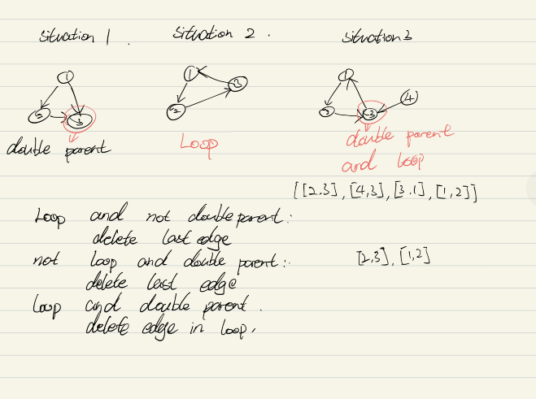

# Python solution with clearn explanation with graph

**Author:** jqmhpj
**Votes:** 11
**Link:** [https://leetcode.com/problems/redundant-connection-ii/solutions/562660/](https://leetcode.com/problems/redundant-connection-ii/solutions/562660/)

---

There are three situations need to be considered. 

1. A node has two parent and no loop in graph
2. No node has two parent and there is a loop in graph
3. A node has two parent and there is a loop in graph

As the image 


As the graph we will find

situation 1:
Find the node which has tow parents
Return the edge between current node and the second parent

situation 2:
The question become Redundant Connection I,  
Return the edge lead loop

situation 3:
As there is a node has two parents and there is a loop in graph, we need find which edges both in loop and is one of the two parents.
renturn the edge in loop and is the parent of doubleParentNode

For this step,I create a new graph by deleting the second parent and check there is a loop or not. If there is no loop in new graph, we return second edge, else return first edge.

Coding:
Now we need check is a node has two parents ? 
using dictionary

Is there is a loop ?
A: using union-find to check 


```
class Solution:
    def findRedundantDirectedConnection(self, edges: List[List[int]]) -> List[int]:
	
        unionList = list(range(len(edges)+1))
        
        def find(x):
            if x == unionList[x]:
                return x
            return find(unionList[x])
        
        def union(x,y):
            if find(x) != find(y):
                unionList[x] = y
         
		#check and saving the last edge in loop
        loop = None
		
		#check parent
        parent = {}
        for i,j in edges:
            parent.setdefault(j,[]).append(i)
            if find(i) == find(j):
                loop = [i,j]
            union(i,j)
			
		
		#get the node which has more than one parent
		doubleParent = [i for i in parent if len(parent[i]) > 1]
        hasDoubleParent = len(doubleParent)
		
        #which situation we are? 
        if not hasDoubleParent and loop:
            return loop
			# simple,return the edge in loop
        elif hasDoubleParent and not loop:
            return [parent[doubleParent[0]][1],doubleParent[0]]
			# easy, return the edge between node with second parent
		else:
			# get first edge and second edge(one of them should be removed)
			firstEdge = [parent[doubleParent[0]][0],doubleParent[0]]
            secondEdge = [parent[doubleParent[0]][1],doubleParent[0]]
			
			#remove second edge and check there is a loop or not
            deleteSecondEdge = edges[:]
            deleteSecondEdge.remove(secondEdge)
            unionList = list(range(len(edges)+1))
            
			
            for i,j in deleteSecondEdge:
                if find(i) == find(j):
				# opps,there is still a loop, we should remove first edge, so return it 
                    return firstEdge
                union(i,j)
			# seems like remove second edge works.
            return secondEdge
