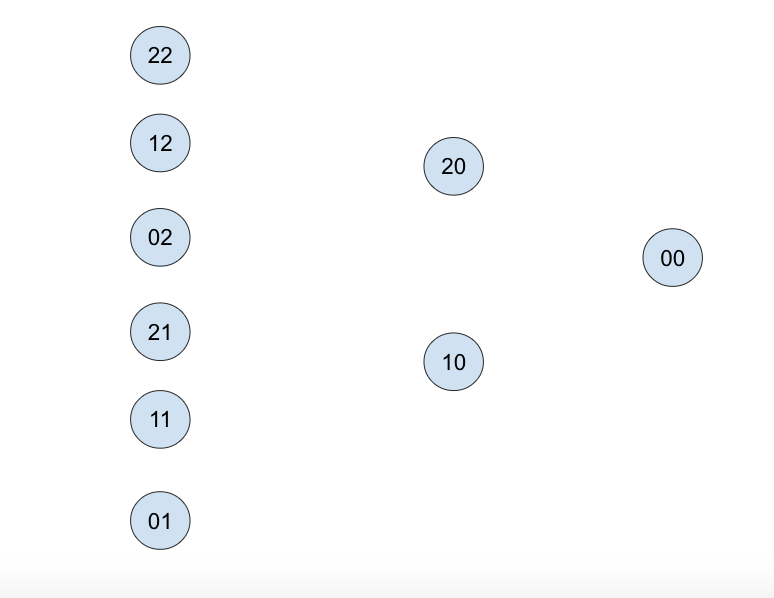
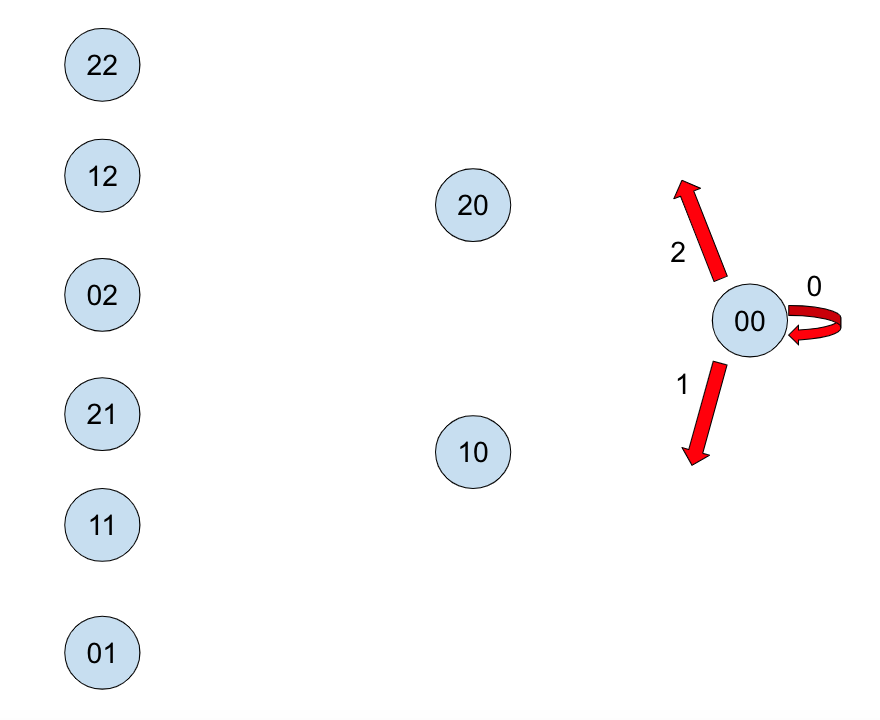
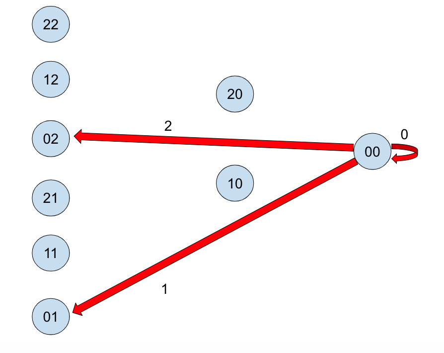
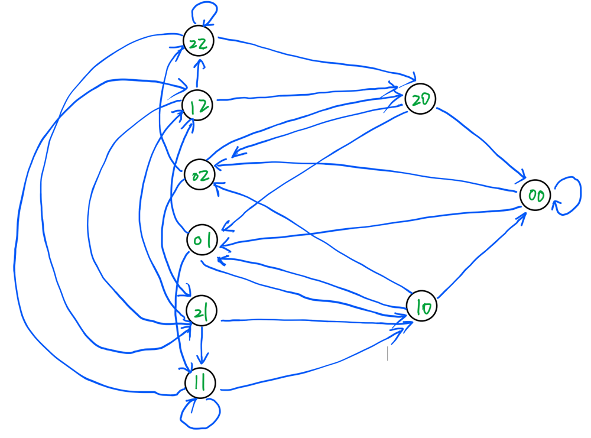
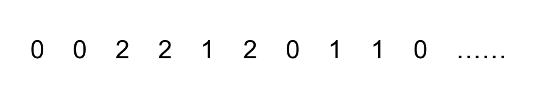
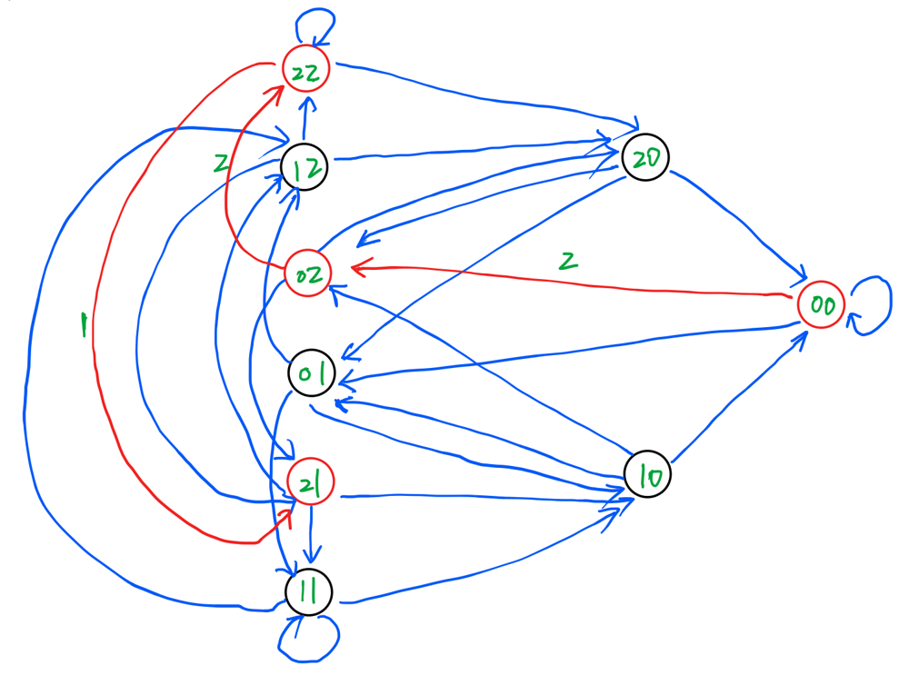
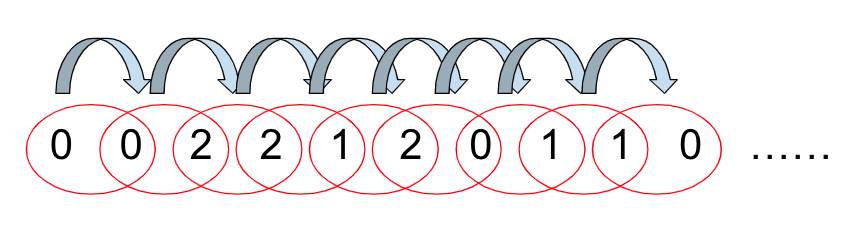
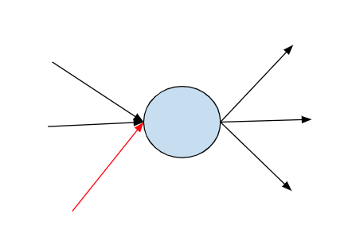
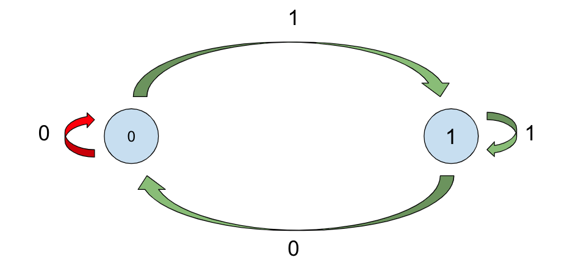

# Python Eulerian Path (Eulerian Trail) Solution

**Author:** Daniel513
**Votes:** 23
**Link:** [https://leetcode.com/problems/cracking-the-safe/solutions/3056844/](https://leetcode.com/problems/cracking-the-safe/solutions/3056844/)

---

# Intuition
The original problem can be formulated as finding the Eulerian Path in a finite connected graph. If you are not familiar with the concept of the Eulerian Path, please read [this Wikipedia page](https://en.wikipedia.org/wiki/Eulerian_path).

Let's say the length of the correct password is `n`, and the possible digits are in the range `[0, k-1]`. If we enumerate all the possible permutations of length `n-1` and model them as vertices, then we get a graph. Let's use a concrete example, let's say `n = 3`, `k = 3`. Then if we draw all the permutations with length `2`, we get the following graph.



Now we add one more digit to the end of these permutations. The available digits are in the range `[0, k-1]`. We model the added digit as an outgoing edge. Let's use the vertex `00` in the above graph as an example. After appending one more digit to this vertex, the graph will look like the following.
 


The formed length `n` permutations are `000, 001, 002`. These three permutations are all the permutations of length `n` with the prefix `00`. We do the same thing to all the other vertices, and then the graph will contain all the possible permutations of length `n` on a size-k alphabet. Each edge represents a distinct permutation. Since there is `k` to the power of `n` permutations, the number of edges in the graph will also be `k^n`. The suffixes of the permutations `000, 001, 002` are `00, 01, 02`. If we treat vertices in the graph as suffixes, then we can connect the vertex `00` to `02` to represent the transformation between two different vertices(suffixes).



Now we connect all the vertices in this way. Then we get a connected graph. Each edge in the graph represents a permutation of length `n`. In the example we used, `n = 3`.



Let's go back to the problem itself. It asks us to find the shortest length of unlocking the safe. Imagine that you are pressing the keyboard and entering a sequence of digits, trying to break the safe. The sequence of digits you used is the following:



The `n` is `3`, and `k` is in the range `[0, 2]`. The first password you tried is `002`, the second is `022`, the third is `221`, and so on. The suffixes of these passwords are `02`, `22`, `21`, and so on. In the graph, it equivalents to you starting from node `00`, passing through `02`, `22`, and arrived at node `21`. The path you have gone through is shown in the following graph.



In fact, you can think of the sequence of digits that you just entered as a flattened graph. Every subsequence of length `n-1` (In this example, `n-1` is `2`.) is a vertex in the graph.



Now the original problem has been completely transformed into a graph traversing problem. To make the sequence as short as possible, we just need to make sure that we traverse the above graph as short as possible. Also, since we also want to make sure the safe can be cracked in the end, we want to make sure we try each possible password of length `n` at least once. Each edge of the above graph represents a distinct password. All edges represent all possible passwords. So we want to traverse each edge at least once. Combining all these, ***we want to find a path in the graph that traverses each edge exactly once.*** If such a path exists, then we have found the shortest sequence of digits, which can surely crack the safe.

The definition of the Eulerian Path is exactly the same: it is a path in a finite graph that visits every edge exactly once. So the problem actually asks us to determine whether there is an Eulerian Path in the above graph. If so, then find it. The Eulerian Theorem tells us: 

* A connected graph has an Euler cycle if and only if every vertex has an even degree.

In the above graph, each vertex has `k` incoming edges and `k` outcoming edges. Therefore each vertex has `2k` connected edges, which means the above graph has an Euler cycle. The Euler cycle is also one kind of Eulerian path. Therefore we know there must be a path that covers each edge exactly once in the above graph. Now the question is: how to find it?

The solution we used is to start from node `00`. At each vertex, we choose the highest possible `k` edge. In the end, we surely go back to node `00,` and the path we have traversed is the answer. Why? How do we prove that we always got all the edge using the algorithm I described above?

First, we can prove that we would never get stuck in any vertex except for the node where we start. In other words, we can prove that starting from any arbitrary vertex in the graph, we will surely be able to go back to this starting node. 

We can use contradiction to prove this. Let's say the node below is where we get stuck, and this node is not the starting node. The incoming red edge is where the stuck occurred.



We are stuck at this node because all the outcoming edges have been used once. As a result, when we traverse into this node by the incoming red edge, there is no way for us to get out of this node. Since each node has the same number of incoming edges and outcoming edges, the number of used outcoming edges is `3`. That means we must also have used `3` incoming different edges before. However, we only have `3` incoming edges in total. That means we only used `2` incoming edges. This is a contradiction. Therefore we proved that we would never get stuck at any node in the middle. We can also prove that the only node we will get stuck in is the node where we started. We can use the same logic above to prove this. The difference between the starting node and the middle node is that we used the outcoming edge first in the starting node. However, for the other node, we used their incoming edge first.

Now we have proved that we would only get stuck at the starting node after we have used all its outcoming and incoming edges. In other words, when the traversal ends, all edges of the starting node have been traversed. Now, if we can prove that all the edges of other nodes have been traversed, we are done. Not all kinds of traversals cover all edges of the graph. See the following example.



In this example, `n = 2` and `k = 2`. If the starting node is the vertex with value `1`, and the algorithm picks the edges from the highest value to the lowest value, then when the traversal ends, there is one edge that has not been traveled - the edge in red in the graph. How do we prove that the traversal used in our algorithm does cover all the edges?

Below is the graph of our previous example.


To remind you, the algorithm we used traverses the graph from the node `00`, and always pick the highest-value untraveled edge to go at each step. As we said before, when the algorithm ends, all the edges of the starting node are traversed. Now we go backward and look at the nodes `20` and `10`. When the algorithm goes from `20` or `10` to the node `00`, all the other edges of these two nodes must have been traversed. The reason is the edges connecting `20` or `10` to the node `00` have the lowest edge value, `0`. According to the algorithm, it means all the outcoming edges with higher values (`2`, `0`) have been traversed. Since one outcoming edge must be paired with one incoming edge, we know that when the algorithm picks the lowest-value outcoming edge, all the edges of this node must have been traversed. Thus, we can conclude that all the edges connected to nodes `20` and `10` have been covered.

We can go backward further and make the same conclusion for the nodes `22`, `12`, `02`, `01`, `21`, and `11`. Specifically, when the length of the password is `n`, starting from the starting node `0...0`, we can go `n-1` layers backward and make the same conclusion for all nodes in these `n-1` layers. The number of nodes in these layers is:

`(k-1) + (k-1)*k + (k-1)*k^2 + ...... + (k-1)*k^(n-2)`

We can simplify this to:

`k^(n-1) - 1`

Adding the starting node, the number of nodes becomes:

`k^(n-1)`

Therefore, up until now, we have proved there are `k^(n-1)` nodes having all connected edges covered. The number of nodes in the graph is also `k^(n-1)`, since the number of permutations of length `n-1` is `k^(n-1)`. That proves all edges of all nodes in the graph have been traversed.

# Code
```
class Solution:
    def crackSafe(self, n: int, k: int) -> str:
        ava_edge = defaultdict(lambda: k-1)
        res = ['0'] * (n-1)
        suffix = ''.join(res)
        while ava_edge[suffix] >= 0:
            res.append(str(ava_edge[suffix]))
            ava_edge[suffix] -= 1
            suffix = ''.join(res[1-n:] if n > 1 else [])
        return ''.join(res)
```

