# Image Explanation🏆- [Both BFS & DFS ways] - C++/Java/Python

**Author:** aryan_0077
**Votes:** 57
**Link:** [https://leetcode.com/problems/is-graph-bipartite/solutions/3540122/](https://leetcode.com/problems/is-graph-bipartite/solutions/3540122/)

---

# Video Solution (`Aryan Mittal`) - Link in LeetCode Profile
`Is Graph Bipartite?` by `Aryan Mittal`


# Approach & Intution
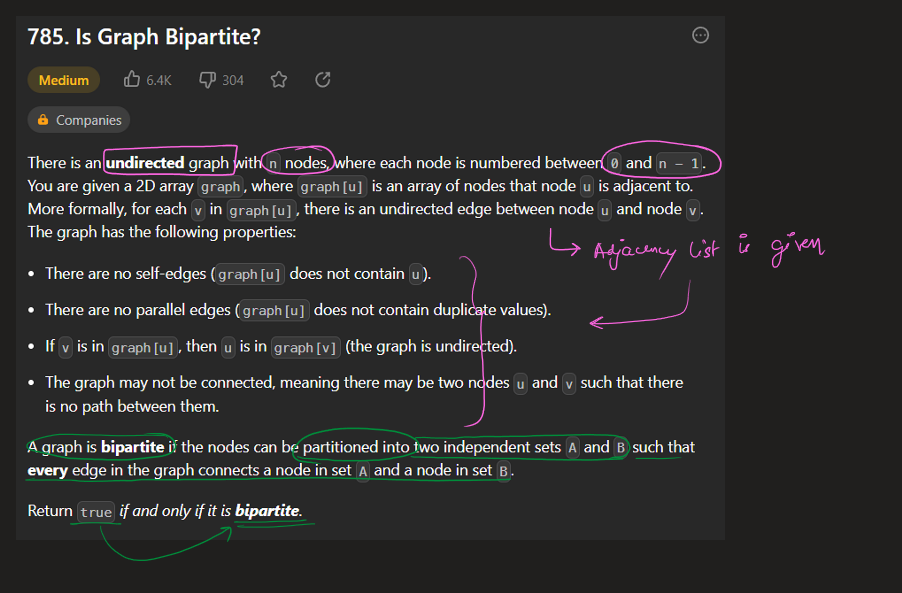
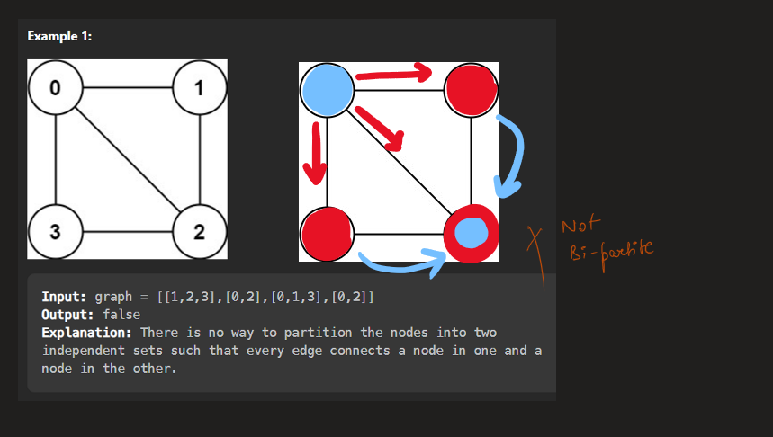
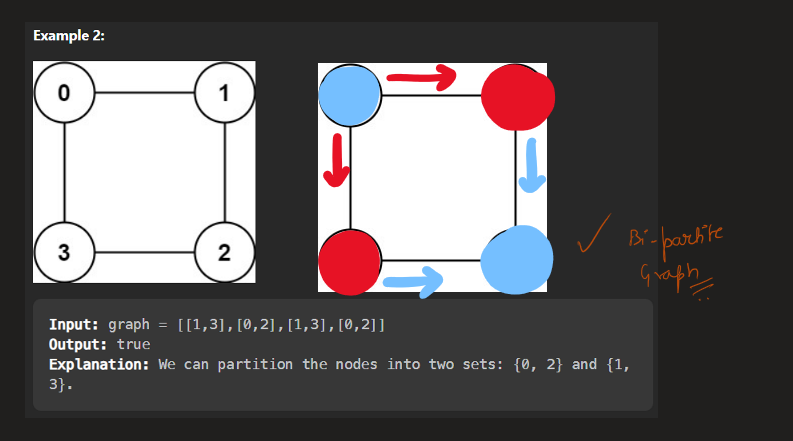
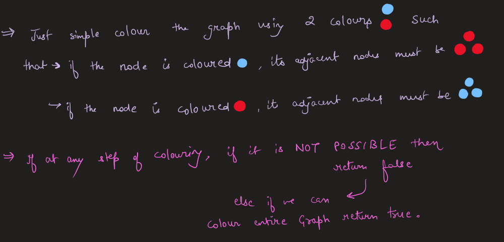
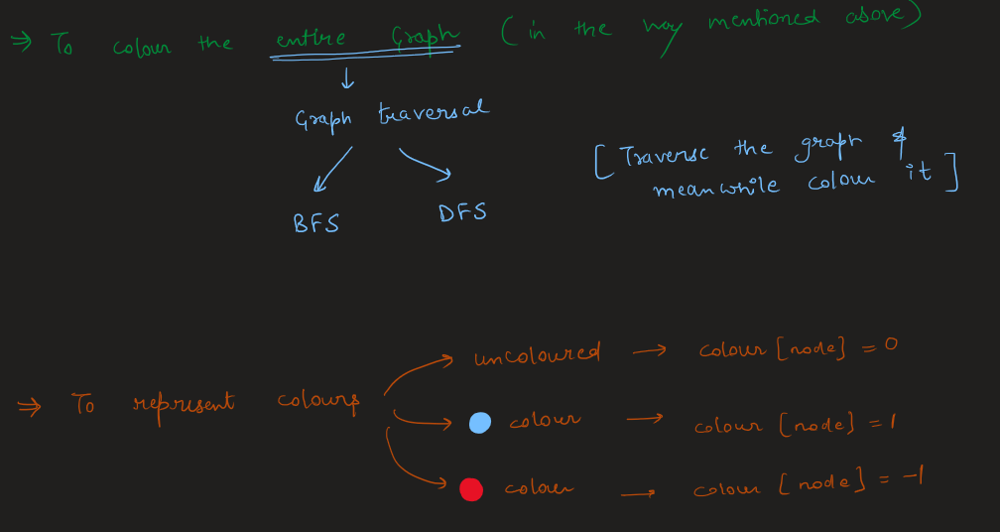
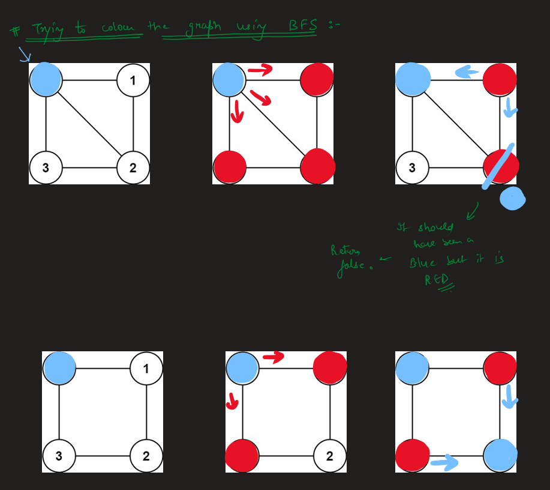
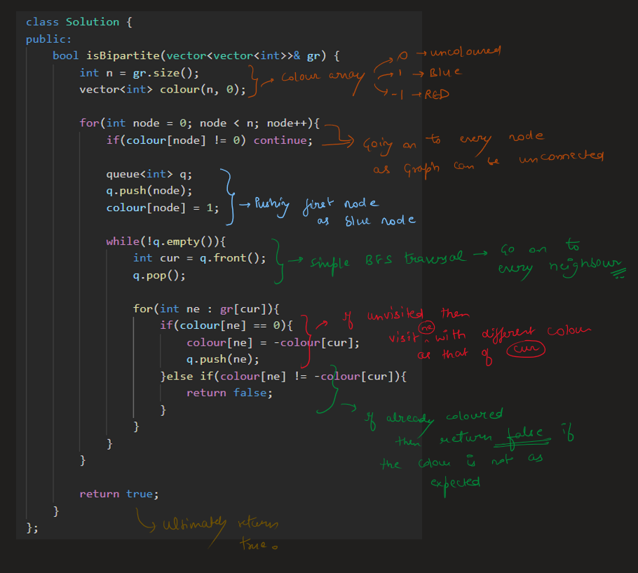
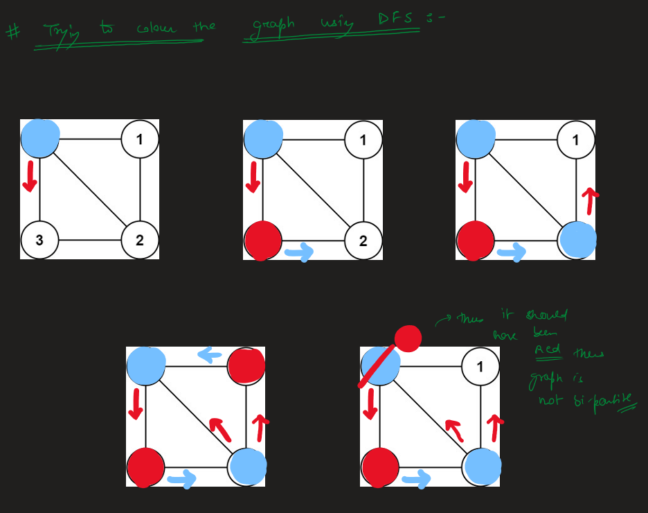
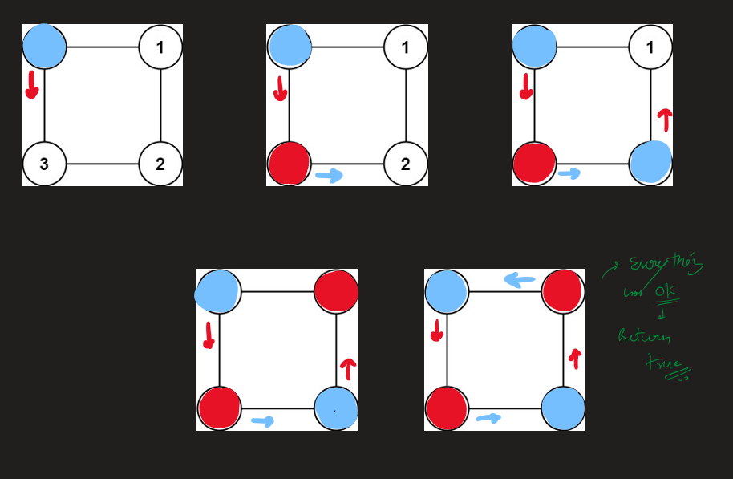
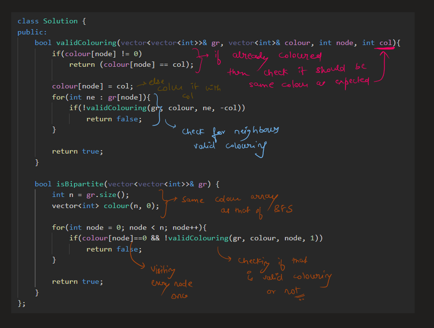
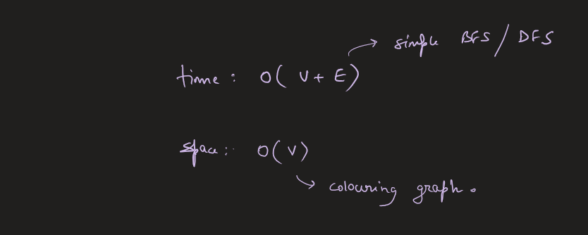


# BFS Code
```C++ []
class Solution {
public:
    bool isBipartite(vector<vector<int>>& gr) {
        int n = gr.size();
        vector<int> colour(n, 0);

        for(int node = 0; node < n; node++){
            if(colour[node] != 0) continue;

            queue<int> q;
            q.push(node);
            colour[node] = 1;

            while(!q.empty()){
                int cur = q.front();
                q.pop();

                for(int ne : gr[cur]){
                    if(colour[ne] == 0){
                        colour[ne] = -colour[cur];
                        q.push(ne);
                    }else if(colour[ne] != -colour[cur]){
                        return false;
                    }
                }
            }
        }

        return true;
    }
};
```
```Java []
import java.util.ArrayDeque;
import java.util.Queue;

class Solution {
    public boolean isBipartite(int[][] gr) {
        int n = gr.length;
        int[] colour = new int[n];

        for (int node = 0; node < n; node++) {
            if (colour[node] != 0) {
                continue;
            }

            Queue<Integer> q = new ArrayDeque<>();
            q.add(node);
            colour[node] = 1;

            while (!q.isEmpty()) {
                int cur = q.poll();

                for (int ne : gr[cur]) {
                    if (colour[ne] == 0) {
                        colour[ne] = -colour[cur];
                        q.add(ne);
                    } else if (colour[ne] != -colour[cur]) {
                        return false;
                    }
                }
            }
        }

        return true;
    }
}
```
```Python []
from typing import List
from collections import deque

class Solution:
    def isBipartite(self, gr: List[List[int]]) -> bool:
        n = len(gr)
        colour = [0] * n

        for node in range(n):
            if colour[node] != 0:
                continue

            q = deque()
            q.append(node)
            colour[node] = 1

            while q:
                cur = q.popleft()

                for ne in gr[cur]:
                    if colour[ne] == 0:
                        colour[ne] = -colour[cur]
                        q.append(ne)
                    elif colour[ne] != -colour[cur]:
                        return False

        return True
```

# DFS Code
```C++ []
class Solution {
public:
    bool validColouring(vector<vector<int>>& gr, vector<int>& colour, int node, int col){
        if(colour[node] != 0)
            return (colour[node] == col);

        colour[node] = col;
        for(int ne : gr[node]){
            if(!validColouring(gr, colour, ne, -col))
                return false;
        }

        return true;
    }

    bool isBipartite(vector<vector<int>>& gr) {
        int n = gr.size();
        vector<int> colour(n, 0);

        for(int node = 0; node < n; node++){
            if(colour[node]==0 && !validColouring(gr, colour, node, 1))
                return false;
        }

        return true;
    }
};
```
```Java []
class Solution {
    public boolean validColouring(int[][] gr, int[] colour, int node, int col) {
        if (colour[node] != 0)
            return colour[node] == col;

        colour[node] = col;
        for (int ne : gr[node]) {
            if (!validColouring(gr, colour, ne, -col))
                return false;
        }

        return true;
    }

    public boolean isBipartite(int[][] gr) {
        int n = gr.length;
        int[] colour = new int[n];

        for (int node = 0; node < n; node++) {
            if (colour[node] == 0 && !validColouring(gr, colour, node, 1))
                return false;
        }

        return true;
    }
}
```
```Python []
class Solution:
    def validColouring(self, gr, colour, node, col):
        if colour[node] != 0:
            return colour[node] == col

        colour[node] = col
        for ne in gr[node]:
            if not self.validColouring(gr, colour, ne, -col):
                return False

        return True

    def isBipartite(self, gr):
        n = len(gr)
        colour = [0] * n

        for node in range(n):
            if colour[node] == 0 and not self.validColouring(gr, colour, node, 1):
                return False

        return True
```