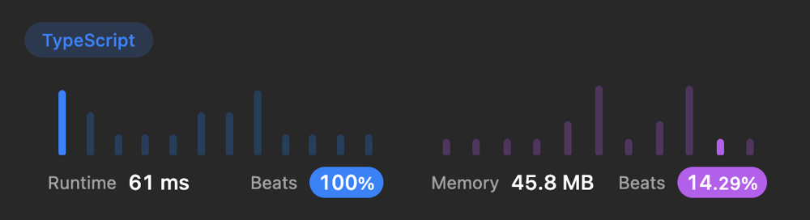

# 🚀 61ms, 100% Beats Runtime. TypeScript, JavaScript

**Author:** ArtMe
**Votes:** 2
**Link:** [https://leetcode.com/problems/is-graph-bipartite/solutions/3541290/](https://leetcode.com/problems/is-graph-bipartite/solutions/3541290/)

---

# Code
``` typescript []
function dfs(graph: number[][], node: number, colors: number[], color: number): boolean {
  colors[node] = color;
  for (const neighbor of graph[node]) {
    if (colors[neighbor] === color) {
      return false;
    }
    if (!colors[neighbor]) {
      if (!dfs(graph, neighbor, colors, -color)) {
        return false;
      }
    }
  }
  return true;
}

function isBipartite(graph: number[][]): boolean {
  const n = graph.length;
  const colors: number[] = new Array(n).fill(0);  
  for (let i = 0; i < n; i++) {
    if (!colors[i]) {
      if (!dfs(graph, i, colors, 1)) {
        return false;
      }
    }
  }
  return true;
}
```
``` javascript []
function dfs(graph, node, colors, color) {
  colors[node] = color;
  for (const neighbor of graph[node]) {
    if (colors[neighbor] === color) {
      return false;
    }
    if (!colors[neighbor]) {
      if (!dfs(graph, neighbor, colors, -color)) {
        return false;
      }
    }
  }
  return true;
}

isBipartite = function(graph) {
  const n = graph.length;
  const colors = new Array(n).fill(0);  
  for (let i = 0; i < n; i++) {
    if (!colors[i]) {
      if (!dfs(graph, i, colors, 1)) {
        return false;
      }
    }
  }
  return true;
}
```

