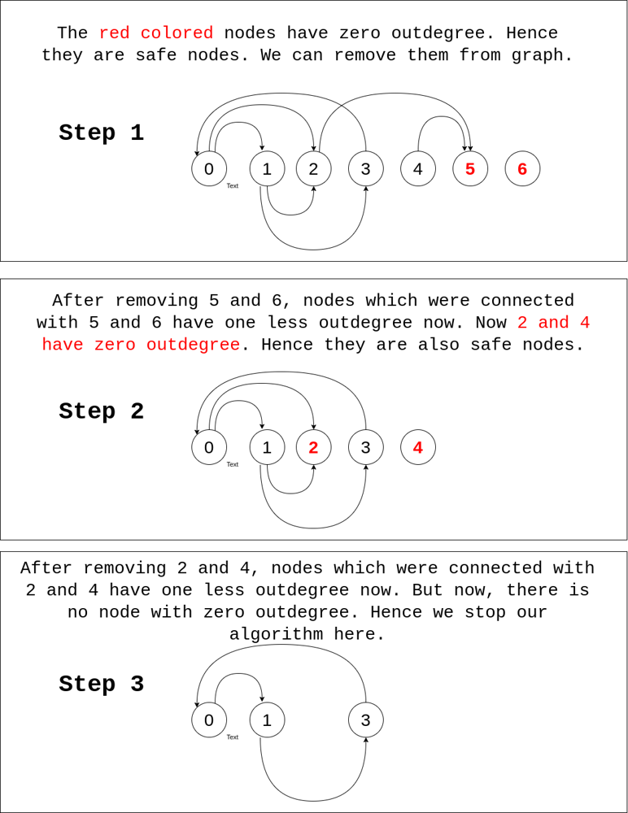

# C++ | Topological Sort | Diagram

**Author:** kiranpalsingh1806
**Votes:** 183
**Link:** [https://leetcode.com/problems/find-eventual-safe-states/solutions/2600013/](https://leetcode.com/problems/find-eventual-safe-states/solutions/2600013/)

---

<details>

<summary> Approach </summary>

- We will use **Topological Sort** in this problem.
- We will take use **queue** and **store all the nodes with zero outdegree in it**.
- The nodes with **zero outdegree are our safe nodes**. Hence, we include it in our answer.
- We we **remove nodes with zero outdegree from graph**, all the nodes which we connected to that node, their outdegree also decreases by one.
- In last, if no node with outdegree zero is left, we stop our process.
</details>



```cpp
vector<int> eventualSafeNodes(vector<vector<int>>& G) {
    int N = G.size();
    vector<vector<int>> R(N);
    vector<int> outdegree(N), safe(N), ans;
    queue<int> q;
    for (int i = 0; i < N; ++i) {
        for (int v : G[i]) {
            R[v].push_back(i);
        }
        outdegree[i] = G[i].size();
        if (outdegree[i] == 0) q.push(i);
    }
    while (q.size()) {
        int u = q.front();
        q.pop();
        safe[u] = 1;
        for (int v : R[u]) {
            if (--outdegree[v] == 0) q.push(v);
        }
    }
    for (int i = 0; i < N; ++i) {
        if (safe[i]) ans.push_back(i);
    }
    return ans;
}
```