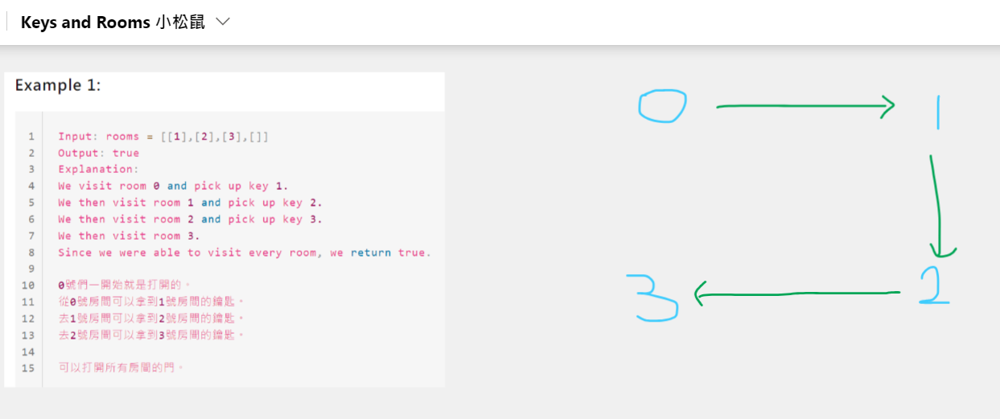
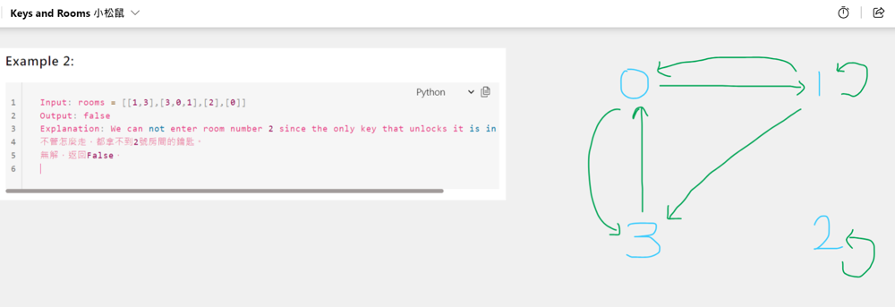

# Python/Go O(V+E) by simple DFS // BFS [w/ Visualization] 有中文解題文章

**Author:** brianchiang_tw
**Votes:** 6
**Link:** [https://leetcode.com/problems/keys-and-rooms/solutions/1117268/](https://leetcode.com/problems/keys-and-rooms/solutions/1117268/)

---

[\u4E2D\u6587\u89E3\u984C\u6587\u7AE0](https://vocus.cc/article/65b4a95bfd89780001df1b69)

Python O(V+E) by simple DFS // BFS

V (Vertice): number of rooms
E (Directed egde): number of keys

---
# Visualization


---




---

**Implementation**:

Python:

DFS
```
class Solution:
    def canVisitAllRooms(self, rooms: List[List[int]]) -> bool:
		
		# a set to record visited rooms
        visited = set()
        
        # --------------------------------
        def dfs( cur_room ):
            
            if cur_room in visited:
			
				# base case aslo known as stop condition
                return
            
			# mark current room as visited
            visited.add( cur_room )
            
			# general case:
            for next_room in rooms[cur_room]:
				
				# Visit next room in DFS
                dfs( next_room )
            
            return
        # --------------------------------
        
		# Launch DFS at room_#0
        dfs(cur_room = 0)
        
		# Return true if all rooms are visited
        return len(visited) == len(rooms)
```

---
BFS

```
class Solution:
    def canVisitAllRooms(self, rooms: List[List[int]]) -> bool:
        
        seen = set([0])
        bfs_q = deque([0])

        while bfs_q:
            cur = bfs_q.popleft()

            for next_room in rooms[cur]:
                if next_room not in seen:
                    seen.add( next_room )
                    bfs_q.append( next_room )
        
        return len(rooms) == len(seen)
```

---

Go:

```
func canVisitAllRooms(rooms [][]int) bool {
    
	// a map (so-called dictionary) to record visited rooms
	// Note: golang has no native set, so here we use map as alternative plan.
    visited := make( map[int]bool)
    
	// ------------------------------------------
    var dfs func( curRoom int )
    
    dfs = func( curRoom int){
        
        if _, exist:= visited[curRoom]; exist{
            
            // base case also known as stop condition
            return
        }
        
		// mark current room as visited
        visited[curRoom] = true
        
		// general case:
        for _, nextRoom := range rooms[curRoom]{
			
			// Visit next room in DFS
            dfs( nextRoom )
        }
        return
    }
	
    // ------------------------------------------
	
	// Launch DFS at room_#0
    dfs( 0 )
    
	// Return true if all rooms are visited
    return len(visited) == len(rooms)
    
}
```