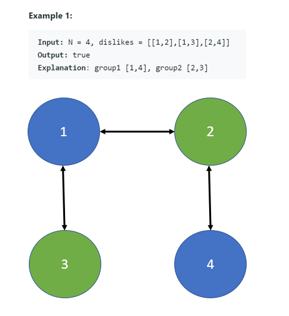
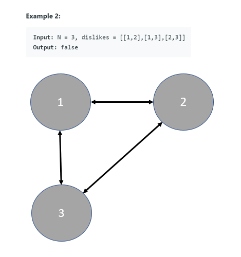
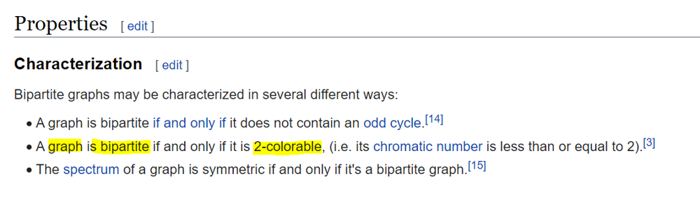

# Python/C++/Java O(n) by DFS and coloring. [w/ Graph]

**Author:** brianchiang_tw
**Votes:** 258
**Link:** [https://leetcode.com/problems/possible-bipartition/solutions/654955/](https://leetcode.com/problems/possible-bipartition/solutions/654955/)

---

Sol by DFS and coloring.

---

**Hint**:

Think of **graph**, **node coloring**, and **DFS**.

Abstract model transformation:

**Person** <-> **Node**

P1 **dislikes P2** <-> Node 1 and Node 2 **share one edge**, and they should be **drawed with different two colors** (i.e., for dislike relation)


If we can **draw each dislike pair** with **different two colors**, and **keep the dislike relationship always**, then there exists at least one possible **bipartition**.

---

**Illustration** and **Visualization**:



---




---

**Implementation** by DFS and coloring:

**Special thanks to @ezpzm9's contribution** in discussion.

```python []
class Solution:
    def possibleBipartition(self, N: int, dislikes: List[List[int]]) -> bool:
        
        # Constant defined for color drawing to person
        BLUE, GREEN = 1, -1
        # -------------------------------------
        
        def draw( person_id, color ):
            
            # Draw person_id as color
            color_of[person_id] = color
            
            # Draw the_other, with opposite color, in dislike table of current person_id
            for the_other in dislike_table[ person_id ]:
   
                if color_of[the_other] == color:
                    # the_other has the same color of current person_id
                    # Reject due to breaking the relationship of dislike
                    return False

                if (not color_of[the_other]) and (not draw( the_other, -color)):
                    # Other people can not be colored with two different colors. 
					# Therefore, it is impossible to keep dis-like relationship with bipartition.
                    return False
                    
            return True
        
        
        # ------------------------------------------------
		
		
        if N == 1 or not dislikes:
            # Quick response for simple cases
            return True
        
        # each person maintain a list of dislike
        dislike_table = defaultdict( list )
        
        # key: person ID
        # value: color of person
        color_of = defaultdict(int)
        
        for p1, p2 in dislikes:
            
            # P1 dislikes P2
            # P1 and P2 should be painted with two different color
            dislike_table[p1].append( p2 )
            dislike_table[p2].append( p1 )
            
        
        # Try to draw dislike pair with different colors in DFS
        for person_id in range(1, N+1):
            
            if (not color_of[person_id])  and (not draw( person_id, BLUE)):
                # Other people can not be colored with two different colors. 
				# Therefore, it is impossible to keep dis-like relationship with bipartition.
                return False 
        
        return True
```
```C++ []
class Solution {
public:
    bool possibleBipartition(int n, vector<vector<int>>& dislikes) {
        
        enum COLOR_CONSTANT{
            GREEN = -1,         // -1
            NOT_COLORDED,       // 0
            BLUE                // 1
        };
        
        
        if( n == 1 || dislikes.size() == 0 ){
            
            // Quick response for simple cases
            return true;
        }
        
        // each person maintains a list of dislike
        unordered_map< int, vector<int> > dislikeTable;
        
        // key: personID
        // value: color of person
        unordered_map< int, int> colorTable;
        
        // -----------------------
        
        std::function< bool( int, int ) > helper;
        helper = [&]( int personID, int color)->bool{
            
            // Draw personID as color
            colorTable[personID] = color;
            
            // Draw theOther, with opposite color, in dislike table of current personID
            for( const int& theOther : dislikeTable[ personID ] ){
                
                if( colorTable[theOther] == color ){
                    // the_other has the same color of current person_id
                    // Reject due to breaking the relationship of dislike
                    return false;
                }
                
                if( colorTable[theOther] == NOT_COLORDED && ( !helper(theOther, -color) ) ){
                    // Other people can not be colored with two different colors. 
                    // Therefore, it is impossible to keep dis-like relationship with bipartition.
                    return false;
                }
            }
            
            return true;
            
        };
        
        // -----------------------
        
        
        // update dislike table
        for( const auto& relation : dislikes ){
            
            int p1 = relation[0], p2 = relation[1];
            
            dislikeTable[p1].emplace_back( p2 );
            dislikeTable[p2].emplace_back( p1 );
            
        }
        
        // Try to draw dislike pair with different color in DFS
        for( int personID = 1 ; personID <= n ; personID++){
            
            if( colorTable[personID] == NOT_COLORDED && ( !helper(personID, BLUE) ) ){
                    // Other people can not be colored with two different colors. 
				    // Therefore, it is impossible to keep dis-like relationship with bipartition.
                    return false;
            }
        }
        

        return true;        
    }
};
```
```Java []
class Solution {
    public boolean possibleBipartition(int N, int[][] dislikes) {        
        List<Integer>[] graph = new List[N + 1];  

        for (int i = 1; i <= N; ++i) graph[i] = new ArrayList<>();        

        for (int[] dislike : dislikes) {
            graph[dislike[0]].add(dislike[1]);
            graph[dislike[1]].add(dislike[0]);
        }

        Integer[] colors = new Integer[N + 1];

        for (int i = 1; i <= N; ++i) {
            // If the connected component that node i belongs to hasn't been colored yet then try coloring it.
            if (colors[i] == null && !dfs(graph, colors, i, 1)) return false;
        }
        return true;   
    }

    private boolean dfs(List<Integer>[] graph, Integer[] colors, int currNode, int currColor) {
        colors[currNode] = currColor;

        // Color all uncolored adjacent nodes.
        for (Integer adjacentNode : graph[currNode]) {

            if (colors[adjacentNode] == null) {
                if (!dfs(graph, colors, adjacentNode, currColor * -1)) return false;     

            } else if (colors[adjacentNode] == currColor) {
                return false;                                     
            }
        }
        return true;        
    }
}
```

---

Share equivalent BFS implementation

```
class Solution:
    def possibleBipartition(self, N: int, dislikes: List[List[int]]) -> bool:
        
        # Constant defined for color drawing to person
        BLUE, GREEN = 1, -1
        # -------------------------------------

        # Update dislike relationship, either a dislikes b, or b dislikes a        
        dislike = defaultdict(list)
        for a, b in dislikes:
            dislike[a].append(b)
            dislike[b].append(a)
        
        # Color map of each person
        color_of = dict()

        for person in range(1, N+1):
            
            # If this person has been draw, just skip
            if person in color_of: continue
            
            # Without the loss of generality, start drawing from BLUE        
            # (It can be GREEN if you like)
            color_of[person] = BLUE
            bfs_queue = deque([(person, BLUE)])

            while bfs_queue:

                cur, color = bfs_queue.popleft()
                for enemy in dislike[cur]:
                    
                    if enemy not in color_of:
                        # Draw enemy with opposite color
                        color_of[enemy] = -1*color
                        bfs_queue.append( (enemy, color_of[enemy]) )

                    elif color_of[enemy] == color:
                        # If enemy and me have same color, woops, it is impossible to being bipartite
                        return False
                    
        return True
```

---

Supplement material:



---

Reference:

[1] [Wiki: Bipartite graph](https://en.wikipedia.org/wiki/Bipartite_graph)