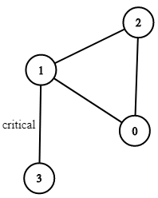

# [1192. Critical Connections in a Network](https://leetcode.com/problems/critical-connections-in-a-network/)

| Category | Difficulty | Likes | Dislikes |
| :------: | :--------: | :---: | :------: |
| Algorithms | Hard | 6635 | 192 |

**Tags:** [`depth-first-search`](https://leetcode.com/tag/depth-first-search), [`graph`](https://leetcode.com/tag/graph), [`biconnected-component`](https://leetcode.com/tag/biconnected-component)

**Companies:** `amazon`, `flipkart`, `microsoft`, `google`, `bloomberg`

## Description

There are `n` servers numbered from `0` to `n - 1` connected by undirected server-to-server `connections` forming a network where `connections[i] = [a_i, b_i]` represents a connection between servers `a_i` and `b_i`. Any server can reach other servers directly or indirectly through the network.

A *critical connection* is a connection that, if removed, will make some servers unable to reach some other server.

Return all critical connections in the network in any order.

 

**Example 1:**


```

Input: n = 4, connections = [[0,1],[1,2],[2,0],[1,3]]
Output: [[1,3]]
Explanation: [[3,1]] is also accepted.

```

**Example 2:**

```

Input: n = 2, connections = [[0,1]]
Output: [[0,1]]

```

 

**Constraints:**

	- `2 <= n <= 10^5`

	- `n - 1 <= connections.length <= 10^5`

	- `0 <= a_i, b_i <= n - 1`

	- `a_i != b_i`

	- There are no repeated connections.

---

**Links:** [Submissions](https://leetcode.com/problems/critical-connections-in-a-network/) | [Solutions](https://leetcode.com/problems/critical-connections-in-a-network/)
