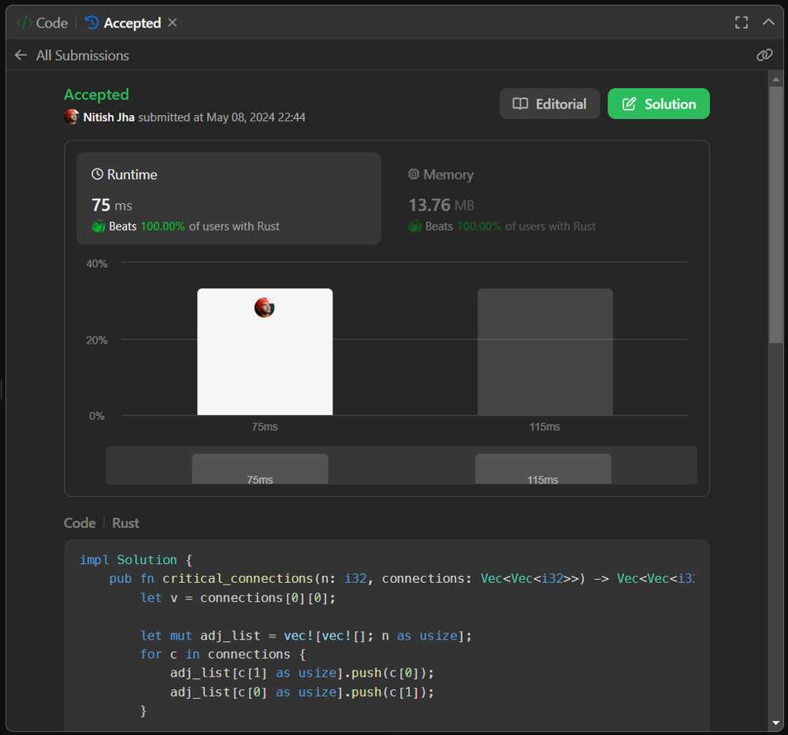

# Rust beats 100%

**Author:** deleted_user
**Votes:** 5
**Link:** [https://leetcode.com/problems/critical-connections-in-a-network/solutions/5188749/](https://leetcode.com/problems/critical-connections-in-a-network/solutions/5188749/)

---

Rust beats 100%


# Code
```
impl Solution {
    pub fn critical_connections(n: i32, connections: Vec<Vec<i32>>) -> Vec<Vec<i32>> {
        let v = connections[0][0];

        let mut adj_list = vec![vec![]; n as usize];
        for c in connections {
            adj_list[c[1] as usize].push(c[0]);
            adj_list[c[0] as usize].push(c[1]);
        }

        let mut rez = vec![];
        Self::dfs(
            v,
            &mut vec![0; n as usize],
            &mut adj_list,
            &mut rez,
        );
        rez
    }

    fn dfs(
        v: i32,
        visited: &mut Vec<u32>,
        adj_list: &mut Vec<Vec<i32>>,
        rez: &mut Vec<Vec<i32>>,
    ) -> u32 {
        let mut total_collisions = 0;

        visited[v as usize] = 1;
        for u in std::mem::take(&mut adj_list[v as usize]) {
            if visited[u as usize] != 0 {
                visited[u as usize] += 1;
                total_collisions += 1;
                continue;
            }
            let collisions = Self::dfs(u, visited, adj_list, rez);
            if collisions == 1 {
                rez.push(vec![v, u]);
            }
            total_collisions += collisions + 1 - visited[v as usize];
            visited[v as usize] = 1;
        }
        visited[v as usize] = 0;
        total_collisions
    }
}
```