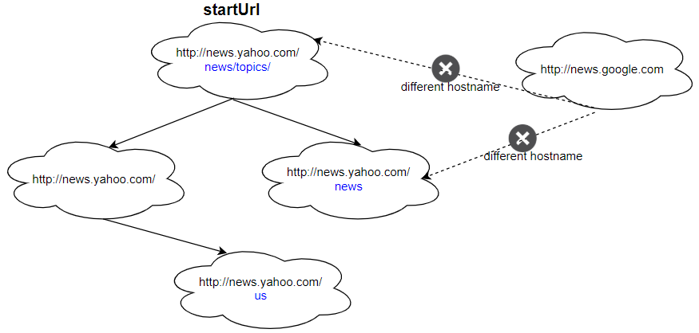

# [1242. Web Crawler Multithreaded](https://leetcode.com/problems/web-crawler-multithreaded/)

| Category | Difficulty | Likes | Dislikes |
| :------: | :--------: | :---: | :------: |
| Concurrency | Medium | 583 | 100 |

**Tags:** [`depth-first-search`](https://leetcode.com/tag/depth-first-search), [`breadth-first-search`](https://leetcode.com/tag/breadth-first-search), [`concurrency`](https://leetcode.com/tag/concurrency)

**Companies:** `rubrik`, `snowflake`, `mongodb`, `apple`, `openai`, `dropbox`, `facebook`

## Description

Given a URL `startUrl` and an interface `HtmlParser`, implement **a Multi-threaded web crawler** to crawl all links that are under the **same hostname** as `startUrl`.

Return all URLs obtained by your web crawler in **any** order.

Your crawler should:

	- Start from the page: `startUrl`

	- Call `HtmlParser.getUrls(url)` to get all URLs from a webpage of a given URL.

	- Do not crawl the same link twice.

	- Explore only the links that are under the **same hostname** as `startUrl`.


As shown in the example URL above, the hostname is `example.org`. For simplicity's sake, you may assume all URLs use **HTTP protocol** without any **port** specified. For example, the URLs `http://leetcode.com/problems` and `http://leetcode.com/contest` are under the same hostname, while URLs `http://example.org/test` and `http://example.com/abc` are not under the same hostname.

The `HtmlParser` interface is defined as such:

```

interface HtmlParser {
  // Return a list of all urls from a webpage of given url.
  // This is a blocking call, that means it will do HTTP request and return when this request is finished.
  public List&lt;String&gt; getUrls(String url);
}

```

Note that `getUrls(String url)` simulates performing an HTTP request. You can treat it as a blocking function call that waits for an HTTP request to finish. It is guaranteed that `getUrls(String url)` will return the URLs within **15ms. ** Single-threaded solutions will exceed the time limit so, can your multi-threaded web crawler do better?

Below are two examples explaining the functionality of the problem. For custom testing purposes, you'll have three variables `urls`, `edges` and `startUrl`. Notice that you will only have access to `startUrl` in your code, while `urls` and `edges` are not directly accessible to you in code.

 

**Example 1:**



```

Input:
urls = [
&nbsp; &quot;http://news.yahoo.com&quot;,
&nbsp; &quot;http://news.yahoo.com/news&quot;,
&nbsp; &quot;http://news.yahoo.com/news/topics/&quot;,
&nbsp; &quot;http://news.google.com&quot;,
&nbsp; &quot;http://news.yahoo.com/us&quot;
]
edges = [[2,0],[2,1],[3,2],[3,1],[0,4]]
startUrl = &quot;http://news.yahoo.com/news/topics/&quot;
Output: [
&nbsp; &quot;http://news.yahoo.com&quot;,
&nbsp; &quot;http://news.yahoo.com/news&quot;,
&nbsp; &quot;http://news.yahoo.com/news/topics/&quot;,
&nbsp; &quot;http://news.yahoo.com/us&quot;
]

```

**Example 2:**

****

```

Input: 
urls = [
&nbsp; &quot;http://news.yahoo.com&quot;,
&nbsp; &quot;http://news.yahoo.com/news&quot;,
&nbsp; &quot;http://news.yahoo.com/news/topics/&quot;,
&nbsp; &quot;http://news.google.com&quot;
]
edges = [[0,2],[2,1],[3,2],[3,1],[3,0]]
startUrl = &quot;http://news.google.com&quot;
Output: [&quot;http://news.google.com&quot;]
Explanation: The startUrl links to all other pages that do not share the same hostname.
```

 

**Constraints:**

	- `1 https://en.wikipedia.org/wiki/Hostname#Restrictions_on_valid_hostnames

	- You may assume there're no duplicates in the URL library.

 

**Follow up:**

	- Assume we have 10,000 nodes and 1 billion URLs to crawl. We will deploy the same software onto each node. The software can know about all the nodes. We have to minimize communication between machines and make sure each node does equal amount of work. How would your web crawler design change?

	- What if one node fails or does not work?

	- How do you know when the crawler is done?

---

**Links:** [Submissions](https://leetcode.com/problems/web-crawler-multithreaded/) | [Solutions](https://leetcode.com/problems/web-crawler-multithreaded/)
