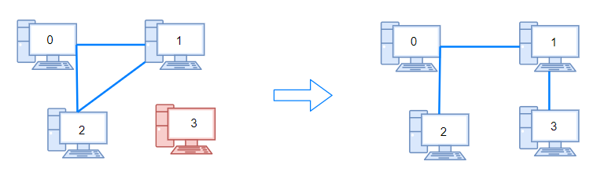
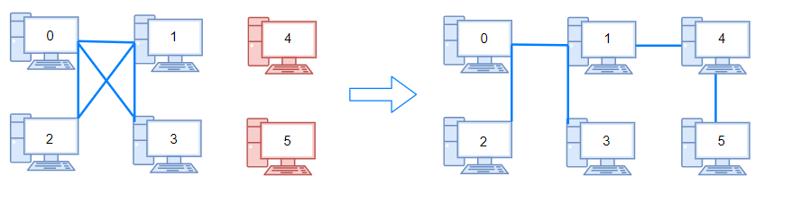

# [1319. Number of Operations to Make Network Connected](https://leetcode.com/problems/number-of-operations-to-make-network-connected/)

| Category | Difficulty | Likes | Dislikes |
| :------: | :--------: | :---: | :------: |
| Algorithms | Medium | 5511 | 83 |

**Tags:** [`depth-first-search`](https://leetcode.com/tag/depth-first-search), [`breadth-first-search`](https://leetcode.com/tag/breadth-first-search), [`union-find`](https://leetcode.com/tag/union-find), [`graph`](https://leetcode.com/tag/graph)

**Companies:** `ibm`, `amazon`, `phonepe`, `salesforce`, `facebook`, `google`, `akuna-capital`

## Description

There are `n` computers numbered from `0` to `n - 1` connected by ethernet cables `connections` forming a network where `connections[i] = [a_i, b_i]` represents a connection between computers `a_i` and `b_i`. Any computer can reach any other computer directly or indirectly through the network.

You are given an initial computer network `connections`. You can extract certain cables between two directly connected computers, and place them between any pair of disconnected computers to make them directly connected.

Return *the minimum number of times you need to do this in order to make all the computers connected*. If it is not possible, return `-1`.

 

**Example 1:**


```

Input: n = 4, connections = [[0,1],[0,2],[1,2]]
Output: 1
Explanation: Remove cable between computer 1 and 2 and place between computers 1 and 3.

```

**Example 2:**


```

Input: n = 6, connections = [[0,1],[0,2],[0,3],[1,2],[1,3]]
Output: 2

```

**Example 3:**

```

Input: n = 6, connections = [[0,1],[0,2],[0,3],[1,2]]
Output: -1
Explanation: There are not enough cables.

```

 

**Constraints:**

	- `1 <= n <= 10^5`

	- `1 <= connections.length <= min(n * (n - 1) / 2, 10^5)`

	- `connections[i].length == 2`

	- `0 <= a_i, b_i < n`

	- `a_i != b_i`

	- There are no repeated connections.

	- No two computers are connected by more than one cable.

---

**Links:** [Submissions](https://leetcode.com/problems/number-of-operations-to-make-network-connected/) | [Solutions](https://leetcode.com/problems/number-of-operations-to-make-network-connected/)
