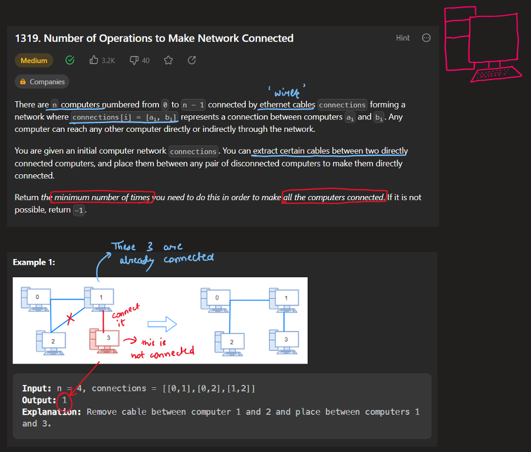
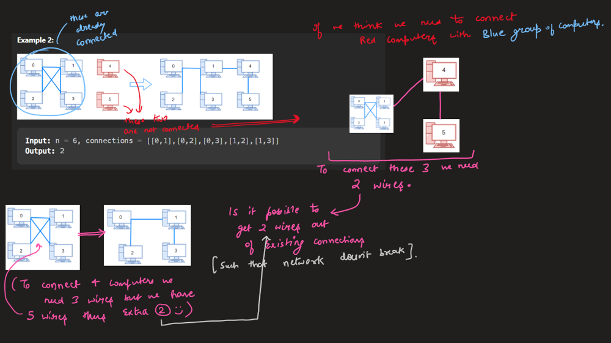
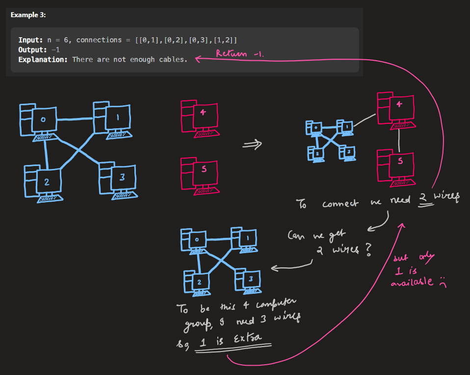
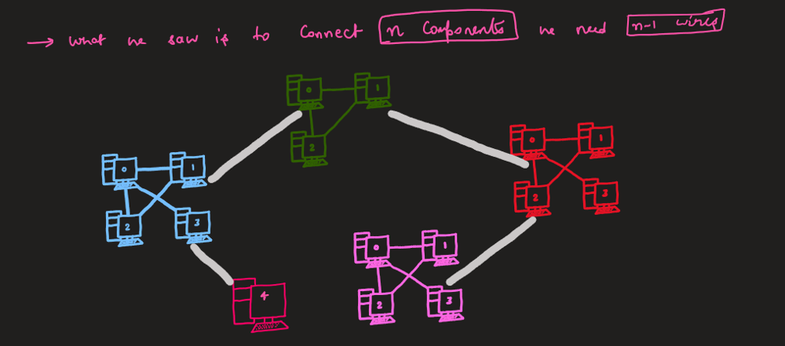
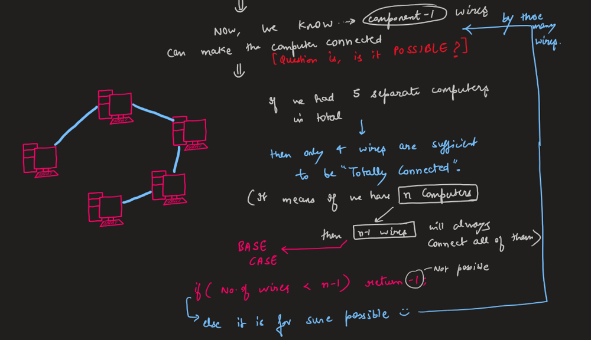
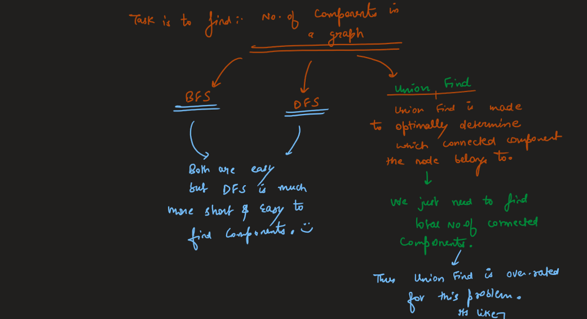
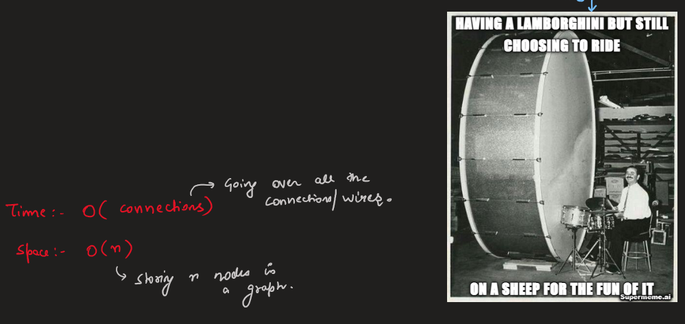
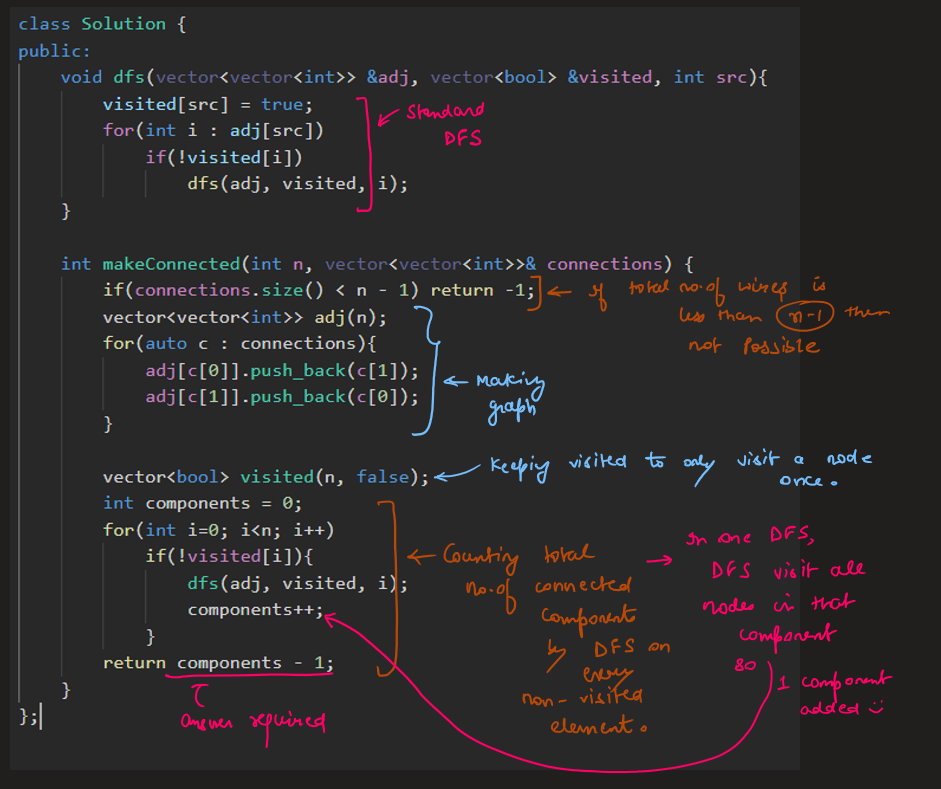

# Image Explanation🏆- [Easiest DFS] - C++/Java/Python

**Author:** aryan_0077
**Votes:** 41
**Link:** [https://leetcode.com/problems/number-of-operations-to-make-network-connected/solutions/3330446/](https://leetcode.com/problems/number-of-operations-to-make-network-connected/solutions/3330446/)

---

# Video Solution
`Number of Operations to Make Network Connected by Aryan Mittal`


# Approach & Intuition





Although the same problem of finding number of component can be solved by `BFS`, `DFS` & also with help of `Union Find` but DFS is the most easiest and intuitive way.





# Code
```C++ []
class Solution {
public:
    void dfs(vector<vector<int>> &adj, vector<bool> &visited, int src){
        visited[src] = true;
        for(int i : adj[src])
            if(!visited[i])
                dfs(adj, visited, i);
    }

    int makeConnected(int n, vector<vector<int>>& connections) {
        if(connections.size() < n - 1) return -1;
        vector<vector<int>> adj(n);
        for(auto c : connections){
            adj[c[0]].push_back(c[1]);
            adj[c[1]].push_back(c[0]);
        }

        vector<bool> visited(n, false);
        int components = 0;
        for(int i=0; i<n; i++)
            if(!visited[i]){
                dfs(adj, visited, i);
                components++;
            }
        return components - 1;
    }
};
```
```Java []
class Solution {
    int dfs(int u, List<Integer>[] graph, boolean[] visited) {
        if (visited[u]) return 0;
        visited[u] = true;
        for (int v : graph[u]) dfs(v, graph, visited);
        return 1;
    }

    public int makeConnected(int n, int[][] connections) {
        if (connections.length < n - 1) return -1;
        List<Integer>[] graph = new List[n];
        for (int i = 0; i < n; i++) graph[i] = new ArrayList<>();
        for (int[] c : connections) {
            graph[c[0]].add(c[1]);
            graph[c[1]].add(c[0]);
        }
        
        int components = 0;
        boolean[] visited = new boolean[n];
        for (int v = 0; v < n; v++) components += dfs(v, graph, visited);
        return components - 1;
    }
}
```
```Python []
class Solution:
    def makeConnected(self, n: int, connections: List[List[int]]) -> int:
        if len(connections) < n - 1: return -1
        
        graph = [set() for i in range(n)]
        for u, v in connections:
            graph[u].add(v)
            graph[v].add(u)
        visited = [0] * n

        def dfs(node):
            if visited[node]: return 0
            visited[node] = 1
            for neighbor in graph[node]: dfs(neighbor)
            return 1

        return sum(dfs(node) for node in range(n)) - 1
```
