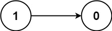
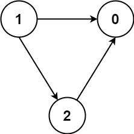

# [1462. Course Schedule IV](https://leetcode.com/problems/course-schedule-iv/)

| Category | Difficulty | Likes | Dislikes |
| :------: | :--------: | :---: | :------: |
| Algorithms | Medium | 2088 | 92 |

**Tags:** [`depth-first-search`](https://leetcode.com/tag/depth-first-search), [`breadth-first-search`](https://leetcode.com/tag/breadth-first-search), [`graph`](https://leetcode.com/tag/graph), [`topological-sort`](https://leetcode.com/tag/topological-sort)

**Companies:** `tiktok`, `amazon`, `google`, `facebook`, `uber`

## Description

There are a total of `numCourses` courses you have to take, labeled from `0` to `numCourses - 1`. You are given an array `prerequisites` where `prerequisites[i] = [a_i, b_i]` indicates that you **must** take course `a_i` first if you want to take course `b_i`.

	- For example, the pair `[0, 1]` indicates that you have to take course `0` before you can take course `1`.

Prerequisites can also be **indirect**. If course `a` is a prerequisite of course `b`, and course `b` is a prerequisite of course `c`, then course `a` is a prerequisite of course `c`.

You are also given an array `queries` where `queries[j] = [u_j, v_j]`. For the `j^th` query, you should answer whether course `u_j` is a prerequisite of course `v_j` or not.

Return a boolean array `answer`, where `answer[j]` is the answer to the `j^th` query.

 

**Example 1:**


```

Input: numCourses = 2, prerequisites = [[1,0]], queries = [[0,1],[1,0]]
Output: [false,true]
Explanation: The pair [1, 0] indicates that you have to take course 1 before you can take course 0.
Course 0 is not a prerequisite of course 1, but the opposite is true.

```

**Example 2:**

```

Input: numCourses = 2, prerequisites = [], queries = [[1,0],[0,1]]
Output: [false,false]
Explanation: There are no prerequisites, and each course is independent.

```

**Example 3:**


```

Input: numCourses = 3, prerequisites = [[1,2],[1,0],[2,0]], queries = [[1,0],[1,2]]
Output: [true,true]

```

 

**Constraints:**

	- `2 <= numCourses <= 100`

	- `0 <= prerequisites.length <= (numCourses * (numCourses - 1) / 2)`

	- `prerequisites[i].length == 2`

	- `0 <= a_i, b_i <= numCourses - 1`

	- `a_i != b_i`

	- All the pairs `[a_i, b_i]` are **unique**.

	- The prerequisites graph has no cycles.

	- `1 <= queries.length <= 10^4`

	- `0 <= u_i, v_i <= numCourses - 1`

	- `u_i != v_i`

---

**Links:** [Submissions](https://leetcode.com/problems/course-schedule-iv/) | [Solutions](https://leetcode.com/problems/course-schedule-iv/)
