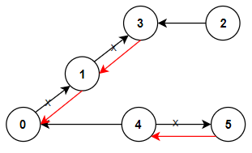

# [Go] [Golang] DFS, Adjacency List

**Author:** f1rstmehul
**Votes:** 8
**Link:** [https://leetcode.com/problems/reorder-routes-to-make-all-paths-lead-to-the-city-zero/solutions/1833582/](https://leetcode.com/problems/reorder-routes-to-make-all-paths-lead-to-the-city-zero/solutions/1833582/)

---

Since we know that graph is sparse we'll use Adjacency List to represent graph.
**n : number of cities**
**m: number of roads**
*Space* and *Time* complexity for *Adjacency List* will be: **O(n + m)** [only if graph is sparse]
In worst case(i.e. when graph is dense) *space* and *time* complexity will be **n^2.**

### 1. Build an Adjacency List:
Time to build an Adjacency List will be **O(m)**



We'll use `[[0,1],[1,3],[2,3],[4,0],[4,5]]` edges to build list.
```
adList := make(map[int][]int)

for _, con := range connections {
	//  Append the outgoing road to the city
	adList[con[0]] = append(adList[con[0]], con[1])

	// Append incoming road to the city.  Here we need a way to differenciate between 
	// incoming and outgoing road So we can mark this edge negetive. 
	adList[con[1]] = append(adList[con[1]], -con[0])
}
```

<details>
  <summary>Important Details</summary>
  
> **Note that in case of the city `0` negative of `0` will be `0` itself So here we can't sure about the direction of the edge. But this won't create any issue when we'll traverse the graph because we're starting DFS from city `0` and marking it as visited.**

</details>


After building Adjacency List it will look like this: 
```
map[
	0:[1 -4] 
	1:[0 3] 
	2:[3] 
	3:[-1 -2] 
	4:[0 5] 
	5:[-4]
]
```

### 2. Keep track of visited nodes:
To keep track of visited cities we're using a slice. Because the city's names are simply from 0 to n-1 so we can directly map these with the slice index. If cities had some name like in the real world then we had to use a map.
```
visited := make([]bool, n)
```

### 3. Use DFS to traverse the graph:
Here we're using closure to avoid passing the `cities` and count parameters.
```
var dfs func(start int)
dfs = func(start int) {
	visited[start] = true
	for _, nb := range adList[start] {
		// incoming edge
		if nb < 0 { // nb -> neighbor
			nb = abs(nb)
			if !visited[nb] {
				dfs(nb)
			}
		} else {
			// outgoing edge that needs to be reoriented
			if !visited[nb] {
				count++
				dfs(nb)
			}
		}
	}
}
// start with city `0`
dfs(0)
```

## Complete Code
```
func minReorder(n int, connections [][]int) int {
	adList := make(map[int][]int)

	for _, con := range connections {
		adList[con[0]] = append(adList[con[0]], con[1])
		adList[con[1]] = append(adList[con[1]], -con[0])
	}

	count := 0
    visited := make([]bool, n)

	var dfs func(start int)
	dfs = func(start int) {
		visited[start] = true
		for _, nb := range adList[start] {
			if nb < 0 {
				nb = abs(nb)
				if !visited[nb] {
					dfs(nb)
				}
			} else {
				if !visited[nb] {
					count++
					dfs(nb)
				}
			}
		}
	}
	dfs(0)
	return count
}

func abs(a int) int {
	if a < 0 {
		return -a
	}
	return a
}
```