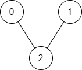
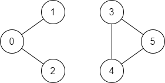

# [1971. Find if Path Exists in Graph](https://leetcode.com/problems/find-if-path-exists-in-graph/)

| Category | Difficulty | Likes | Dislikes |
| :------: | :--------: | :---: | :------: |
| Algorithms | Easy | 4229 | 247 |

**Tags:** [`depth-first-search`](https://leetcode.com/tag/depth-first-search), [`breadth-first-search`](https://leetcode.com/tag/breadth-first-search), [`union-find`](https://leetcode.com/tag/union-find), [`graph`](https://leetcode.com/tag/graph)

**Companies:** `microsoft`, `google`, `bloomberg`, `amazon`, `facebook`

## Description

There is a **bi-directional** graph with `n` vertices, where each vertex is labeled from `0` to `n - 1` (**inclusive**). The edges in the graph are represented as a 2D integer array `edges`, where each `edges[i] = [u_i, v_i]` denotes a bi-directional edge between vertex `u_i` and vertex `v_i`. Every vertex pair is connected by **at most one** edge, and no vertex has an edge to itself.

You want to determine if there is a **valid path** that exists from vertex `source` to vertex `destination`.

Given `edges` and the integers `n`, `source`, and `destination`, return `true`* if there is a **valid path** from *`source`* to *`destination`*, or *`false`* otherwise**.*

 

**Example 1:**


```

Input: n = 3, edges = [[0,1],[1,2],[2,0]], source = 0, destination = 2
Output: true
Explanation: There are two paths from vertex 0 to vertex 2:
- 0 &rarr; 1 &rarr; 2
- 0 &rarr; 2

```

**Example 2:**


```

Input: n = 6, edges = [[0,1],[0,2],[3,5],[5,4],[4,3]], source = 0, destination = 5
Output: false
Explanation: There is no path from vertex 0 to vertex 5.

```

 

**Constraints:**

	- `1 <= n <= 2 * 10^5`

	- `0 <= edges.length <= 2 * 10^5`

	- `edges[i].length == 2`

	- `0 <= u_i, v_i <= n - 1`

	- `u_i != v_i`

	- `0 <= source, destination <= n - 1`

	- There are no duplicate edges.

	- There are no self edges.

---

**Links:** [Submissions](https://leetcode.com/problems/find-if-path-exists-in-graph/) | [Solutions](https://leetcode.com/problems/find-if-path-exists-in-graph/)
