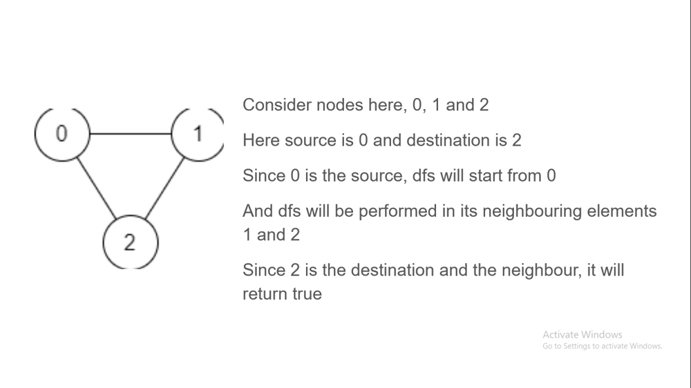
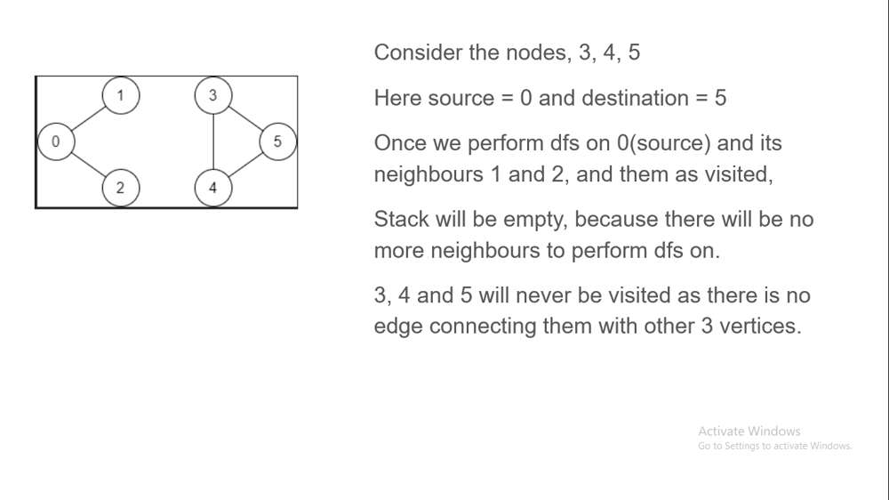
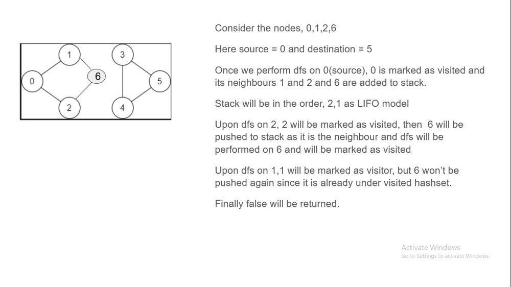

# Simpler || Easier ||Fully explained Pictorial

**Author:** priyasmb24
**Votes:** 5
**Link:** [https://leetcode.com/problems/find-if-path-exists-in-graph/solutions/5052699/](https://leetcode.com/problems/find-if-path-exists-in-graph/solutions/5052699/)

---

# Intuition
<!-- Describe your first thoughts on how to solve this problem. -->
iterate through the edges
if source edge is found,
    perform dfs on the neighbouring vertices using stack
    To avoid performing DFS on same vertices again, use hashset.
example 1 where source connects with destination


example 2 where source and destination aren't connected


example 3 where there is a possibility of visiting already visited vertice



# Approach
<!-- Describe your approach to solving the problem. -->
This approach explores vertices in a depth-first manner, visiting neighbors of a vertex before moving on to the next vertex. 

If the destination vertex is reached during the traversal, it returns True, indicating the existence of a valid path.

Otherwise, it returns False if the destination is not reachable from the source.

1) Graph Representation: The graph is represented as an adjacency list using a default dictionary or hashmap. This allows for efficient retrieval of neighbors for each vertex.

2) Initialization:
        A Hashset called visited is used to keep track of visited vertices to avoid revisiting them.
        A stack is used to perform the DFS traversal. It starts with the source vertex source as the only element in the stack.

3) DFS Traversal:
        While the stack is not empty, pop a vertex node from the stack.
        If node is equal to the destination vertex destination, return True, indicating that a valid path exists.
        Otherwise, mark node as visited and iterate over its neighbors.
        For each unvisited neighbor neighbor, push neighbor onto the stack.

4) Termination:
        If the stack becomes empty without finding the destination vertex, return False, indicating that there is no valid path from source to destination.


# Complexity
- Time complexity: O(V+E)
<!-- Add your time complexity here, e.g. $$O(n)$$ -->

- Space complexity: O(V+E)
<!-- Add your space complexity here, e.g. $$O(n)$$ -->

Edit 1: 
Java solution is giving TLE, so have added another solution which uses BFS

# Code
``` C# []
public class Solution {
    public bool ValidPath(int n, int[][] edges, int source, int destination) {
        //Convert the graph into dictionary, adding the vertices of the edges
        Dictionary<int, List<int>> graph = new Dictionary<int, List<int>>();
        foreach (int[] edge in edges) {
            int u = edge[0];
            int v = edge[1];
            // since it is bidrectional, add edges in the both ways, u->v and v->u
            // if the vertices are encountered for the first time, create a new list
            if (!graph.ContainsKey(u))
                graph[u] = new List<int>();
            if (!graph.ContainsKey(v)) 
                graph[v] = new List<int>();
            graph[u].Add(v);
            graph[v].Add(u);
        }

        //create a new hashset to store the visited vertices, so that we will not visit them again
        HashSet<int> visited = new HashSet<int>();

        // Maintain a stack to keep track of which elements to perform DFS on.
        Stack<int> stack = new Stack<int>();
        stack.Push(source);

        while (stack.Count > 0) {
            //pop the latest element from the stack
            int node = stack.Pop();
            //if it is same as destination, return true, since destination is found
            if (node == destination) {
                return true;
            }
            // else mark the current vertice as visited.
            visited.Add(node);
            //perform dfs on the neighbouring vertices of the current vertice
            foreach (int neighbor in graph[node]) {
                //if it is not yet visited, add it to the stack to perform dfs
                if (!visited.Contains(neighbor)) {
                    stack.Push(neighbor);
                }
            }
        }
        //if the destination is not found even after performing dfs, return false
        return false;
    }
}

```
```Java []
class Solution {
    public boolean validPath(int n, int[][] edges, int source, int destination) {
        // Create a graph represented as an adjacency list
        Map<Integer, List<Integer>> graph = new HashMap<>();
        for (int[] edge : edges) {
            int u = edge[0];
            int v = edge[1];
            // Add edges to the adjacency list (graph is bidirectional)
            graph.computeIfAbsent(u, k -> new ArrayList<>()).add(v);
            graph.computeIfAbsent(v, k -> new ArrayList<>()).add(u);
        }

        // Set to keep track of visited vertices
        Set<Integer> visited = new HashSet<>();
        // Stack for DFS traversal
        Stack<Integer> stack = new Stack<>();
        // Start from the source vertex
        stack.push(source);

        // Perform DFS iteratively using a stack
        while (!stack.isEmpty()) {
            // Pop the top vertex from the stack
            int node = stack.pop();
            // If the popped vertex is the destination, return true
            if (node == destination) {
                return true;
            }
            // Mark the current vertex as visited
            visited.add(node);
            // Iterate over the neighbors of the current vertex
            for (int neighbor : graph.get(node)) {
                // If the neighbor has not been visited, push it to the stack
                if (!visited.contains(neighbor)) {
                    stack.push(neighbor);
                }
            }
        }

        // If destination is not reachable, return false
        return false;
    }
}

```
```Python []
class Solution(object):
    def validPath(self, n, edges, source, destination):
        """
        :type n: int
        :type edges: List[List[int]]
        :type source: int
        :type destination: int
        :rtype: bool
        """
        # Create a graph represented as an adjacency list
        graph = defaultdict(list)
        for u, v in edges:
            graph[u].append(v)
            graph[v].append(u)
        
        # Set to keep track of visited vertices
        visited = set()
        # Stack for DFS traversal
        stack = [source]
        
        # Perform DFS iteratively using a stack
        while stack:
            node = stack.pop()
            if node == destination:
                return True
            visited.add(node)
            for neighbor in graph.get(node, []):
                if neighbor not in visited:
                    stack.append(neighbor)
        
        # If destination is not reachable, return False
        return False

```
``` Java2 []
class Solution {
    public boolean validPath(int n, int[][] edges, int source, int destination) {
        // Create a graph represented as an adjacency list
        Map<Integer, List<Integer>> graph = new HashMap<>();
        for (int[] edge : edges) {
            int u = edge[0];
            int v = edge[1];
            // Add edges to the adjacency list (graph is bidirectional)
            graph.computeIfAbsent(u, k -> new ArrayList<>()).add(v);
            graph.computeIfAbsent(v, k -> new ArrayList<>()).add(u);
        }

        // Early exit if source and destination are the same
        if (source == destination) {
            return true;
        }

        // Set to keep track of visited vertices
        Set<Integer> visited = new HashSet<>();
        // Queue for BFS traversal
        Queue<Integer> queue = new LinkedList<>();
        // Start from the source vertex
        queue.add(source);
        visited.add(source);

        // Perform BFS iteratively using a queue
        while (!queue.isEmpty()) {
            // Dequeue the front vertex from the queue
            int node = queue.poll();
            // Iterate over the neighbors of the current vertex
            for (int neighbor : graph.get(node)) {
                // If the neighbor is the destination, return true
                if (neighbor == destination) {
                    return true;
                }
                // If the neighbor has not been visited, enqueue it
                if (!visited.contains(neighbor)) {
                    visited.add(neighbor);
                    queue.add(neighbor);
                }
            }
        }

        // If destination is not reachable, return false
        return false;
    }
}

```