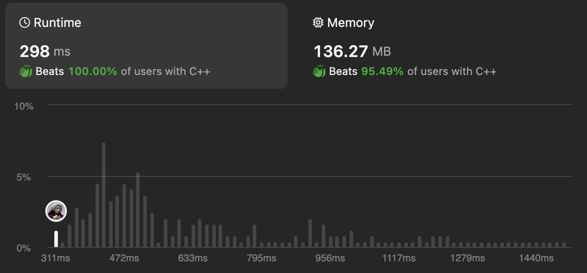

# 🔥 BEATS 100% | ✅ BEST [ C++/Java/Python/JavaScript] Solution

**Author:** codermal7
**Votes:** 21
**Link:** [https://leetcode.com/problems/find-all-people-with-secret/solutions/4775568/](https://leetcode.com/problems/find-all-people-with-secret/solutions/4775568/)

---



---


# Code
```C++ []
#pragma GCC optimize("O3", "unroll-loops")
class Solution {
public:
#define MAX_N 100000
    int find(const int* groups, int index){
        while(index != groups[index])index = groups[index];
        return index;
    }

    vector<int> findAllPeople(int n, vector<vector<int>>& meetings, int firstPerson) {
        static int groups[MAX_N];
        static vector<int> temp;

        for (int i = 0; i < n; ++i) groups[i] = i;
        groups[firstPerson] = 0;

        sort(meetings.begin(), meetings.end(), [](const auto& l, const auto& r) {
            return l[2] < r[2];
        });

        const int SIZE = meetings.size();
        int i = 0;
        while (i < SIZE) {
            int currentTime = meetings[i][2];
            temp.clear();
            while (i < SIZE && meetings[i][2] == currentTime) {
                int g1 = find(groups, meetings[i][0]);
                int g2 = find(groups, meetings[i][1]);
                groups[max(g1, g2)] = min(g1, g2);
                temp.push_back(meetings[i][0]);
                temp.push_back(meetings[i][1]);
                ++i;
            }
            for (int j = 0; j < temp.size(); ++j) {
                if (find(groups, temp[j]) != 0) {
                    groups[temp[j]] = temp[j];
                }
            }
        }

        vector<int> result;
        for (int j = 0; j < n; ++j) {
            if (find(groups, j) == 0)result.push_back(j);
        }

        return result;
    }
};
auto init = []() {
    ios::sync_with_stdio(0);
    cin.tie(0);
    cout.tie(0);
    return 'c';
}();
```
```Java []
class Solution {
    public List<Integer> findAllPeople(int n, int[][] meetings, int firstPerson) {
        int[] groups = new int[100000];
        List<Integer> result = new ArrayList<>();
        List<Integer> temp = new ArrayList<>();

        for (int i = 0; i < n; ++i) groups[i] = i;
        groups[firstPerson] = 0;

        Arrays.sort(meetings, (a, b) -> Integer.compare(a[2], b[2]));

        int i = 0;
        while (i < meetings.length) {
            int currentTime = meetings[i][2];
            temp.clear();
            while (i < meetings.length && meetings[i][2] == currentTime) {
                int g1 = find(groups, meetings[i][0]);
                int g2 = find(groups, meetings[i][1]);
                groups[Math.max(g1, g2)] = Math.min(g1, g2);
                temp.add(meetings[i][0]);
                temp.add(meetings[i][1]);
                ++i;
            }
            for (int j = 0; j < temp.size(); ++j) {
                if (find(groups, temp.get(j)) != 0) {
                    groups[temp.get(j)] = temp.get(j);
                }
            }
        }

        for (int j = 0; j < n; ++j) {
            if (find(groups, j) == 0) result.add(j);
        }

        return result;
    }

    private int find(int[] groups, int index) {
        while (index != groups[index]) index = groups[index];
        return index;
    }
}
```
```Python []
class Solution:
    def findAllPeople(self, n: int, meetings: List[List[int]], firstPerson: int) -> List[int]:
        groups = [i for i in range(n)]
        groups[firstPerson] = 0

        meetings.sort(key=lambda x: x[2])

        size = len(meetings)
        i = 0
        while i < size:
            current_time = meetings[i][2]
            temp = []
            while i < size and meetings[i][2] == current_time:
                g1 = self.find(groups, meetings[i][0])
                g2 = self.find(groups, meetings[i][1])
                groups[max(g1, g2)] = min(g1, g2)
                temp.extend([meetings[i][0], meetings[i][1]])
                i += 1
            for j in temp:
                if self.find(groups, j) != 0:
                    groups[j] = j

        result = []
        for j in range(n):
            if self.find(groups, j) == 0:
                result.append(j)

        return result

    def find(self, groups: List[int], index: int) -> int:
        while index != groups[index]:
            index = groups[index]
        return index
```
```javascript []
/**
 * @param {number} n
 * @param {number[][]} meetings
 * @param {number} firstPerson
 * @return {number[]}
 */
var findAllPeople = function(n, meetings, firstPerson) {
    const find = (groups, index) => {
        while (index !== groups[index]) {
            index = groups[index];
        }
        return index;
    };

    let groups = new Array(100000).fill(0).map((_, i) => i);
    let result = [];

    groups[firstPerson] = 0;

    meetings.sort((a, b) => a[2] - b[2]);

    let i = 0;
    while (i < meetings.length) {
        let currentTime = meetings[i][2];
        let temp = [];
        while (i < meetings.length && meetings[i][2] === currentTime) {
            let g1 = find(groups, meetings[i][0]);
            let g2 = find(groups, meetings[i][1]);
            groups[Math.max(g1, g2)] = Math.min(g1, g2);
            temp.push(meetings[i][0]);
            temp.push(meetings[i][1]);
            ++i;
        }
        for (let j = 0; j < temp.length; ++j) {
            if (find(groups, temp[j]) !== 0) {
                groups[temp[j]] = temp[j];
            }
        }
    }

    for (let j = 0; j < n; ++j) {
        if (find(groups, j) === 0) {
            result.push(j);
        }
    }

    return result;
};
```
