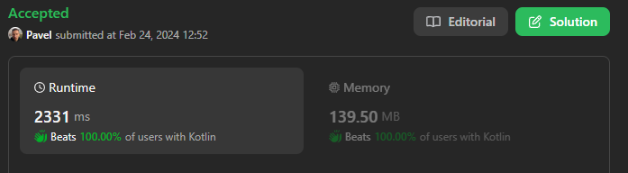

# My first hard question solved without any hints!!

**Author:** naXa777
**Votes:** 2
**Link:** [https://leetcode.com/problems/find-all-people-with-secret/solutions/4776100/](https://leetcode.com/problems/find-all-people-with-secret/solutions/4776100/)

---

# Approach

### Data Structures

1. Model all meetings as an undirected graph.
   * People = vertices
   * Meetings = edges
2. Use MinHeap to process meetings in chronological order.
3. Use a set to form the answer.

### Algorithm

Not sure. It is a hybrid that combines elements of greedy and graph exploration strategies (BFS?) for distributing a secret across a network of meetings.

# Complexity

- Time complexity: _It took me 30 minutes._ (Just kidding! $$O(M\u22C5log\\ M)$$)
- Space complexity: $$O(M + N)$$

where $$M$$ is the number of meetings, and $$N$$ is the number of people.

# Code

```kt
class Solution {
    fun findAllPeople(n: Int, meetings: Array<IntArray>, firstPerson: Int): List<Int> {
        // adjacency list
        val graph = Array<MutableSet<Meeting>>(n) { mutableSetOf<Meeting>() }

        for (m in meetings) {
            val (x, y, time) = m
            graph[x].add(Meeting(
                person = y,
                time = time
            ))
            graph[y].add(Meeting(
                person = x,
                time = time
            ))
        }

        // discovered edges
        val minHeap = PriorityQueue(compareBy<Meeting> { it.time })
        // discovered vertices = people with secret
        val peopleWithSecret = mutableSetOf<Int>(0, firstPerson)

        minHeap.addAll(graph[0])
        minHeap.addAll(graph[firstPerson])

        while (minHeap.isNotEmpty()) {
            val (person, time) = minHeap.remove()
            peopleWithSecret.add(person)
            val upcomingMeetings = graph[person]
                .filter { it.time >= time }
                .filterNot { it.person in peopleWithSecret }
            minHeap.addAll(upcomingMeetings)
        }

        return peopleWithSecret.toList()
    }
}

data class Meeting(
    val person: Int,
    val time: Int
)
```

# Screenshot

Note: 100% means nothing.

It's efficient, but I'm sure there are solutions with better performance. Leetcode doesn't have enough data to correctly compare my solution with others.


