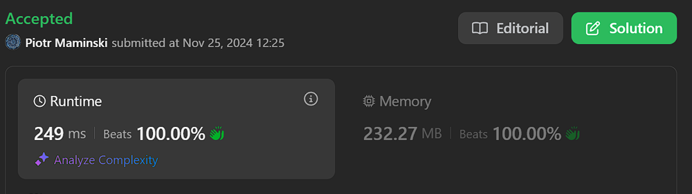
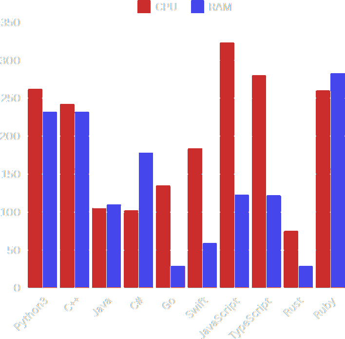
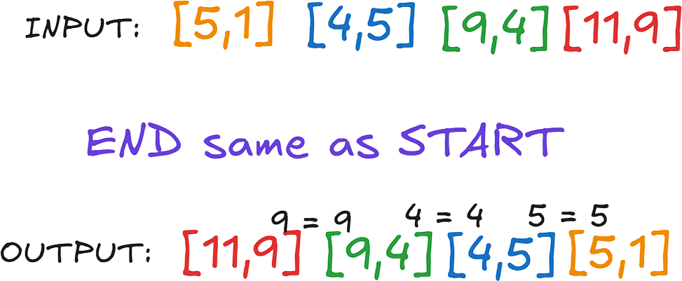

# ✅Beats 100%

**Author:** Piotr_Maminski
**Votes:** 48
**Link:** [https://leetcode.com/problems/valid-arrangement-of-pairs/solutions/6081701/](https://leetcode.com/problems/valid-arrangement-of-pairs/solutions/6081701/)

---



# #1 Clean Code, Most Opt (All Beats 100% [[1]](https://leetcode.com/problems/valid-arrangement-of-pairs/submissions/1462397475)[[2]](https://leetcode.com/problems/valid-arrangement-of-pairs/submissions/1462398961)[[3]](https://leetcode.com/problems/valid-arrangement-of-pairs/submissions/1462400534)[[4]](https://leetcode.com/problems/valid-arrangement-of-pairs/submissions/1462413689)[[5]](https://leetcode.com/problems/valid-arrangement-of-pairs/submissions/1462383991)[[6]](https://leetcode.com/problems/valid-arrangement-of-pairs/submissions/1462396019)
```python3 []
class Solution:
    def validArrangement(self, pairs: List[List[int]]) -> List[List[int]]:
        # graph represents adjacency list, inOutDeg tracks in/out degree difference
        graph = defaultdict(list)
        inOutDeg = defaultdict(int)

        # Build graph and count in/out degrees
        for start, end in pairs:
            graph[start].append(end)
            inOutDeg[start] += 1  # out-degree
            inOutDeg[end] -= 1    # in-degree

        # Find starting node 
        startNode = pairs[0][0] 
        for node in inOutDeg:
            if inOutDeg[node] == 1:
                startNode = node
                break

        path = []
        def dfs(curr):
            while graph[curr]:
                nextNode = graph[curr].pop()
                dfs(nextNode)
                path.append((curr, nextNode))

        dfs(startNode)
        return path[::-1]
```
```cpp []
class Solution {
public:
    vector<vector<int>> validArrangement(vector<vector<int>>& pairs) {
        unordered_map<int, vector<int>> adjacencyList;
        unordered_map<int, int> inOutDegree;
        
        // Build graph and count in/out degrees
        for (const auto& pair : pairs) {
            adjacencyList[pair[0]].push_back(pair[1]);
            inOutDegree[pair[0]]++;  // out-degree
            inOutDegree[pair[1]]--;  // in-degree
        }
        
        // Find starting node
        int startNode = pairs[0][0];
        for (const auto& [node, degree] : inOutDegree) {
            if (degree == 1) {
                startNode = node;
                break;
            }
        }
        
        vector<int> path;
        stack<int> nodeStack;
        nodeStack.push(startNode);
        
        while (!nodeStack.empty()) {
            auto& neighbors = adjacencyList[nodeStack.top()];
            if (neighbors.empty()) {
                path.push_back(nodeStack.top());
                nodeStack.pop();
            } else {
                int nextNode = neighbors.back();
                nodeStack.push(nextNode);
                neighbors.pop_back();
            }
        }
        
        vector<vector<int>> arrangement;
        int pathSize = path.size();
        arrangement.reserve(pathSize - 1);
        
        for (int i = pathSize - 1; i > 0; --i) {
            arrangement.push_back({path[i], path[i-1]});
        }
        
        return arrangement;
    }
};
```
```java []
class Solution {
    public int[][] validArrangement(int[][] pairs) {
        Map<Integer, List<Integer>> adjacencyList = new HashMap<>();
        Map<Integer, Integer> inOutDegree = new HashMap<>();
        
        // Build graph and count in/out degrees
        for (int[] pair : pairs) {
            adjacencyList.computeIfAbsent(pair[0], k -> new ArrayList<>()).add(pair[1]);
            inOutDegree.merge(pair[0], 1, Integer::sum);  // out-degree
            inOutDegree.merge(pair[1], -1, Integer::sum);  // in-degree
        }
        
        // Find starting node
        int startNode = pairs[0][0];
        for (Map.Entry<Integer, Integer> entry : inOutDegree.entrySet()) {
            if (entry.getValue() == 1) {
                startNode = entry.getKey();
                break;
            }
        }
        
        List<Integer> path = new ArrayList<>();
        Deque<Integer> nodeStack = new ArrayDeque<>();
        nodeStack.push(startNode);
        
        while (!nodeStack.isEmpty()) {
            List<Integer> neighbors = adjacencyList.getOrDefault(nodeStack.peek(), new ArrayList<>());
            if (neighbors.isEmpty()) {
                path.add(nodeStack.pop());
            } else {
                int nextNode = neighbors.get(neighbors.size() - 1);
                nodeStack.push(nextNode);
                neighbors.remove(neighbors.size() - 1);
            }
        }
        
        int pathSize = path.size();
        int[][] arrangement = new int[pathSize - 1][2];
        
        for (int i = pathSize - 1; i > 0; --i) {
            arrangement[pathSize - 1 - i] = new int[]{path.get(i), path.get(i-1)};
        }
        
        return arrangement;
    }
}
```
```csharp []
public class Solution {
    public int[][] ValidArrangement(int[][] pairs) {
        var adjacencyList = new Dictionary<int, List<int>>();
        var inOutDegree = new Dictionary<int, int>();
        
        // Build graph and count in/out degrees
        foreach (var pair in pairs) {
            if (!adjacencyList.ContainsKey(pair[0])) {
                adjacencyList[pair[0]] = new List<int>();
            }
            adjacencyList[pair[0]].Add(pair[1]);
            
            inOutDegree[pair[0]] = inOutDegree.GetValueOrDefault(pair[0], 0) + 1;  // out-degree
            inOutDegree[pair[1]] = inOutDegree.GetValueOrDefault(pair[1], 0) - 1;  // in-degree
        }
        
        // Find starting node
        int startNode = pairs[0][0];
        foreach (var kvp in inOutDegree) {
            if (kvp.Value == 1) {
                startNode = kvp.Key;
                break;
            }
        }
        
        var path = new List<int>();
        var nodeStack = new Stack<int>();
        nodeStack.Push(startNode);
        
        while (nodeStack.Count > 0) {
            if (!adjacencyList.ContainsKey(nodeStack.Peek()) || 
                adjacencyList[nodeStack.Peek()].Count == 0) {
                path.Add(nodeStack.Pop());
            } else {
                var neighbors = adjacencyList[nodeStack.Peek()];
                int nextNode = neighbors[neighbors.Count - 1];
                nodeStack.Push(nextNode);
                neighbors.RemoveAt(neighbors.Count - 1);
            }
        }
        
        var arrangement = new List<int[]>();
        int pathSize = path.Count;
        
        for (int i = pathSize - 1; i > 0; --i) {
            arrangement.Add(new int[] { path[i], path[i-1] });
        }
        
        return arrangement.ToArray();
    }
}
```
```golang []
func validArrangement(pairs [][]int) [][]int {
    // Create adjacency list and in/out degree maps
    adjacencyList := make(map[int][]int)
    inOutDegree := make(map[int]int)
    
    // Build graph and count in/out degrees
    for _, pair := range pairs {
        adjacencyList[pair[0]] = append(adjacencyList[pair[0]], pair[1])
        inOutDegree[pair[0]]++  // out-degree
        inOutDegree[pair[1]]--  // in-degree
    }
    
    // Find starting node
    startNode := pairs[0][0]
    for node, degree := range inOutDegree {
        if degree == 1 {
            startNode = node
            break
        }
    }
    
    // Use slice as stack for path
    path := []int{}
    nodeStack := []int{startNode}
    
    for len(nodeStack) > 0 {
        lastIdx := len(nodeStack) - 1
        curr := nodeStack[lastIdx]
        neighbors := adjacencyList[curr]
        
        if len(neighbors) == 0 {
            path = append(path, curr)
            nodeStack = nodeStack[:lastIdx]
        } else {
            nextNode := neighbors[len(neighbors)-1]
            nodeStack = append(nodeStack, nextNode)
            adjacencyList[curr] = neighbors[:len(neighbors)-1]
        }
    }
    
    // Build final arrangement
    arrangement := make([][]int, 0, len(path)-1)
    for i := len(path) - 1; i > 0; i-- {
        arrangement = append(arrangement, []int{path[i], path[i-1]})
    }
    
    return arrangement
}
```
```swift []
// Ver. Eulerian path + Hierholzer's algorithm 184ms 
// Swift like that https://github.com/swiftlang/swift/blob/main/docs/OptimizationTips.rst
class Solution {
    func validArrangement(_ pairs: [[Int]]) -> [[Int]] {
        // build a graph
        var adjList: [Int:[Int]] = [:]
        var inDegree: [Int:Int] = [:]
        for pair in pairs {
            adjList[pair[0], default:[]].append(pair[1])
            inDegree[pair[1], default:0] += 1
        }
        // Eulerian path
        var start = pairs[0][0] 
        for (v, outEdges) in adjList {
            if outEdges.count - inDegree[v, default:0] == 1 { 
                start = v; break 
            }
        }
        
        // Hierholzer's algorithm
        var path: [[Int]] = []
        func traverse(from vertex: Int) {
            while let next = adjList[vertex]?.popLast() {
                traverse(from: next)
                path.append([vertex, next])
            }
        }
        
        traverse(from: start)
        path.reverse()
        return path
    }
}
```
```javascript [JS]
// JavaScript
const validArrangement = (pairs) => {
    // Build graph and degrees
    const graph = new Map();
    const inDegree = new Map();
    
    for (const [from, to] of pairs) {
        if (!graph.has(from)) graph.set(from, []);
        graph.get(from).push(to);
        inDegree.set(to, (inDegree.get(to) || 0) + 1);
    }
    
    // Find start node
    let start = pairs[0][0];
    for (const [vertex, edges] of graph) {
        if (edges.length - (inDegree.get(vertex) || 0) === 1) {
            start = vertex;
            break;
        }
    }
    
    // Hierholzer's algorithm 
    const path = [];
    const traverse = (vertex) => {
        while (graph.has(vertex) && graph.get(vertex).length) {
            const next = graph.get(vertex).pop();
            traverse(next);
            path.push([vertex, next]);
        }
    };
    
    traverse(start);
    return path.reverse();
};
```
```typescript [TS]
// TypeScript 
// 190ms = 50% and 487ms = 50% too? probably bug
function validArrangement(pairs: number[][]): number[][] {
        const adjacencyList = new Map<number, number[]>();
        const inOutDegree = new Map<number, number>();
        
        // Build graph and count in/out degrees
        for (const pair of pairs) {
            if (!adjacencyList.has(pair[0])) {
                adjacencyList.set(pair[0], []);
            }
            adjacencyList.get(pair[0])!.push(pair[1]);
            inOutDegree.set(pair[0], (inOutDegree.get(pair[0]) || 0) + 1);
            inOutDegree.set(pair[1], (inOutDegree.get(pair[1]) || 0) - 1);
        }
        
        // Find starting node
        let startNode = pairs[0][0];
        for (const [node, degree] of inOutDegree.entries()) {
            if (degree === 1) {
                startNode = node;
                break;
            }
        }
        
        const path: number[] = [];
        const nodeStack: number[] = [startNode];
        
        while (nodeStack.length > 0) {
            const neighbors = adjacencyList.get(nodeStack[nodeStack.length - 1]) || [];
            if (neighbors.length === 0) {
                path.push(nodeStack.pop()!);
            } else {
                const nextNode = neighbors.pop()!;
                nodeStack.push(nextNode);
            }
        }
        
        const arrangement: number[][] = [];
        const pathSize = path.length;
        
        for (let i = pathSize - 1; i > 0; --i) {
            arrangement.push([path[i], path[i-1]]);
        }
        
        return arrangement;
    }
```
```rust []
impl Solution {
    pub fn valid_arrangement(pairs: Vec<Vec<i32>>) -> Vec<Vec<i32>> {
        use std::collections::HashMap;
        
        let mut adjacency_list: HashMap<i32, Vec<i32>> = HashMap::with_capacity(pairs.len());
        let mut in_out_degree: HashMap<i32, i32> = HashMap::with_capacity(pairs.len() * 2);
        
        // Build graph and count in/out degrees
        for pair in &pairs {
            adjacency_list.entry(pair[0])
                .or_insert_with(Vec::new)
                .push(pair[1]);
            *in_out_degree.entry(pair[0]).or_default() += 1;
            *in_out_degree.entry(pair[1]).or_default() -= 1;
        }
        
        // Find starting node (head)
        let mut start_node = pairs[0][0];
        for (&node, &degree) in &in_out_degree {
            if degree == 1 {
                start_node = node;
                break;
            }
        }
        
        let mut path = Vec::with_capacity(pairs.len() + 1);
        let mut node_stack = vec![start_node];
        
        while !node_stack.is_empty() {
            if let Some(neighbors) = adjacency_list.get_mut(&node_stack[node_stack.len() - 1]) {
                if neighbors.is_empty() {
                    path.push(node_stack.pop().unwrap());
                } else {
                    let next_node = neighbors.pop().unwrap();
                    node_stack.push(next_node);
                }
            } else {
                path.push(node_stack.pop().unwrap());
            }
        }
        
        let mut arrangement = Vec::with_capacity(path.len() - 1);
        let path_size = path.len();
        
        for i in (1..path_size).rev() {
            arrangement.push(vec![path[i], path[i-1]]);
        }
        
        arrangement
    }
}
```
```ruby []
def valid_arrangement(pairs)
    adjacency_list = Hash.new { |h, k| h[k] = [] }
    in_out_degree = Hash.new(0)
    
    # Build graph and count in/out degrees
    pairs.each do |pair|
        adjacency_list[pair[0]] << pair[1]
        in_out_degree[pair[0]] += 1  # out-degree
        in_out_degree[pair[1]] -= 1  # in-degree
    end
    
    # Find starting node
    start_node = pairs[0][0]
    in_out_degree.each do |node, degree|
        if degree == 1
            start_node = node
            break
        end
    end
    
    path = []
    node_stack = [start_node]
    
    while !node_stack.empty?
        neighbors = adjacency_list[node_stack.last]
        if neighbors.empty?
            path << node_stack.pop
        else
            next_node = neighbors.pop
            node_stack << next_node
        end
    end
    
    arrangement = []
    path_size = path.size
    
    (path_size - 1).downto(1) do |i|
        arrangement << [path[i], path[i-1]]
    end
    
    arrangement
end
```

- Complexity: Time O(E) & Space O(E)



(less =  better, sorry light mode user)


# Explanation


---

## Intuition



- All pairs have **START** and **END**  [**START**,**END**]
- Match up the pairs so that the **END** of each pair (except the last) meets up with the **START** of the next
- We can always order pairs


## Approach 1

1. Graph Construction
```
graph = defaultdict(list) 
inOutDeg = defaultdict(int) # To track the difference between the output and input stage for each pair

for start, end in pairs:
    graph[start].append(end)
    inOutDeg[start] += 1  # out-degree
    inOutDeg[end] -= 1    # in-degree
```

2. Start Node Finding
```
startNode = pairs[0][0] 
for node in inOutDeg:
    if inOutDeg[node] == 1: # IF 1 start node. No 1 ? any node
        startNode = node
        break
```

3.  Depth First Search Traverse graph, build path in revers order
```
def dfs(curr):
    while graph[curr]:
        nextNode = graph[curr].pop()
        dfs(nextNode)
        path.append((curr, nextNode))
```


4. Result:
```
return path[::-1]
```


## Graph Theory

- It's hard to explain graphs in one solution and then explain it again and again in every other solution, so I invite you to watch (IMO) the best explaining Video on graph from Google engineer.
https://youtu.be/09_LlHjoEiY?si=EKU-b9pAafWX1Wea

- [Eulerian Path & Hierholzer's algorithm (wiki)](https://en.wikipedia.org/wiki/Eulerian_path)
