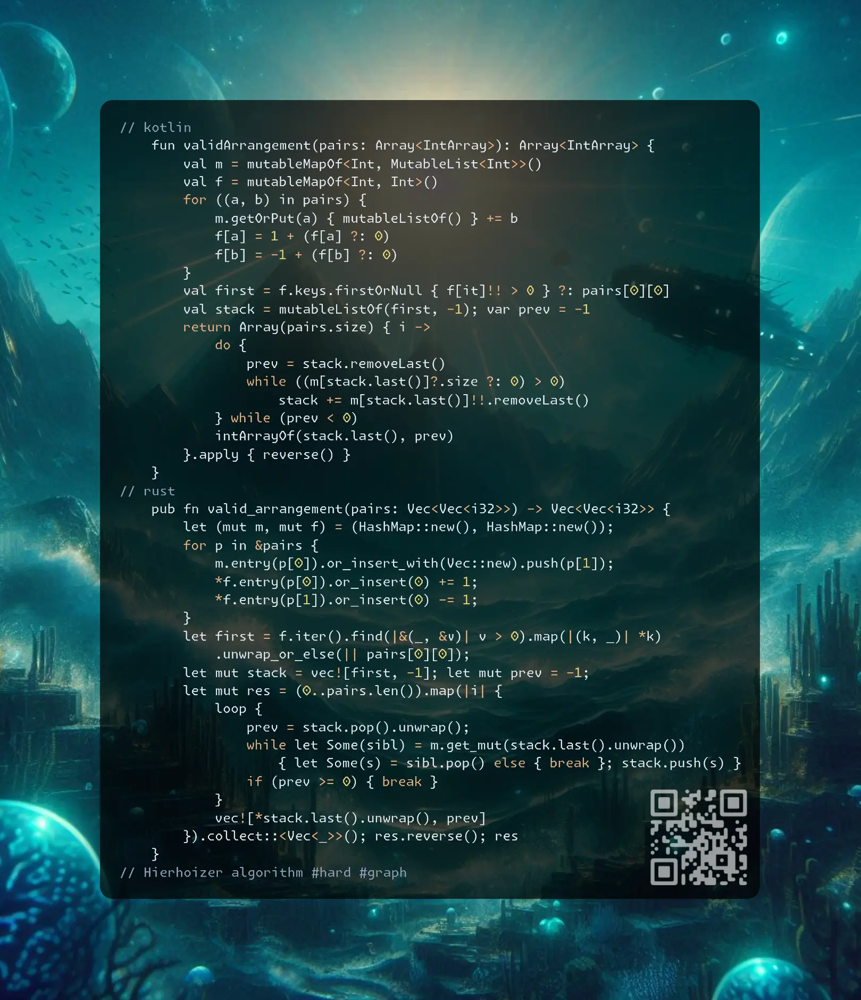
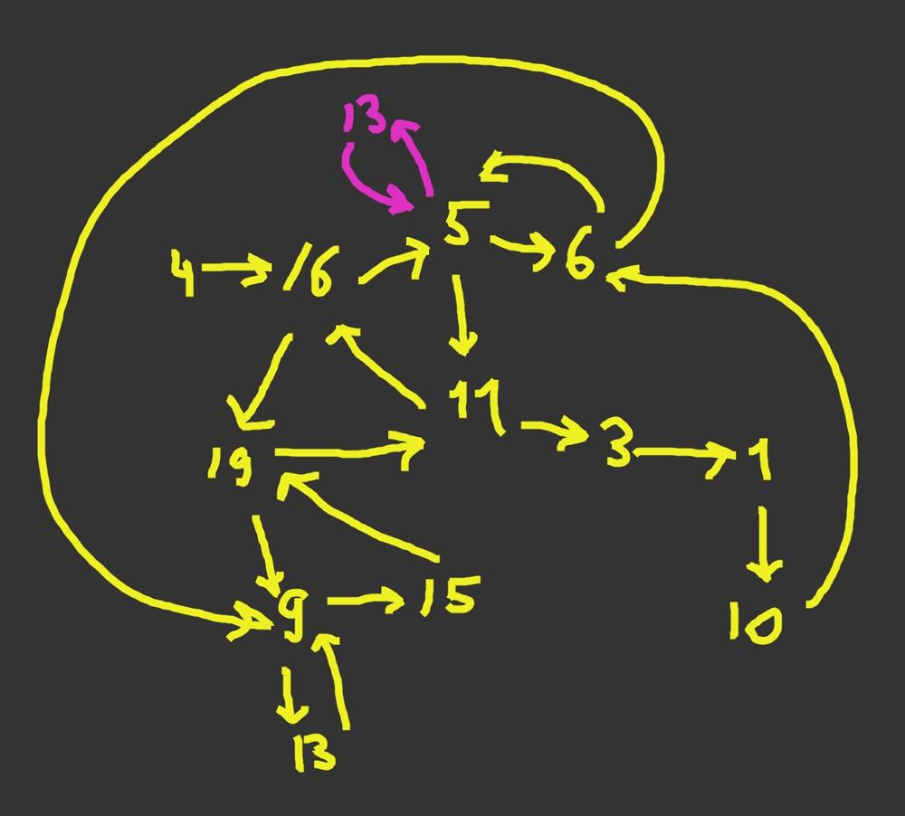
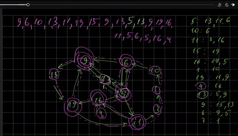

# Kotlin | Rust

**Author:** SamoylenkoDmitry
**Votes:** 1
**Link:** [https://leetcode.com/problems/valid-arrangement-of-pairs/solutions/6096948/](https://leetcode.com/problems/valid-arrangement-of-pairs/solutions/6096948/)

---



https://youtu.be/Z1HXrMxz8a4

#### Join me on Telegram

https://t.me/leetcode_daily_unstoppable/816

#### Problem TLDR

Hierholzer algorithm #hard #graph

#### Intuition

I doubt this can be invented on the fly, so this task is all about one algorithm that we have to know: Hierhoizer.

First, find the node that have more outgoing edges then incoming.
Next, greedily traverse all siblings in a DFS manner, removing the explored edges. Do this without backtracking. Store visited nodes in a `path`.
When all the reached nodes have no more siblings, we reached the end, so `pop` it from the `path`.
While doing the `pop` operation we can discover some previously undiscovered loops in the same manner.






#### Approach

* let's try to learn something new

#### Complexity

- Time complexity:
$$O(E)$$

- Space complexity:
$$O(E + V)$$

#### Code

```kotlin []

    fun validArrangement(pairs: Array<IntArray>): Array<IntArray> {
        val m = mutableMapOf<Int, MutableList<Int>>()
        val f = mutableMapOf<Int, Int>()
        for ((a, b) in pairs) {
            m.getOrPut(a) { mutableListOf() } += b
            f[a] = 1 + (f[a] ?: 0)
            f[b] = -1 + (f[b] ?: 0)
        }
        val first = f.keys.firstOrNull { f[it]!! > 0 } ?: pairs[0][0]
        val stack = mutableListOf(first, -1); var prev = -1
        return Array(pairs.size) { i ->
            do {
                prev = stack.removeLast()
                while ((m[stack.last()]?.size ?: 0) > 0) 
                    stack += m[stack.last()]!!.removeLast()
            } while (prev < 0)
            intArrayOf(stack.last(), prev)
        }.apply { reverse() }
    }

```
```rust []

    pub fn valid_arrangement(pairs: Vec<Vec<i32>>) -> Vec<Vec<i32>> {
        let (mut m, mut f) = (HashMap::new(), HashMap::new());
        for p in &pairs {
            m.entry(p[0]).or_insert_with(Vec::new).push(p[1]);
            *f.entry(p[0]).or_insert(0) += 1;
            *f.entry(p[1]).or_insert(0) -= 1;
        }
        let first = f.iter().find(|&(_, &v)| v > 0).map(|(k, _)| *k)
            .unwrap_or_else(|| pairs[0][0]);
        let mut stack = vec![first, -1]; let mut prev = -1;
        let mut res = (0..pairs.len()).map(|i| {
            loop {
                prev = stack.pop().unwrap();
                while let Some(sibl) = m.get_mut(stack.last().unwrap()) 
                    { let Some(s) = sibl.pop() else { break }; stack.push(s) }
                if (prev >= 0) { break }
            }
            vec![*stack.last().unwrap(), prev]
        }).collect::<Vec<_>>(); res.reverse(); res
    }

```
```c++ []

    vector<vector<int>> validArrangement(vector<vector<int>>& pairs) {
        unordered_map<int, vector<int>> m; unordered_map<int, int> f;
        for (auto &p: pairs) {
            m[p[0]].push_back(p[1]), ++f[p[0]], --f[p[1]];
        }
        int first = pairs[0][0]; for (auto [k, v]: f) if (v > 0) first = k;
        vector<int> path, s{first}; vector<vector<int>> res;
        while (s.size()) {
            while (m[s.back()].size()) {
                int n = s.back(); s.push_back(m[n].back()); m[n].pop_back();
            }
            path.push_back(s.back()); s.pop_back();
        }
        for (int i = path.size() - 1; i; --i) res.push_back({path[i], path[i - 1]});
        return res;
    }

```