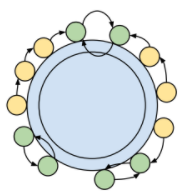

# Mutual Favorites

**Author:** votrubac
**Votes:** 70
**Link:** [https://leetcode.com/problems/maximum-employees-to-be-invited-to-a-meeting/solutions/1674049/](https://leetcode.com/problems/maximum-employees-to-be-invited-to-a-meeting/solutions/1674049/)

---

Your initial impulse could be to use some graph algorithm to find the longest cycle. That would be an overcomplication - there is an easier way to find cycles since each person has only one favorite. And, it won't solve the problem because a cycle is not the only possible arrangement.

If two employees favorite each other, we can sit them together and they would not care who is on the other side. 

If another employee likes one of those mutual favorites, we can sit them next. So, you can "chain" favorites starting from the mutual ones.



We can identify mutual favorites as `fav[fav[i]] == i`. We can also use a reverse favorite tree (`al`) to trace the favorites chain from those mutual favorites, and find the longest chain using DFS.

All mutual favorites with their longest "chains" can be seated at the same table. 

After that, we also need to check for loops. We start from an employee `i` and go up the favorites chain - marking employees as `visited` - until we encounter a visited employee `j` again (loop). The size of the loop is the total number of steps, minus the number of steps from employee `i` to `j`.

**C++**
```cpp
bool visited[100000] = {};
int dfs(int i, vector<vector<int>> &al) {
    visited[i] = true;
    return 1 + accumulate(begin(al[i]), end(al[i]), 0, [&](int res, int j){
        return max(res, dfs(j, al));
    });
}
int maximumInvitations(vector<int>& fav) {
    int res = 0;
    vector<vector<int>> al(fav.size());
    for(int i = 0; i < fav.size(); ++i)
        if (fav[fav[i]] != i)
            al[fav[i]].push_back(i);
    for(int i = 0; i < fav.size(); ++i)
        if (fav[fav[i]] == i)
            res += dfs(i, al);
    for(int i = 0; i < fav.size(); ++i) {
        int cnt = 0, j = i;
        for (; visited[j] == false; j = fav[j]) {
            visited[j] = true;
            ++cnt;
        }
        for (int k = i; k != j; k = fav[k])
            --cnt;
        res = max(res, cnt); 
    }
    return res;
}
```