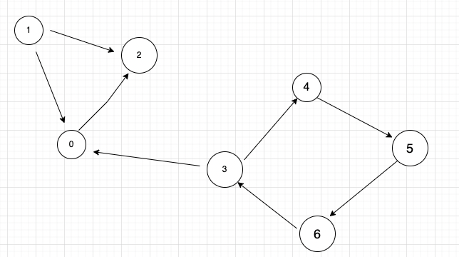
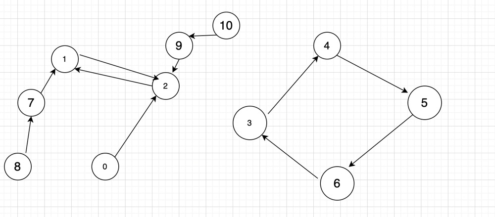
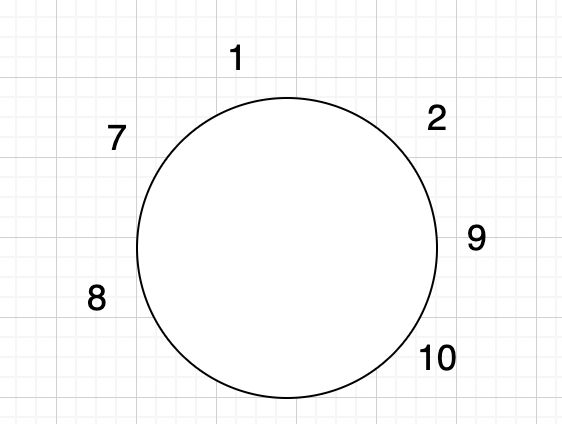

# C++ | Easy Understanding | Topo| Strongly Connected Components | Tarjan's and Kahn's Algorithm

**Author:** shivampandey_7781
**Votes:** 20
**Link:** [https://leetcode.com/problems/maximum-employees-to-be-invited-to-a-meeting/solutions/2360864/](https://leetcode.com/problems/maximum-employees-to-be-invited-to-a-meeting/solutions/2360864/)

---

Let's analyse few cases and then conclude the solution





 For the above graph answer will be 4 (the cycle having largest length)

But lets analyse few more cases where cycle is 2




In above diagram we have largest cycle of 4 but that is not the answer
answer is 6(see below)

**answer is maximum of**
let u,v form 2 length cycle then 
1.maximum length cycle
2. distance(u to leaf without covering any cycle) + distance(v to leaf without covering any cycle)



**So, this is the case we need to look, whenever there is cycle of length 2 we have to recalculate the answer**

So what should be the answer whenever there is a graph having cycle of length 2 
1. Lets suppose u->v and v->u is the 2 length cycle
2. umax = maximum distance between u and leaf without covering any cycle
3. vmax = maximum distance between v and leaf without covering any cycle
4. For all 2 cycle nodes
	1. sum+=umax+vmax

Final answer should be the maximum of sum and  maximumLength Cycle in the graph


Algorithm - 
1. Use Tarjans algorithm to find strongly connected components
2. Store the maximum length cycle
3. if there is any cycle of length 2 we store both nodes in an array
4. we see if there is no 2 length cycle we return maximum length cycle
5. if there is 2 length cycle then
	1. Lets suppose u->v and v->u is the 2 length cycle
	2. umax = maximum distance between u and leaf without covering any cycle
	3. vmax = maximum distance between v and leaf without covering any cycle
	4. For all 2 cycle nodes
		1. sum+=umax+vmax
6. return maximum of sum and  maximumLength Cycle in the grap

```
class Solution {
    vector<vector<int>> graph;
    stack<int> st;
    vector<bool> isMemberOfStack;
    vector<int> time;
    vector<int> low;
    int curr_time = 1;
    int ans;
    bool isThereACycleOfLength2;
    vector<vector<int>> cyclesOfLength2;
public:
    
    void dfs(int u, int parent){
        time[u] = curr_time;
        low[u] = curr_time;
        curr_time += 1;
        st.push(u);
        isMemberOfStack[u] = 1;
        
        for(int adj : graph[u]){
            if(time[adj] == 0){  // node is not visited
                dfs(adj, u);
                low[u] = min(low[u], low[adj]);
            }
            if(isMemberOfStack[adj] == 1){
                low[u] = min(low[u], time[adj]);
            }
        }
         
        if(time[u] == low[u]){
            int count = 0;
            while(st.top() != u){
                int v = st.top();
                st.pop();
                isMemberOfStack[v] = 0;
                count += 1;
                // cout<<v<<" ";
            }
            st.pop();
            isMemberOfStack[u] = 0;
            count += 1;
            // cout<<u<<endl;
            
            ans = max(ans , count);
            
            if(count == 2){
                isThereACycleOfLength2 = true;
                vector<int> temp(2,0);
                temp[0] = u;
                temp[1] = graph[u][0];
              
                cyclesOfLength2.push_back(temp);
            }
        }
    }
    
    
    void prepareMaximumLengthsWithoutCycles(vector<int> &maxLen, vector<int> indegree){
        queue<int> q;
        int n = maxLen.size();
        
        for(int i = 0 ; i < n ; i++){
            if(indegree[i] == 0){
                q.push(i);
            }
        }
        
        while(q.empty() == false){
            int u = q.front();
            q.pop();
            
            for(int v : graph[u]){
                maxLen[v] = max(maxLen[v], 1+ maxLen[u]);
                indegree[v] -= 1;
                if(indegree[v] == 0){
                    q.push(v);
                }
            }
        }
        
    
    }
    

    int maximumInvitations(vector<int>& edges) {
        
        int n = edges.size();
        graph.resize(n);
        time.resize(n);
        low.resize(n);
        isMemberOfStack.resize(n);
        isThereACycleOfLength2 = false;
        vector<int> indegree(n , 0);
        for(int i = 0 ; i < n ; i++){
            
            graph[i].push_back(edges[i]);
            isMemberOfStack[i] = 0;
            time[i] = 0;
            low[i] = 0;
            indegree[edges[i]] += 1;
        }
        
        for(int i = 0 ; i < n ; i++){
            if(time[i] == 0){
                dfs(i, -1);
            }
        }
        
        if(ans == 1){
            return -1;
        }
        
        // if we don't have a cycle of length 2
        if(isThereACycleOfLength2 == false){
            return ans;
        }
        
        
        // if we have cycles of length 2
        
        vector<int> maxLen(n, 1);
        prepareMaximumLengthsWithoutCycles(maxLen, indegree);
        
        
        
        int twonodecyclegraphsanswers = 0;
        for(vector<int> p : cyclesOfLength2 ){
            twonodecyclegraphsanswers += maxLen[p[0]] + maxLen[p[1]] ; 
            ans = max(ans,twonodecyclegraphsanswers );
        }
        
        return ans;
        
        
        
        
        
    }
};
```

Time Complexity - O(N+E)
Space Complexity - O(N)
