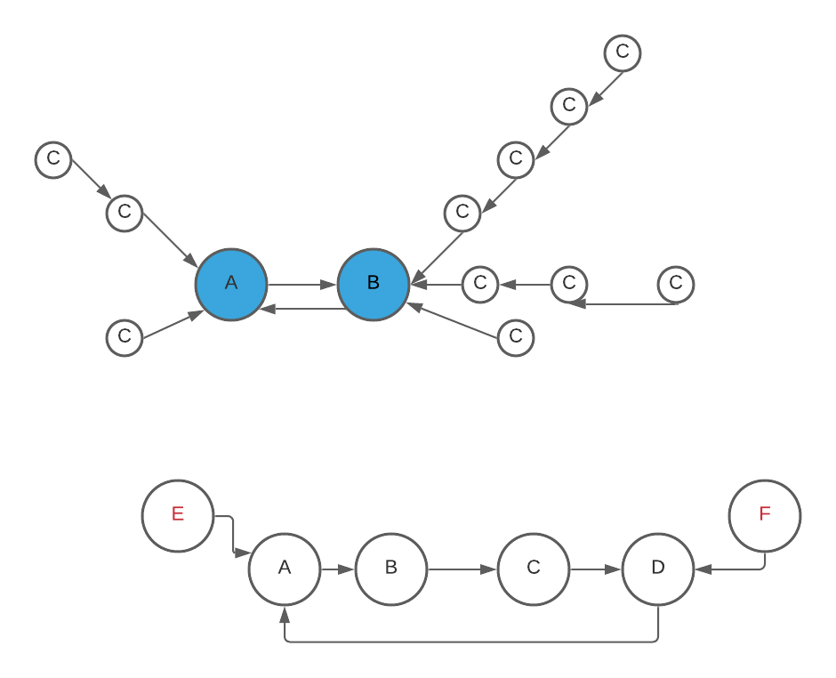

# [Java] Detailed explanation with picture. O(n) time complexity

**Author:** cool_leetcoder
**Votes:** 57
**Link:** [https://leetcode.com/problems/maximum-employees-to-be-invited-to-a-meeting/solutions/1661037/](https://leetcode.com/problems/maximum-employees-to-be-invited-to-a-meeting/solutions/1661037/)

---

There are two conditions:
  1. There is a pair of ***Gganbu***, who are each others' favorite. So anyone who like them are lucky. So we only need to select the longest path.
  2. There is a circle. Anyone outside the circle will be eliminated. As shown in picture, E, F are not lucky to be selected.
  
```
class Solution {
    public int maximumInvitations(int[] favorite) {
        List<List<Integer>> graph = new ArrayList<>();
        for (int i = 0; i < favorite.length; i++) {
            graph.add(new ArrayList<>());
        }

        int answer = 0;

        List<List<Integer>> pairs = new ArrayList<>();
        for (int i = 0; i < favorite.length; i++) {
            if (i == favorite[favorite[i]]) {
                if (i < favorite[i]) {
                    List<Integer> pair = new ArrayList<>();
                    pair.add(i);
                    pair.add(favorite[i]);
                    pairs.add(pair);
                }
            } else {
                graph.get(favorite[i]).add(i);
            }
        }

        boolean[] visited = new boolean[favorite.length];
        for (List<Integer> pair: pairs) {
            answer += dfs(graph, pair.get(0), visited) + dfs(graph, pair.get(1), visited);
        }
        
        int[] counter = new int[favorite.length];
        int[] round = new int[favorite.length];

        int rnd = 1;

        int circleMax = 0;

        for (int i = 0; i < favorite.length; i++) {
            if (visited[i]) {
                continue;
            }
            if (round[i] != 0) {
                continue;
            }

            int cnt = 1;
            int j = i;
            while (counter[j] == 0) {
                counter[j] = cnt;
                round[j] = rnd;
                j = favorite[j];
                cnt++;
            }
            if (round[j] == rnd) {
                circleMax = Math.max(circleMax, cnt - counter[j]);
            }
            rnd++;
        }
        return Math.max(circleMax, answer);
    }

    private int dfs(List<List<Integer>> graph, int node, boolean[] visited) {
        visited[node] = true;
        int max = 0;
        for (int neighbor: graph.get(node)) {
            max = Math.max(max, dfs(graph, neighbor, visited));
        }
        return max + 1;
    }
}
```