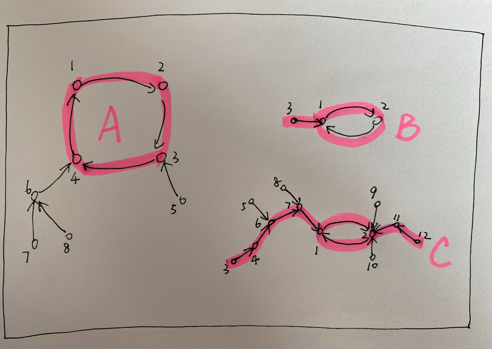

# ✅ [Python] O(N) || Cycle Detection and DFS/BFS || Image Explanation Step by Step

**Author:** linfq
**Votes:** 17
**Link:** [https://leetcode.com/problems/maximum-employees-to-be-invited-to-a-meeting/solutions/1663628/](https://leetcode.com/problems/maximum-employees-to-be-invited-to-a-meeting/solutions/1663628/)

---

**PLEASE UPVOTE if you like** \uD83D\uDE01 **If you have any question, feel free to ask.** 
* We first construct a directed graph, the vertices are employees, if a favorite b then a directed edge points from a to b
* Through union find set, we divide the graph into several disconnected islands. It can be proved that each island has one and only one cycle. Moreover since there is one and only one cycle on every island, we can also find out the cycle directly without UnionFind, and the nodes connected to eacy cycle forms an island.
	* If the circle is greater than 2, employees in this circle can only sit at a table alone.
	* If the circle is equal to 2, the two employees in the circle favor each other, and a favorite chain can be gathered on their left and right sides to form a free sequence.
		* Note that all free sequences can be concated and sit at a table together.
	

* Now I explain the detail step by step with the help of the examples in the figure.
	* we can easily find out that there are 3 islands in the graph via union find set and denoted by A B C respectively.
	* for each island we find out the only cycle on it, for example A has the cycle (A1, A2, A3, A4) and B has the cycle (B1, B2). since there is one and only one cycle on every island, we can also find out the cycle directly without UnionFind. 
	* If we invite anyone in (A1, A2, A3, A4), we must invite them all and we cannot invite any other one on or not on island A. Actually employees on island A but not belong to the cycle cannot be invited forever.
	* However on island B, it is much more different. (B1, B2) is the cycle and they faver eacy other, and  B3 who favors B1 can sit on the other side of B2 without conflict. (B3, B1, B2) form a free sequence.
	* The situation on Island C is similar to Island B. After selecting C1 and C2 on the circle, we can further invite the longest favorite chain on both sides of them to form the longest free sequence on the island together with C1 and C2, that is (C3, C4, C6, C7, C1, C2, C11, C12)
	* Finally we concat all the free sequences because they can sit together without confilit. that is (B3, B1, B2, C3, C4, C6, C7, C1, C2, C11, C12)
	* The answer is the maximum of the longest single cycle and the concated free sequences.
		* the longest single cycle
			* (A1, A2, A3, A4)
		* the concated free sequences
			* (B3, B1, B2, C3, C4, C6, C7, C1, C2, C11, C12)

```
Time  Complexity: O(N) for each node would be visited only once, we use a set named seen to avoid repeat.
Space Complexity: O(N)
```

**Python Without Union Find**
```
class Solution(object):
    def maximumInvitations(self, favorite):
        pre = collections.defaultdict(list)
        for i, j in enumerate(favorite):
            pre[j].append(i)

        seen, max_cycle_length, sequence_length = set(), 0, 0

        for node in range(len(favorite)):  # for each island, there is one and only one cycle
            # find the cycle and its length
            if node in seen: continue
            path = [node]
            while favorite[path[-1]] not in seen:
                seen.add(favorite[path[-1]])
                path.append(favorite[path[-1]])
            if favorite[path[-1]] not in path: continue
            cycle_length = len(path) - path.index(favorite[path[-1]])

            if cycle_length == 2:  # cycle can concat with other sequential nodes on the island at both left and right
                # via dfs or bfs through pre, we can find out the longest sequence left and right of the cycle
                # finally we concat the left longest sequence and the cycle itself and the right longest sequence as
                # the longest valid sequence of the island.
                max_sub_len = [0, 0]
                cycle = path[-2:]
                pre[cycle[0]].remove(cycle[1])
                pre[cycle[1]].remove(cycle[0])
                for k in [0, 1]:  # the left and right of the cycle as the start point of dfs respectively
                    dq = collections.deque([(cycle[k], 0)])
                    while dq:
                        i, depth = dq.pop()  # DFS
                        # i, depth = dq.popleft()  # BFS
                        if i in pre:
                            for j in pre[i]:
                                dq.append((j, depth + 1))
                                seen.add(j)
                        else:
                            max_sub_len[k] = max(max_sub_len[k], depth)  # get the length of longest sequence
                # 2 is the length of cycle, max_sub_len are lengths of longest sequence of both left and right ends
                sequence_length += 2 + sum(max_sub_len)
            else:  # greater than 2, the cycle can't concat with any other node
                max_cycle_length = max(max_cycle_length, cycle_length)

        # either a big cycle or some free sequences will be the final answer
        return max(max_cycle_length, sequence_length)
```

**Python With Union Find**
```
class UnionFind(object):  # standard union find set class
    def __init__(self, n):
        self.parent = range(n)
        self.level = [0] * n

    def find(self, i):
        while self.parent[i] != i:
            i = self.parent[i]
        return i

    def union(self, i, j):
        i = self.find(i)
        j = self.find(j)
        if self.level[i] < self.level[j]:
            self.parent[i] = j
        elif self.level[j] < self.level[i]:
            self.parent[j] = i
        else:
            self.parent[j] = i
            self.level[i] += 1


class Solution(object):
    def maximumInvitations(self, favorite):
        pre = collections.defaultdict(list)
        uf = UnionFind(len(favorite))
        for i, j in enumerate(favorite):
            uf.union(i, j)
            pre[j].append(i)
        islands = collections.defaultdict(list)
        for i in range(len(favorite)):
            islands[uf.find(i)].append(i)

        max_cycle_length = 0
        sequence_length = 0

        for nodes in islands.values():  # for each island, there is one and only one cycle
            # find the cycle and its length
            path = [nodes[0]]
            path_set = set([nodes[0]])
            while favorite[path[-1]] not in path_set:
                path_set.add(favorite[path[-1]])
                path.append(favorite[path[-1]])
            cycle_length = len(path) - path.index(favorite[path[-1]])

            if cycle_length == 2:  # cycle can concat with other sequential nodes on the island at both left and right
                # via dfs or bfs through pre, we can find out the longest sequence left and right of the cycle
                # finally we concat the left longest sequence and the cycle itself and the right longest sequence as
                # the longest valid sequence of the island.
                max_sub_len = [0, 0]
                cycle = path[-2:]
                pre[cycle[0]].remove(cycle[1])
                pre[cycle[1]].remove(cycle[0])
                for k in [0, 1]:  # the left and right of the cycle as the start point of dfs respectively
                    dq = collections.deque([(cycle[k], 0)])
                    while dq:
                        i, depth = dq.pop()  # DFS
                        # i, depth = dq.popleft()  # BFS
                        if i in pre:
                            for j in pre[i]:
                                dq.append((j, depth + 1))
                        else:
                            max_sub_len[k] = max(max_sub_len[k], depth)  # get the length of longest sequence
                # 2 is the length of cycle, max_sub_len are lengths of longest sequence of both left and right ends
                sequence_length += 2 + sum(max_sub_len)
            else:  # greater than 2, the cycle can't concat with any other node
                max_cycle_length = max(max_cycle_length, cycle_length)

        # either a big cycle or some free sequences will be the final answer
        return max(max_cycle_length, sequence_length)
```
**PLEASE UPVOTE if you like** \uD83D\uDE01 **If you have any question, feel free to ask.**