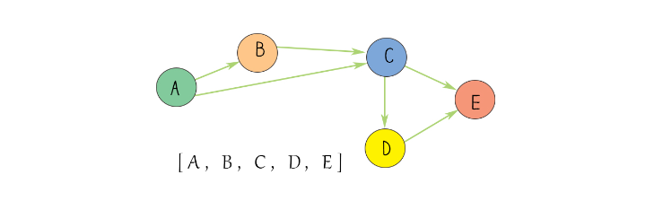

# [Topological Sort Tutorial] All Ancestors of a Node in a Directed Acyclic Graph

**Author:** never_get_piped
**Votes:** 32
**Link:** [https://leetcode.com/problems/all-ancestors-of-a-node-in-a-directed-acyclic-graph/solutions/5384971/](https://leetcode.com/problems/all-ancestors-of-a-node-in-a-directed-acyclic-graph/solutions/5384971/)

---

**Topic** :  Topological Sort
Topological sorting for **Directed Acyclic Graph (DAG)** is a linear ordering of vertices such that for every directed edge u-v, vertex u comes before v in the ordering. Topological Sorting for a graph is not possible if the graph is not a **DAG**. (GFG)

Here's an example demonstrating Topological sorting on a graph:



Here's how we can apply topological sorting:
1. Identify vertices with no incoming edges (in-degree zero).
2. Process the vertices.
3. Update in-degrees.
4. Repeat until all vertices are processed.

With the avove illustration:
```
Start with A.
Then, proceed with B (since A -> B).
Next, C (since A -> C, and B -> C).
Then, D (since C -> D).
Finally, E (since D -> E).
```

___

## Solution
First, we can represent our graph using an adjacency list named `graph`. We can do it as follow:
```
//pseudocode is written in C++
vector<vector<int>> graph(n, vector<int>(0));
for(auto& e : edges) { //build adjecent list graph
	 graph[e[0]].push_back(e[1]);
 }
```

Since the input graph is a **DAG** (Directed Acyclic Graph), Topological sort allows us to process each node in order. Besides constructing the graph, we also need to calculate the in-degree of each node.

One observation is that if there is a directed edge from node `u` to node `v` (denoted as `u -> v`), then any ancestor of `u` is also an ancestor of `v`. Additionally, `u` itself is also an ancestor of `v`.

As we perform topological sorting, we maintain a list of each node's ancestors. It's important to note that a node starting with a degree of 0 has no ancestors initially.

If we process an edge `u -> v` during topological sorting, we add all ancestors from `u`'s list to `v`'s list of ancestors. Simultaneously, we ensure to add `u` itself to `v`'s list of ancestors. To avoid duplicates, each list of ancestors is implemented as a **set** data structure.

Finally, after processing, we convert the list of ancestors back into the appropriate output structure as needed.
<br/>
```c++ []
class Solution {
public:
    vector<vector<int>> getAncestors(int n, vector<vector<int>>& edges) {
        vector<vector<int>> graph(n, vector<int>(0));
        vector<int> inDeg(n);
        for(auto& e : edges) { //build adjecent list graph
            graph[e[0]].push_back(e[1]);
            inDeg[e[1]]++;
        }
        
        queue<int> q;
        for(int i = 0; i < n; i++) {
            if(inDeg[i] == 0) {
                q.push(i);
            }
        }
        
        vector<unordered_set<int>> ancestors(n);
        while(q.size() > 0) {
            int u = q.front(); q.pop();
            for(int v : graph[u]) {
                inDeg[v]--;
                ancestors[v].insert(u);
                for(int ancestor : ancestors[u]) {
                    ancestors[v].insert(ancestor);
                }
                if(inDeg[v] == 0) {
                    q.push(v);
                }
            }
        }
        
        vector<vector<int>> ans(n);
        for(int i = 0; i < n; i++) {
            ans[i] = vector<int>(ancestors[i].begin(), ancestors[i].end());
            sort(ans[i].begin(), ans[i].end());
        }
        return ans;
    }
};
```
```java []
class Solution {
    public List<List<Integer>> getAncestors(int n, int[][] edges) {
        List<List<Integer>> graph = new ArrayList<>();
        for (int i = 0; i < n; i++) {
            graph.add(new ArrayList<>());
        }
        
        int[] inDeg = new int[n];
        for (int[] e : edges) {
            graph.get(e[0]).add(e[1]);
            inDeg[e[1]]++;
        }
        
        Queue<Integer> q = new LinkedList<>();
        for (int i = 0; i < n; i++) {
            if (inDeg[i] == 0) {
                q.add(i);
            }
        }
        
        List<Set<Integer>> ancestors = new ArrayList<>();
        for (int i = 0; i < n; i++) {
            ancestors.add(new HashSet<>());
        }
        
        while (!q.isEmpty()) {
            int u = q.poll();
            for (int v : graph.get(u)) {
                inDeg[v]--;
                ancestors.get(v).add(u);
                for (int ancestor : ancestors.get(u)) {
                    ancestors.get(v).add(ancestor);
                }
                if (inDeg[v] == 0) {
                    q.add(v);
                }
            }
        }
        
        List<List<Integer>> ans = new ArrayList<>();
        for (int i = 0; i < n; i++) {
            List<Integer> list = new ArrayList<>(ancestors.get(i));
            Collections.sort(list);
            ans.add(list);
        }
        
        return ans;
    }
}
```
```python []
class Solution:
    def getAncestors(self, n: int, edges: List[List[int]]) -> List[List[int]]:
        graph = [[] for _ in range(n)]
        inDeg = [0] * n
        
        for e in edges:
            graph[e[0]].append(e[1])
            inDeg[e[1]] += 1
        
        q = deque()
        for i in range(n):
            if inDeg[i] == 0:
                q.append(i)
        
        ancestors = [set() for _ in range(n)]
        
        while q:
            u = q.popleft()
            for v in graph[u]:
                inDeg[v] -= 1
                ancestors[v].add(u)
                ancestors[v].update(ancestors[u])
                if inDeg[v] == 0:
                    q.append(v)
        
        ans = [[] for _ in range(n)]
        for i in range(n):
            ans[i] = sorted(list(ancestors[i]))
        
        return ans
```
```Go []
func getAncestors(n int, edges [][]int) [][]int {
    graph := make([][]int, n)
	inDeg := make([]int, n)
	
	for _, e := range edges {
		graph[e[0]] = append(graph[e[0]], e[1])
		inDeg[e[1]]++
	}
	
	q := make([]int, 0)
	for i := 0; i < n; i++ {
		if inDeg[i] == 0 {
			q = append(q, i)
		}
	}
	
	ancestors := make([]map[int]bool, n)
	for i := 0; i < n; i++ {
		ancestors[i] = make(map[int]bool)
	}
	
	for len(q) > 0 {
		u := q[0]
		q = q[1:]
		for _, v := range graph[u] {
			inDeg[v]--
			ancestors[v][u] = true
			for ancestor := range ancestors[u] {
				ancestors[v][ancestor] = true
			}
			if inDeg[v] == 0 {
				q = append(q, v)
			}
		}
	}
	
	ans := make([][]int, n)
	for i := 0; i < n; i++ {
		ans[i] = make([]int, 0, len(ancestors[i]))
		for ancestor := range ancestors[i] {
			ans[i] = append(ans[i], ancestor)
		}
		sort.Ints(ans[i])
	}
	
	return ans
}
```
```PHP []
class Solution {

    /**
     * @param Integer $n
     * @param Integer[][] $edges
     * @return Integer[][]
     */
    function getAncestors($n, $edges) {
        $graph = array_fill(0, $n, []);
        $inDeg = array_fill(0, $n, 0);
        
        foreach ($edges as $e) {
            $graph[$e[0]][] = $e[1];
            $inDeg[$e[1]]++;
        }
        
        $q = [];
        for ($i = 0; $i < $n; $i++) {
            if ($inDeg[$i] == 0) {
                $q[] = $i;
            }
        }
        
        $ancestors = array_fill(0, $n, []);
        for ($i = 0; $i < $n; $i++) {
            $ancestors[$i] = [];
        }
        
        while (!empty($q)) {
            $u = array_shift($q);
            foreach ($graph[$u] as $v) {
                $inDeg[$v]--;
                $ancestors[$v][] = $u;
                foreach ($ancestors[$u] as $ancestor) {
                    if (!in_array($ancestor, $ancestors[$v])) {
                        $ancestors[$v][] = $ancestor;
                    }
                }
                if ($inDeg[$v] == 0) {
                    $q[] = $v;
                }
            }
        }
        
        $ans = array_fill(0, $n, []);
        for ($i = 0; $i < $n; $i++) {
            sort($ancestors[$i]);
            $ans[$i] = $ancestors[$i];
        }
        
        return $ans;
    }
}
```
```javascript []
/**
 * @param {number} n
 * @param {number[][]} edges
 * @return {number[][]}
 */
var getAncestors = function(n, edges) {
    let graph = new Array(n).fill(null).map(() => []);
    let inDeg = new Array(n).fill(0);
    
    for (let e of edges) {
        graph[e[0]].push(e[1]);
        inDeg[e[1]]++;
    }
    
    let q = [];
    for (let i = 0; i < n; i++) {
        if (inDeg[i] === 0) {
            q.push(i);
        }
    }
    
    let ancestors = new Array(n).fill(null).map(() => new Set());
    
    while (q.length > 0) {
        let u = q.shift();
        for (let v of graph[u]) {
            inDeg[v]--;
            ancestors[v].add(u);
            for (let ancestor of ancestors[u]) {
                ancestors[v].add(ancestor);
            }
            if (inDeg[v] === 0) {
                q.push(v);
            }
        }
    }
    
    let ans = new Array(n);
    for (let i = 0; i < n; i++) {
        ans[i] = Array.from(ancestors[i]).sort((a, b) => a - b);
    }
    
    return ans;
};
```

**Complexity**:
* Time Complexity : `O(n ^ 2 log(n) + n * m)`
* Space Complexity : `O(n ^ 2)`

**Feel free to leave a comment if something is confusing, or if you have any suggestions on how I can improve the post.**